# 03 業務フロー図

| 項目 | 内容 |
|---|---|
| 文書番号 | SF-DOC-03 |
| 版 | 1.0（2026-11-18） |
| 関連 | 02 要件定義書（BR・FR の番号）、提案書 P03・P04・P11・P15・P16 |
| 図の形式 | Mermaid（GitHub・多くの Markdown ビューアで図として表示される記法） |

図の中の【 】は、関係する要件の番号です。

---

## 1. 全体像

人と機器と SoilFlow のつながりです（提案書 P05）。土場には機器を置きません。

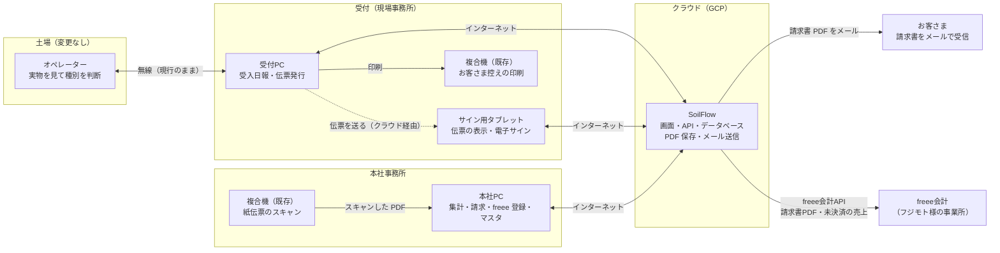

---

## 2. 現行の業務（As-Is）

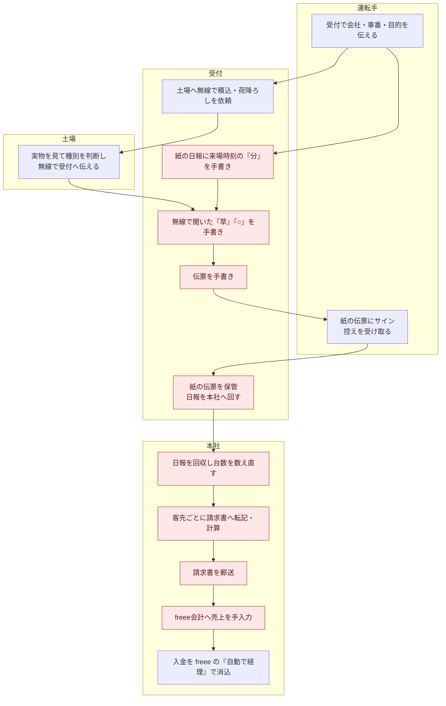

赤い工程が手作業・転記の工程です。

---

## 3. 導入後の業務（To-Be）

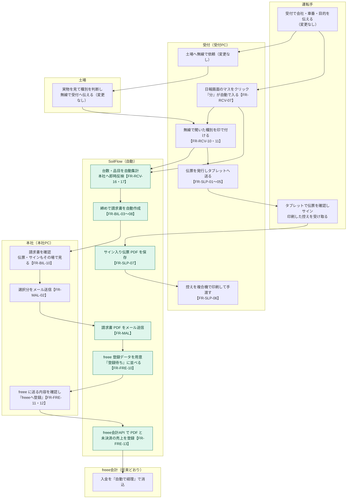

緑の工程が SoilFlow が自動で行う工程です。自動登録に切り替えた場合は、本社の D3 がなくなり S5 から S6 へ直接進みます【FR-FRE-09】。

### 3.1 工程ごとの変化（提案書 P04）

| 工程 | 現行（紙） | 導入後 | 変化 |
|---|---|---|---|
| 来場・受付 | 運転手が会社・車番・目的を伝える | 変わらず（受付が画面で行を選ぶ／追加する） | 変更なし |
| 積込依頼・種別判定 | 受付⇔土場を無線で連絡 | 変わらず（土場の操作なし） | 変更なし |
| 来場時刻・種別の記録 | 紙の日報に手書き | 同じ形の画面のマスをクリック | 紙 → PC |
| 伝票発行・サイン | 手書き・紙にサイン・紙で保管 | 画面から発行、タブレットに電子サイン、客控えのみ印刷 | 紙 → PC |
| 日報の回収・集計 | 本社へ回し、台数を数えて転記 | 記入と同時に本社へ反映、自動集計 | 手作業 → 自動 |
| 請求書作成・送付 | 転記・計算して郵送 | 月締めで自動作成、確認後にメール送信 | 手作業 → 自動 |
| 会計（freee）への登録 | 売上を手入力 | 登録データが自動でそろい、確認して登録するだけ | 手作業 → 自動 |

---

## 4. 受付の1日

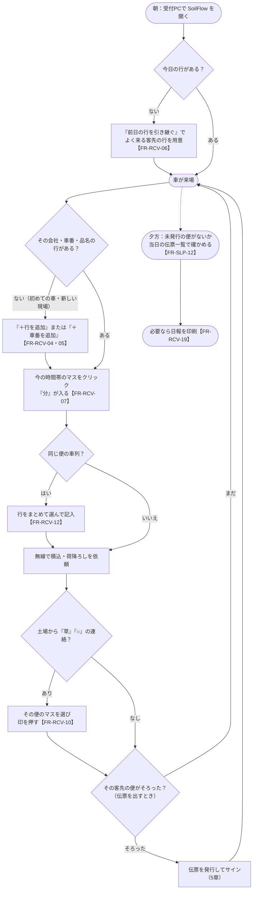

---

## 5. 伝票発行と電子サイン

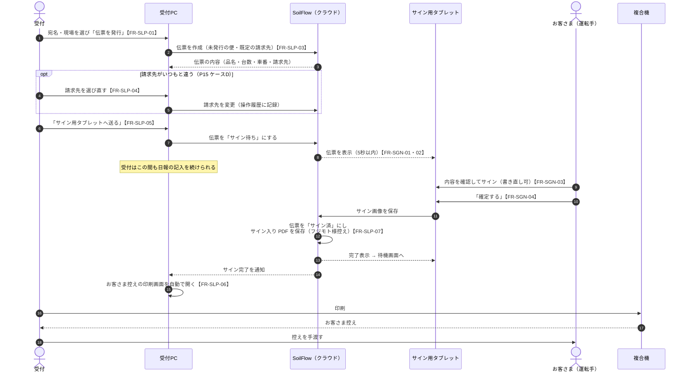

---

## 6. 月締めと請求書のメール送信

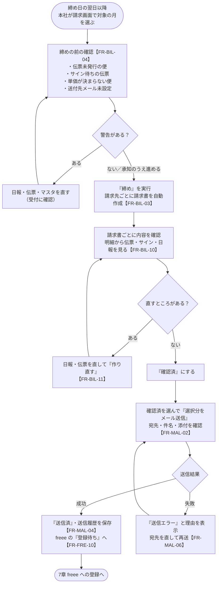

---

## 7. freee への登録

### 7.1 確認してから登録（初期設定）

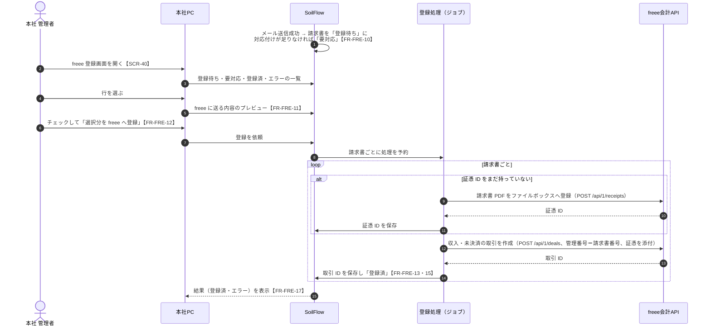

### 7.2 自動登録に切り替えた場合

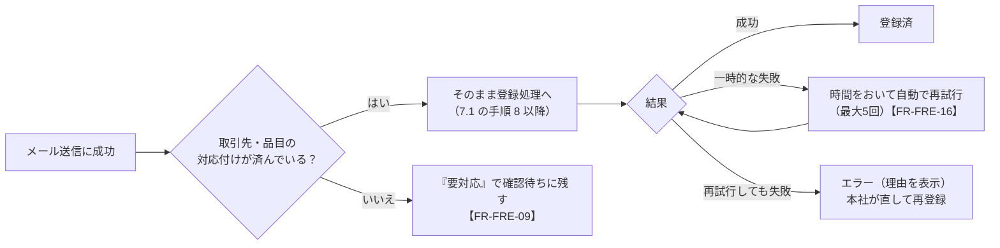

### 7.3 初期設定（最初に一度だけ）

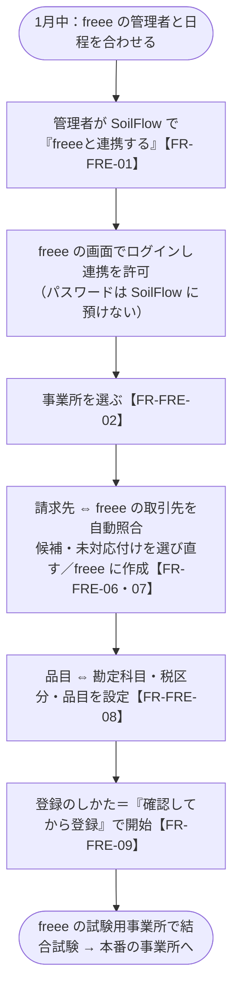

---

## 8. 困ったとき（例外）の流れ

### 8.1 タブレットが使えない・サインを嫌がられた（提案書 P16）

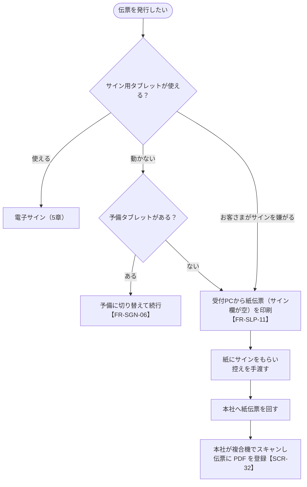

### 8.2 インターネットがつながらない

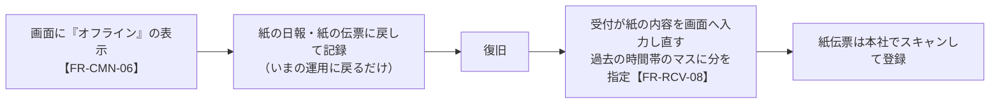

### 8.3 送信済の請求書の取消・再発行

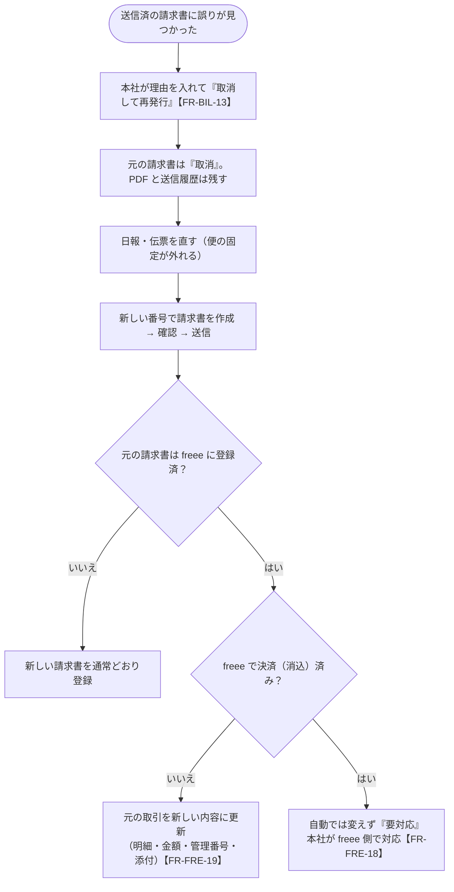

取消だけ（再発行しない）の場合は、freee の取引を削除します。決済済みのときは要対応にします【FR-FRE-18】。

### 8.4 freee の連携が切れた

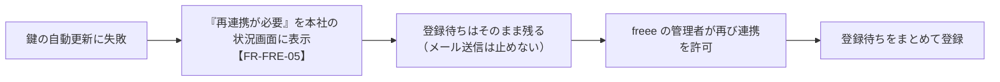

---

## 9. 宛名と請求先の決まり方（提案書 P15）

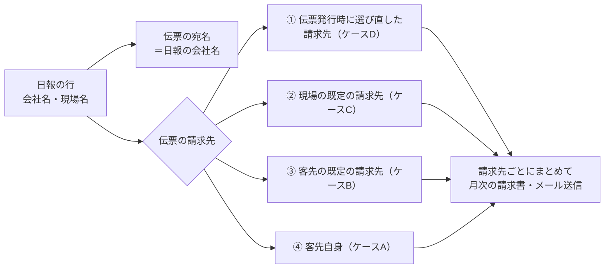

①があれば①、なければ②、③、④の順に使います。伝票を発行していない便は②〜④で決めます【FR-SLP-03、FR-BIL-01】。
