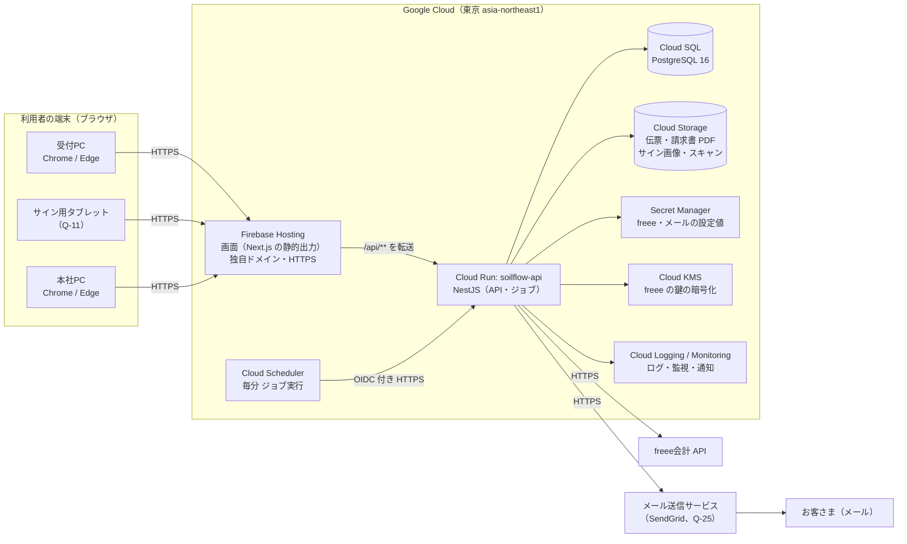
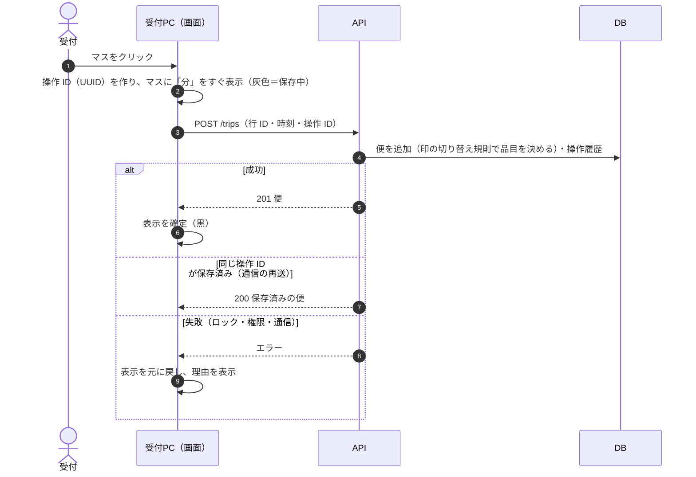
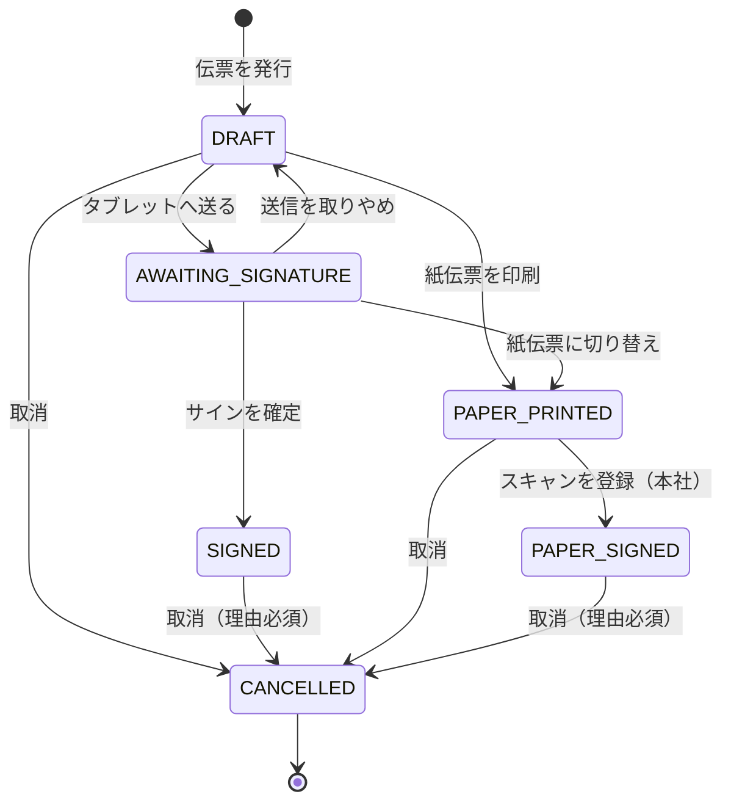
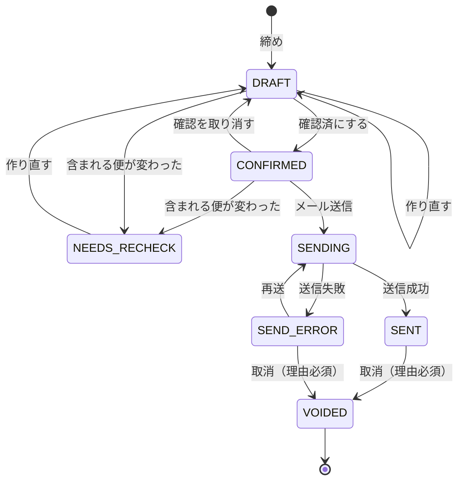
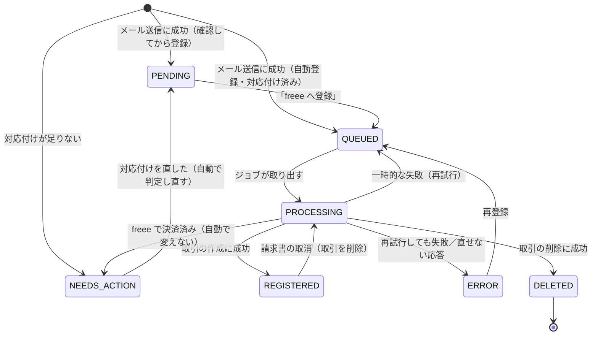
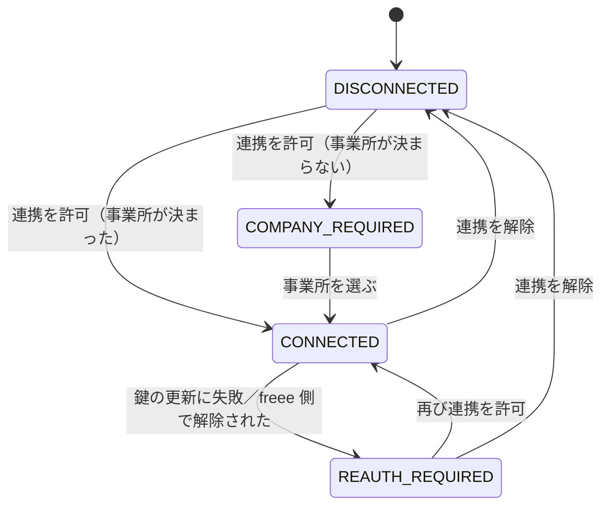

# 04 基本設計書

| 項目 | 内容 |
|---|---|
| 文書番号 | SF-DOC-04 |
| 版 | 1.0（2026-11-18） |
| 関連 | 02 要件定義書、05 画面設計書、07 DB設計書、08 API設計書、09 外部インターフェイス設計書、12 環境・インフラ・ネットワーク設計書 |

## 1. システムの構成

### 1.1 全体の構成



| 構成要素 | 役割 | 選んだ理由 |
|---|---|---|
| Firebase Hosting | 画面のファイル（HTML・JS・CSS）を配信し、`/api/**` を Cloud Run へ転送する。独自ドメインと HTTPS の証明書を無料で扱える | 画面と API を同じドメインにでき（Cookie・CORS の問題がない）、ロードバランサの月額（約2,500円〜）がかからない（NFR-23） |
| Next.js（静的出力） | 受付・タブレット・本社の画面。サーバー側の描画はせず、ブラウザで動く | ログイン後に使う業務画面で、検索エンジン対策が要らない。配信が安く速い |
| Cloud Run（NestJS） | API・PDF 作成・メール送信・freee 連携・ジョブ。使わない時間は0台まで縮む | 管理するサーバーがなく、小規模なら無料枠に収まる |
| Cloud SQL（PostgreSQL 16） | データベース。毎日の自動バックアップ・任意時点への復元 | D-12。管理の手間が少ない |
| Cloud Storage | PDF・サイン画像・スキャンの保存。オブジェクトの保持ロックで消せないようにする | 7年保存（02 6.2）を安く行える |
| Secret Manager | freee のクライアント ID・シークレット、メールの API キー、セッションの署名鍵 | 設定値をコードに書かない |
| Cloud KMS | freee のトークンの暗号化・復号 | NFR-14 |
| Cloud Scheduler | 毎分ジョブを動かす（再試行・PDF・メール・鍵の更新・掃除） | Cloud Run が0台でもジョブを動かせる |

### 1.2 Firebase Hosting で気をつけること

- Firebase Hosting は Cloud Run へ転送するとき、Cookie を `__session` という名前のものしか渡しません。セッションの Cookie 名は `__session` にします。
- Cloud Run へ転送したときの応答の上限は60秒です。60秒を超える処理（締めで請求書を数十件作る、PDF をまとめて作る）はジョブにして、画面は進み具合を問い合わせます。
- API の応答はキャッシュさせません（`Cache-Control: no-store`）。

## 2. ソフトウェアの構成

### 2.1 リポジトリ

```
soilflow/
├─ apps/
│  ├─ web/                  Next.js（App Router、output: 'export'）
│  │  ├─ app/reception/     受付（SCR-10〜15）
│  │  ├─ app/terminal/      サイン用タブレット（SCR-20〜22）
│  │  ├─ app/office/        本社（SCR-30〜36・40〜44・50〜57・60〜62）
│  │  └─ lib/api/           openapi.yaml から生成した API の型と呼び出し
│  └─ api/                  NestJS
│     └─ src/modules/…      2.2 のモジュール
├─ packages/
│  ├─ billing/              請求計算（11 計算仕様書。画面・API・試験で共用）
│  └─ pdf/                  帳票（10 帳票設計書）
├─ infra/                   Terraform
└─ docs/                    資料
```

### 2.2 API のモジュール

| モジュール | 役割 | 主なテーブル | 主な要件 |
|---|---|---|---|
| auth | ログイン・ログアウト・セッション・2段階の確認・権限の確認 | users、sessions、mfa_codes | FR-CMN-01・02、NFR-12・13・15 |
| users | 利用者管理 | users | FR-CMN-03 |
| masters | 客先・現場・請求先・車番・品目・車格・単価表・印・CSV 取込 | 2章のマスタ | FR-MST |
| reports | 日報・行・便・車列・前日の引継ぎ・変更分の取得 | daily_reports、report_rows、trips | FR-RCV |
| slips | 伝票の発行・タブレットへの送信・取消・紙伝票 | slips、slip_lines、slip_counters | FR-SLP |
| terminal | サイン端末の待機・伝票の表示・サイン | slips | FR-SGN |
| aggregates | 集計・出力・本社の状況 | ビュー | FR-AGG |
| billing | 締めの前の確認・締め・作り直し | billing_runs、invoices、invoice_lines、invoice_trips | FR-BIL |
| invoices | 請求書の確認・取消・再発行・検索・PDF | invoices | FR-BIL、02 6.3 |
| mail | メール送信・送信履歴・送信結果の受け取り | mail_logs | FR-MAL |
| freee | 連携許可・鍵の管理・対応付け・登録・取消・記録 | freee_* | FR-FRE |
| pdf | 日報・伝票・請求書の PDF の作成と保存 | ― | RPT |
| jobs | ジョブの予約・取り出し・再試行 | jobs | ― |
| audit | 操作履歴の記録・参照 | audit_logs | FR-CMN-04 |
| settings | システム設定 | settings | FR-CMN-05 |

モジュールの間は、サービスのクラスを直接呼びます（1つのプロセスの中）。freee・メール・ストレージ・KMS は、それぞれ1つのアダプタ（外部とつなぐ部品）を通して呼び、試験ではにせものに差し替えます。

## 3. 処理の方式

### 3.1 画面と API

- 画面は API（JSON）だけでデータをやりとりします。API の契約の正本は `spec/openapi.yaml` です。
- 画面の API 呼び出しの型は openapi.yaml から自動で作り、契約と画面のずれを起こさないようにします。

### 3.2 便の記入（クリックしてすぐ表示）



通信が切れて応答が来ない場合、画面は同じ操作 ID で最大3回送り直します。サーバーは操作 ID で重複を見分けるので、便が二重になりません（`trips.client_op_id`）。

### 3.3 他の画面への反映

| 画面 | 方式 | 間隔 |
|---|---|---|
| 受入日報（受付・本社） | `GET /daily-reports/{date}/changes?since=<カーソル>` で変更分だけ取得 | 5秒（画面が見えていないときは止める） |
| サイン用タブレット | `GET /terminal/current-slip` | 2秒 |
| 受付の伝票一覧（サイン完了の通知） | `GET /slips?date=…&since=…` | 2秒（サイン待ちの伝票があるときだけ） |
| 本社の状況 | `GET /dashboard` | 30秒 |

カーソルは「最後に受け取った更新日時と ID」です。WebSocket は使いません（Cloud Run と Firebase Hosting の転送で長い接続を保つ必要がなく、端末の台数が少ないため）。NFR-03（10秒以内、タブレットは5秒以内）を満たします。

### 3.4 ジョブ

| ジョブ | 予約するとき | 最初の実行 | 再試行 |
|---|---|---|---|
| PDF_SLIP | 伝票のサインの確定・紙伝票の登録 | その場で実行（1秒程度） | 毎分、最大5回 |
| PDF_INVOICE | 請求書の作成・作り直し | 締めの処理の中でまとめて実行 | 毎分、最大5回 |
| MAIL_SEND | メール送信 | その場で実行 | 1・5・15・60分後 |
| FREEE_REGISTER | 「freee へ登録」・自動登録 | その場で実行 | 1・5・15・60・180分後（429・403 の制限のときは10分以上あける） |
| FREEE_DELETE | 登録済の請求書の取消 | その場で実行 | 同上 |
| FREEE_TOKEN_REFRESH | 毎日1回、期限の5分前 | ― | 失敗したら「再連携が必要」 |
| CLEANUP | 毎日1回（夜間） | ― | ― |

- ジョブは `jobs` テーブルに入れ、`SELECT … FOR UPDATE SKIP LOCKED` で1件ずつ取り出します。同時に2つのプロセスが同じジョブを取りません。
- 利用者の操作で起きるジョブは、API がその場で1回目を実行し、失敗したときだけ再試行を Cloud Scheduler（毎分）に任せます（Cloud Run は応答のあとに処理を続けられないため）。
- 同じ請求書の freee 登録は `dedupe_key` で二重に予約しません。

### 3.5 PDF

- PDF は `packages/pdf` で作ります（pdfmake ＋ Noto Sans JP を埋め込み）。ブラウザを使わないため、Cloud Run のメモリ 512MB で動きます。
- 作った PDF は Cloud Storage に保存し、SHA-256 のハッシュ値をデータベースに記録します。送信済の請求書の PDF は作り直しません（02 6.3）。
- 画面からは API が発行する署名付き URL（5分で失効）で開きます。

### 3.6 印刷

- 印刷はブラウザの印刷機能で行います（IF-03）。受付PCでは、サインの確定後に控えの PDF を新しいタブで開き、印刷のダイアログを出します。
- 既定のプリンターを複合機にし、用紙の大きさを PDF に合わせる設定にしておきます（16 移行・導入計画書）。

### 3.7 時刻

- サーバーは UTC で動き、日付の区切りは日本時間（Asia/Tokyo）で行います。
- 便の時刻は、受付PCの時刻とサーバーの時刻の差が5分以内なら受付PCの時刻、5分を超えるならサーバーの時刻を使い、画面に「PCの時計がずれています」と表示します（11 2.1）。

## 4. 権限

利用者区分ごとの権限は 02 要件定義書 3.2 のとおりです。API は各エンドポイントに許可する区分を持ち（08 API設計書 2章）、ガード（NestJS の Guard）で確かめます。画面のメニューも同じ区分で出し分けますが、守りの正本はサーバー側です（NFR-15）。

| 区分 | 使える API の範囲 |
|---|---|
| RECEPTION（受付） | auth、reports、slips（自分の端末へ送る）、masters の参照（金額を除く） |
| SIGN_TERMINAL（サイン端末） | auth、terminal だけ |
| OFFICE（本社） | RECEPTION の範囲＋ aggregates、billing、invoices、mail、masters の更新、freee の参照、audit の参照 |
| ADMIN（管理者） | すべて（freee の連携・対応付け・登録、users、settings を含む） |

受付・サイン端末が受け取る API の応答には、単価・金額を含めません（FR-RCV-20）。

## 5. 状態の移り変わり

### 5.1 伝票



送信済の請求書に含まれる便がある伝票は、取り消せません（FR-SLP-10）。

### 5.2 請求書



「取消して再発行」は、VOIDED にしたあと同じ請求先・同じ請求期間で新しい請求書（DRAFT）を作ります（11 4.8）。

### 5.3 freee 登録



処理の途中で止まっても、証憑 ID・取引 ID を保存しながら進めるため、やり直しで二重に登録しません（09 4.4）。

### 5.4 freee の連携



## 6. エラーの扱い

| 種類 | HTTP | 画面での扱い |
|---|---|---|
| 入力の誤り | 400 | 項目の横に理由を出す |
| ログインしていない・期限切れ | 401 | ログイン画面へ（受付の入力途中の内容は保存済み） |
| 権限がない | 403 | 「この操作はできません」 |
| 見つからない | 404 | 一覧へ戻る |
| 他の人が先に変更した | 409（`CONFLICT`） | 「他の人が先に変更しました」と出して読み直す |
| 決まりに反する（伝票・請求書でロックされた便など） | 422（`TRIP_LOCKED_BY_SLIP` など） | 理由と次の操作を出す（例：「伝票を取り消してから直してください」） |
| サーバーの障害 | 500 | 「時間をおいてやり直してください」とリクエスト ID |
| 外部サービスの障害 | 502・503 | freee・メールの状態を出し、ジョブで再試行 |

エラーの応答は `{ "code": "…", "message": "…", "details": …, "requestId": "…" }` の形にそろえます（08 API設計書 3章）。

## 7. ログと監視

| 対象 | 記録・監視 | 通知 |
|---|---|---|
| API のアクセス | Cloud Logging（リクエスト ID・利用者 ID・処理時間。本文・鍵は記録しない） | ― |
| 業務の操作 | audit_logs（FR-CMN-04） | ― |
| freee の呼び出し | freee_api_logs（要求・応答の要約） | ― |
| 5xx の割合・応答時間 | Cloud Monitoring | 5分間で5xx が5件以上、または95%の応答が3秒超で保守担当にメール |
| ジョブの失敗 | jobs.status=FAILED | 1件でも出たら保守担当にメール |
| freee の再連携が必要 | freee_connection.status | 本社の状況画面と保守担当にメール |
| Cloud SQL | CPU・ディスク・接続数 | 80% 超で保守担当にメール |

## 8. 画面と API のおもな対応

| 画面 | 主な API |
|---|---|
| SCR-10〜13 受入日報 | `GET /daily-reports/{date}`、`/changes`、`POST /daily-reports/{date}/carry-over`、`POST/PATCH/DELETE /report-rows`、`POST /trips`、`PATCH /trips/{id}`、`POST /trips/{id}/cancel`、`GET /daily-reports/{date}/pdf` |
| SCR-14・15 伝票 | `POST /slips`、`PATCH /slips/{id}`、`POST /slips/{id}/send-to-terminal`、`/withdraw`、`/print-paper`、`/cancel`、`GET /slips`、`GET /slips/{id}/pdf` |
| SCR-20〜22 タブレット | `GET /terminal/current-slip`、`POST /terminal/slips/{id}/sign` |
| SCR-30 状況 | `GET /dashboard` |
| SCR-32 伝票（本社） | `GET /slips`、`POST /slips/{id}/paper-scan` |
| SCR-33 集計 | `GET /aggregates`、`GET /aggregates/export` |
| SCR-34〜36 請求 | `GET /billing/precheck`、`POST /billing/runs`、`GET /invoices`、`POST /invoices/{id}/rebuild`・`/confirm`・`/unconfirm`・`/void`・`/reissue`、`POST /invoices/mail-preview`、`POST /invoices/send`、`POST /invoices/{id}/resend`、`GET /invoices/{id}/mail-logs` |
| SCR-40〜44 freee | `GET/PATCH/DELETE /freee/connection`、`POST /freee/connection/authorize`、`GET /freee/oauth/callback`、`GET /freee/partners`、`POST /freee/partner-mappings/auto-match`、`PUT /billing-parties/{id}/freee-partner`、`GET /freee/account-items`・`/taxes`・`/items`、`PUT /items/{id}/freee-mapping`、`GET /freee/registrations`、`GET /freee/registrations/{id}/preview`、`POST /freee/registrations/register`、`GET /freee/api-logs` |
| SCR-50〜57 マスタ | 各マスタの `GET/POST/PATCH`、`POST /masters/import` |
| SCR-60〜62 | `/users`、`/audit-logs`、`/settings` |
