# 05 画面設計書（外部設計）

| 項目 | 内容 |
|---|---|
| 文書番号 | SF-DOC-05 |
| 版 | 1.0（2026-11-18） |
| 関連 | 02 要件定義書 9章（画面一覧）、04 基本設計書、08 API設計書、10 帳票設計書 |
| 動く見本 | `mockup/SoilFlow_試作画面.html`（この資料と1対1。画面の写真は `mockup/img/`）、`mockup/SoilFlow_ご説明資料.html` |

この資料の画面の写真は、試作画面を実際に操作して撮ったものです。試作画面と食い違ったときは、この資料を正とします。

## 1. 画面の共通の決まり

### 1.1 画面の大きさと端末

| 端末 | 想定の大きさ | 枠 |
|---|---|---|
| 受付PC・本社PC | 1920×1080（最小 1366×768） | 上部バー（52px）＋本文。本社は左にメニュー（200px） |
| サイン用タブレット | 10〜11インチ・縦（約 800×1280） | 上部バー＋全面に伝票とサインの枠 |

### 1.2 色と文字

提案書の配色（紺・金・生成り）に合わせます。

| 用途 | 色 |
|---|---|
| 上部バー・見出し・表の見出し | 紺 #16213C |
| 主なボタン・今の時間帯の列・選択中 | 金 #B8862E（押したとき #96701F） |
| 背景 | 生成り #F7F5EF |
| 印「草」 | 緑 #2C6E3F（背景 #E1EFE4） |
| 印「○」 | 茶 #8A5A3C（背景 #F1E4D9） |
| 成功・注意・誤り・情報 | 緑 #1F6F4A／黄 #8F5900（背景 #FFF3CF）／赤 #B23A3A（背景 #FBE5E5）／青 #245C96 |
| freee | 青 #2864F0（freee の画面・ロゴの部分だけ） |

- 文字は 14px 以上（タブレットの伝票は 18〜24px）。数字は等幅の字形。
- 印・状態は色と文字の両方で示します（色だけに頼らない）。
- ボタン・マスの押せる大きさは 36px 以上（タブレットは 52px 以上）。

### 1.3 状態の表示

| 対象 | 表示 |
|---|---|
| 伝票 | 作成（灰）・サイン待ち（黄）・サイン済（緑）・紙で印刷（黄）・紙サイン登録済（緑）・取消（赤） |
| 請求書 | 作成済（未確認）（灰）・要再確認（黄）・確認済（青）・送信中（青）・送信済（緑）・送信エラー（赤）・取消（赤） |
| freee 登録 | 登録待ち（青）・要対応（黄）・処理待ち（青）・登録済（緑）・エラー（赤）・削除済（灰） |
| 通信 | 上部バーに「● オンライン」／「● オフライン（記入できません）」 |

### 1.4 メッセージ

- 操作の結果は画面の下に3秒ほど出します（トースト）。例：「11:24 を記入しました」「請求書 8件を作成しました」。
- 誤りは項目の近くに赤で出し、次に何をすればよいかを書きます（例：「伝票を取り消してから直してください」）。
- 確認が必要な操作（取消・再発行・連携の解除）は、理由の入力か確認のダイアログをはさみます。

### 1.5 キーボード

- Esc でポップアップ・ダイアログを閉じる。Tab で順に移動できる。
- 画面遷移図の箱は Enter・Space で開ける。

## 2. 画面遷移図

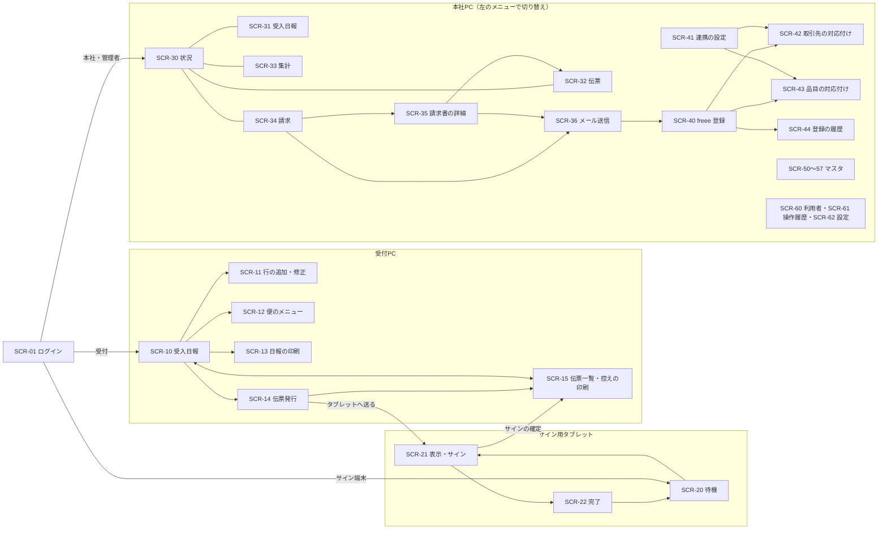

試作画面の「画面遷移図」は、箱を押すとその画面が開く版です。

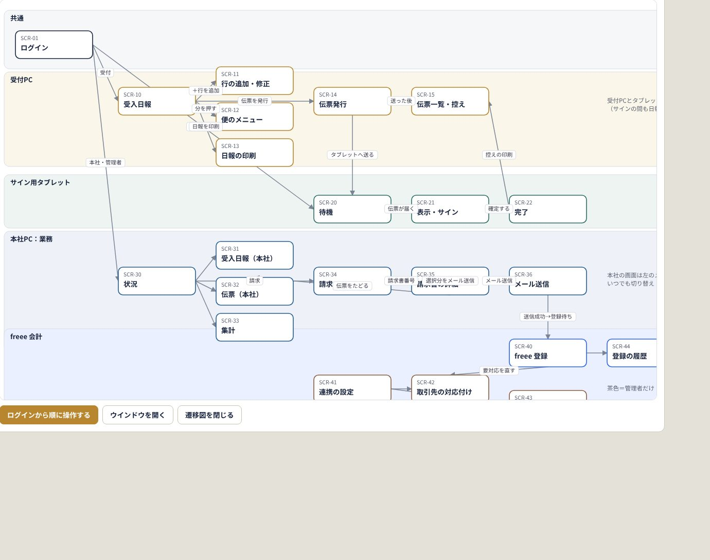

## 3. 画面一覧

| ID | 画面名 | 利用者 | 端末 | 要件 |
|---|---|---|---|---|
| SCR-01 | ログイン | 全員 | 全端末 | FR-CMN-01・02、NFR-12 |
| SCR-10 | 受入日報 | 受付・本社 | 受付PC | FR-RCV-01〜22 |
| SCR-11 | 行の追加・修正 | 受付・本社 | 受付PC（ダイアログ） | FR-RCV-04・05・15 |
| SCR-12 | 便のメニュー | 受付・本社 | 受付PC（ポップアップ） | FR-RCV-08・10〜14 |
| SCR-13 | 日報の印刷 | 受付・本社 | 受付PC（ダイアログ） | FR-RCV-19、RPT-01 |
| SCR-14 | 伝票発行 | 受付・本社 | 受付PC（ダイアログ） | FR-SLP-01〜05・08・11 |
| SCR-15 | 当日の伝票一覧・控えの印刷 | 受付・本社 | 受付PC | FR-SLP-06・09・10・12 |
| SCR-20 | サイン待機 | サイン端末 | タブレット | FR-SGN-01・06 |
| SCR-21 | 伝票の表示・サイン | サイン端末 | タブレット | FR-SGN-02〜05 |
| SCR-22 | サイン完了 | サイン端末 | タブレット | FR-SGN-04 |
| SCR-30 | 状況 | 本社・管理者 | 本社PC | FR-AGG-01 |
| SCR-31 | 受入日報（本社） | 本社・管理者 | 本社PC | FR-AGG-02、FR-RCV-17 |
| SCR-32 | 伝票（本社） | 本社・管理者 | 本社PC | FR-SLP-07・11 |
| SCR-33 | 集計 | 本社・管理者 | 本社PC | FR-AGG-03〜05 |
| SCR-34 | 請求 | 本社・管理者 | 本社PC | FR-BIL-03・04・09、02 6.3 |
| SCR-35 | 請求書の詳細 | 本社・管理者 | 本社PC | FR-BIL-05〜14 |
| SCR-36 | メール送信の確認 | 本社・管理者 | 本社PC（ダイアログ） | FR-MAL-01〜07、FR-FRE-22 |
| SCR-37 | 現金の領収書（一覧・日ごとの合計・取消）／現金で受け取る（受付、ダイアログ） | 受付・本社・管理者 | 受付PC・本社PC | FR-BIL-15（設計案） |
| SCR-40 | freee 登録 | 管理者（本社は参照） | 本社PC | FR-FRE-10〜21 |
| SCR-41 | freee 連携の設定 | 管理者 | 本社PC | FR-FRE-01〜05・09 |
| SCR-42 | 取引先の対応付け | 管理者 | 本社PC | FR-FRE-06・07 |
| SCR-43 | 品目の対応付け | 管理者 | 本社PC | FR-FRE-08 |
| SCR-44 | freee 登録の履歴 | 本社・管理者 | 本社PC | FR-FRE-20 |
| SCR-50 | 客先マスタ | 本社・管理者 | 本社PC | FR-MST-01 |
| SCR-51 | 現場マスタ | 本社・管理者 | 本社PC | FR-MST-02 |
| SCR-52 | 請求先マスタ | 本社・管理者 | 本社PC | FR-MST-03 |
| SCR-53 | 車番マスタ | 本社・管理者 | 本社PC | FR-MST-04 |
| SCR-54 | 品目マスタ | 本社・管理者 | 本社PC | FR-MST-05 |
| SCR-55 | 車格マスタ | 本社・管理者 | 本社PC | FR-MST-06 |
| SCR-56 | 単価表 | 本社・管理者 | 本社PC | FR-MST-07 |
| SCR-57 | 印マスタ | 本社・管理者 | 本社PC | FR-MST-08 |
| SCR-60 | 利用者管理 | 管理者 | 本社PC | FR-CMN-03 |
| SCR-61 | 操作履歴 | 本社・管理者 | 本社PC | FR-CMN-04 |
| SCR-62 | システム設定 | 管理者 | 本社PC | FR-CMN-05 |

## 4. 画面ごとの設計

### SCR-01 ログイン

| 項目 | 内容 |
|---|---|
| 目的 | 利用者を確かめ、区分に合った最初の画面を開く |
| 利用者・端末 | 全員／全端末 |
| 要件 | FR-CMN-01・02、NFR-12 |
| 主な API | /auth/login、/auth/mfa、/auth/me |

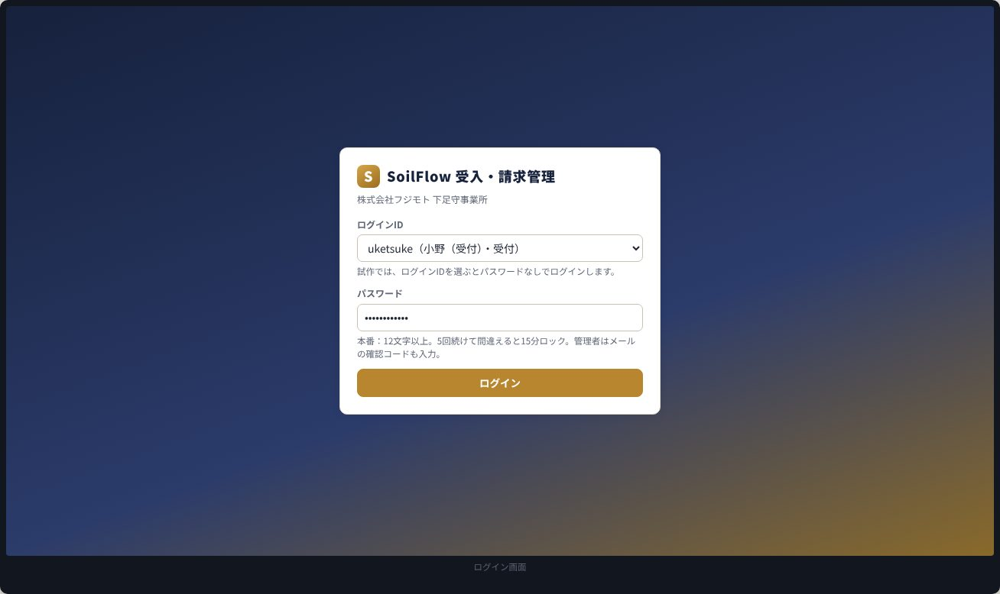

**表示・入力の項目**

| 項目 | 種類 | 内容・決まり |
|---|---|---|
| ログインID | 入力 | 英小文字・数字・. _ -、3〜40文字 |
| パスワード | 入力（伏せ字） | 12文字以上 |
| 確認コード | 入力（管理者のみ・2段目） | 6桁の数字。メールで届く。10分有効 |

**操作**

| 操作 | 動き |
|---|---|
| ログイン | POST /auth/login。成功したら区分ごとの最初の画面（受付→SCR-10、サイン端末→SCR-20、本社・管理者→SCR-30） |
| （初回）パスワード変更 | must_change_password のとき、ログイン後にパスワードの変更を求める |

**入力の確認・制限**

- 5回続けて失敗したら15分ロック（「しばらくしてからやり直してください」）
- ID・パスワードのどちらが違うかは表示しない

### SCR-10 受入日報

| 項目 | 内容 |
|---|---|
| 目的 | 紙の日報と同じ形の画面に、来場時刻と種別の印を記入する（受付のメイン画面） |
| 利用者・端末 | 受付・本社／受付PC |
| 要件 | FR-RCV-01〜22 |
| 主な API | /daily-reports/{date}、/changes、/carry-over、/trips |

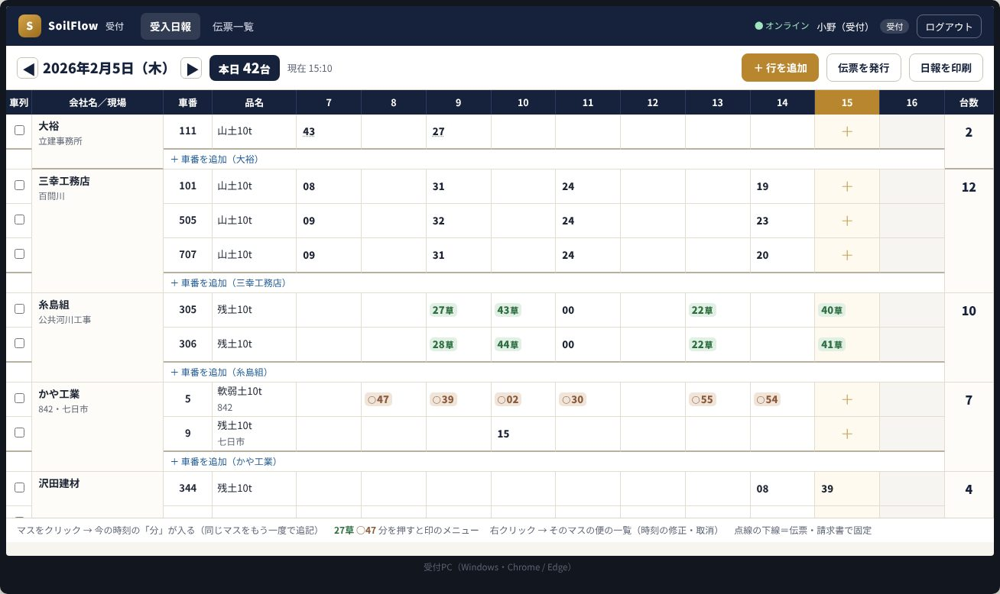

**表示・入力の項目**

| 項目 | 種類 | 内容・決まり |
|---|---|---|
| 日付 | 表示＋◀▶ | 曜日つき。◀▶で前後の日 |
| 本日 N台 | 表示 | その日の有効な便の数 |
| 現在時刻 | 表示 | 今日の日報のとき |
| 車列 | チェック | まとめて記入する行を選ぶ |
| 会社名／現場 | 表示 | 会社名（太字）と現場名。会社ごとにまとめる |
| 車番 | 表示（押すと行の修正） |  |
| 品名 | 表示 | 日報表記＋車格（例：山土10t） |
| 時間帯の列（7〜16） | マス | 便の「分」。今の時間帯の列は金色。1マス4回分まで、5回目から「＋N」。草は分の右、○は左 |
| 台数 | 表示 | 会社ごとの合計 |
| ＋車番を追加 | ボタン | 会社のまとまりの下 |

**操作**

| 操作 | 動き |
|---|---|
| 今の時間帯のマスをクリック | 今の分を記入（POST /trips）。押した瞬間に表示し、保存に失敗したら戻す |
| 前の時間帯のマスをクリック | 分の入力（SCR-12 の「後から記入」） |
| 分を押す | 印のメニュー（SCR-12） |
| マスを右クリック | そのマスの便の一覧（SCR-12） |
| 車列を2行以上選んで「選んだN行に今の時刻で記入」 | 同じ時刻で全部に記入し、車列として記録 |
| ＋行を追加 | SCR-11 |
| ＋車番を追加 | SCR-11（会社・現場・品名を引き継ぐ） |
| 前日の行を引き継ぐ | その日の行がないときだけ表示。前の営業日に便があった行を作る |
| 伝票を発行 | SCR-14 |
| 日報を印刷 | SCR-13 |

**入力の確認・制限**

- 今より後の時間帯：「今より後の時間帯には記入できません」
- オフライン：記入できない（上部に「オフライン」）
- 未来の日付の日報には記入できない

### SCR-11 行の追加・修正

| 項目 | 内容 |
|---|---|
| 目的 | 日報に会社・現場・車番・品名の行を足す、または直す |
| 利用者・端末 | 受付・本社／受付PC（ダイアログ） |
| 要件 | FR-RCV-04・05・15 |
| 主な API | /report-rows、/masters/customers、/masters/vehicles |

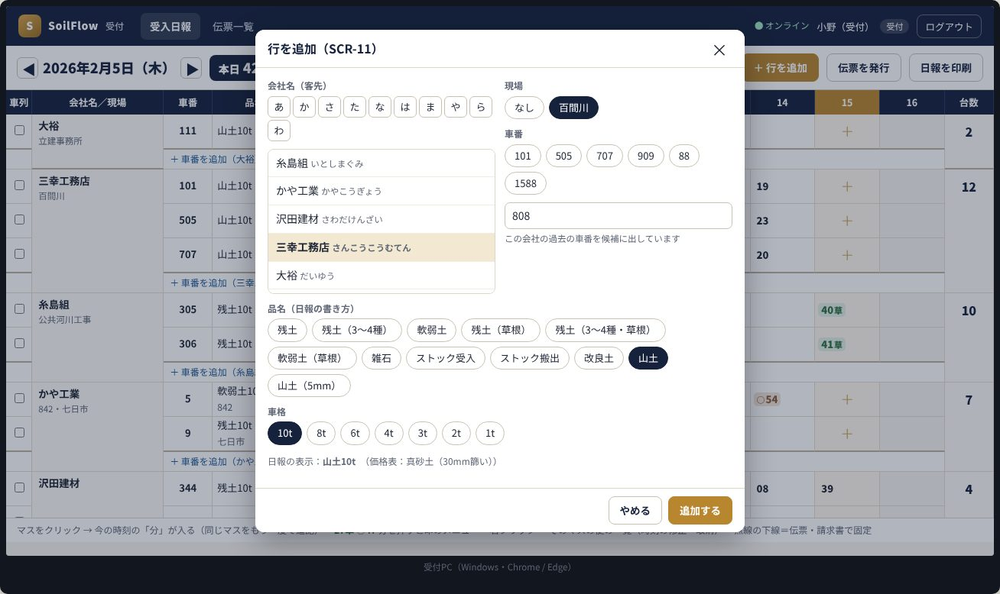

**表示・入力の項目**

| 項目 | 種類 | 内容・決まり |
|---|---|---|
| 会社名（客先） | 頭文字のボタン＋一覧 | あ・か・さ…で読みがなの頭文字を絞り込む |
| 現場 | 選択（なし可） | その客先の現場 |
| 車番 | 候補から選ぶ／入力 | その客先の過去の車番。新しい車番は入力すると車番マスタに登録 |
| 品名 | 選択 | 日報表記（残土・山土・軟弱土…） |
| 車格 | 選択 | 10t〜1t |
| 日報の表示 | 表示 | 例：山土10t（価格表：真砂土（30mm篩い）） |

**操作**

| 操作 | 動き |
|---|---|
| 追加する／直す | POST /report-rows、PATCH /report-rows/{id} |
| 行を削除（修正のとき） | DELETE /report-rows/{id} |

**入力の確認・制限**

- 会社名・車番・品名・車格は必須
- 同じ日に同じ会社・現場・車番・品名・車格の行は作れない
- 伝票・送信済の請求書に含まれる便がある行は、会社・品名・車格を変えられない
- 有効な便がある行は削除できない

### SCR-12 便のメニュー

| 項目 | 内容 |
|---|---|
| 目的 | 印の付与、時刻の修正、取消、後からの記入 |
| 利用者・端末 | 受付・本社／受付PC（ポップアップ） |
| 要件 | FR-RCV-08・10〜14 |
| 主な API | /trips |

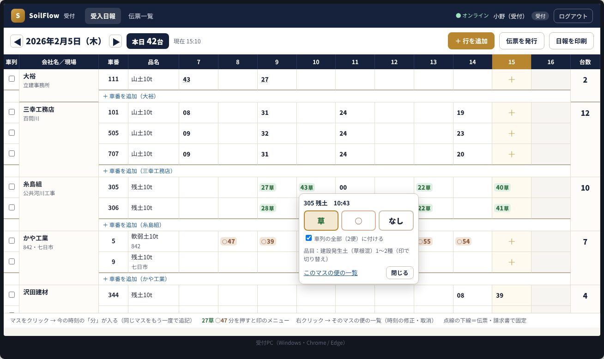

**表示・入力の項目**

| 項目 | 種類 | 内容・決まり |
|---|---|---|
| 印のボタン | 草・○・なし | 押した印を便に付ける |
| 車列の全部に付ける | チェック | 車列の便のとき（初期値：付ける） |
| 品目 | 表示 | 印で切り替えた後の価格表品目 |
| マスの便の一覧 | 一覧 | 時刻（入力）・印（選択）・取消 |
| 後から記入 | 分の選択 | 前の時間帯のマスを押したとき |

**操作**

| 操作 | 動き |
|---|---|
| 印を押す | PATCH /trips/{id}（applyToConvoy） |
| 時刻・印を直す | PATCH /trips/{id} |
| 取消 | POST /trips/{id}/cancel（記録は残る） |
| 記入する（後から） | POST /trips（time 指定） |

**入力の確認・制限**

- 伝票（サイン待ち以降）・送信済の請求書に含まれる便は変更できない（理由を表示）

### SCR-13 日報の印刷

| 項目 | 内容 |
|---|---|
| 目的 | 紙と同じレイアウトの日報（RPT-01）を印刷・PDF 保存する |
| 利用者・端末 | 受付・本社／受付PC（ダイアログ） |
| 要件 | FR-RCV-19、RPT-01 |
| 主な API | /daily-reports/{date}/pdf |

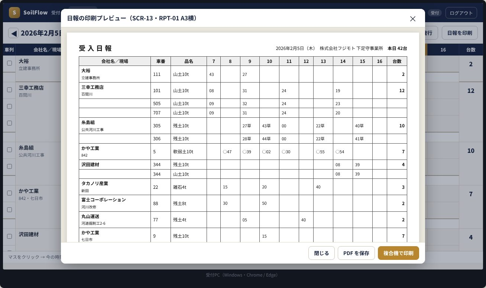

**表示・入力の項目**

| 項目 | 種類 | 内容・決まり |
|---|---|---|
| 日報の見本 | 表示 | A3 横。取消した便は出さない |

**操作**

| 操作 | 動き |
|---|---|
| 複合機で印刷 | PDF を開いてブラウザの印刷 |
| PDF を保存 | GET /daily-reports/{date}/pdf |

### SCR-14 伝票発行

| 項目 | 内容 |
|---|---|
| 目的 | 伝票未発行の便から伝票を作り、タブレットに送る（または紙で印刷する） |
| 利用者・端末 | 受付・本社／受付PC（ダイアログ） |
| 要件 | FR-SLP-01〜05・08・11 |
| 主な API | /slips、/slips/{id}/send-to-terminal、/print-paper |

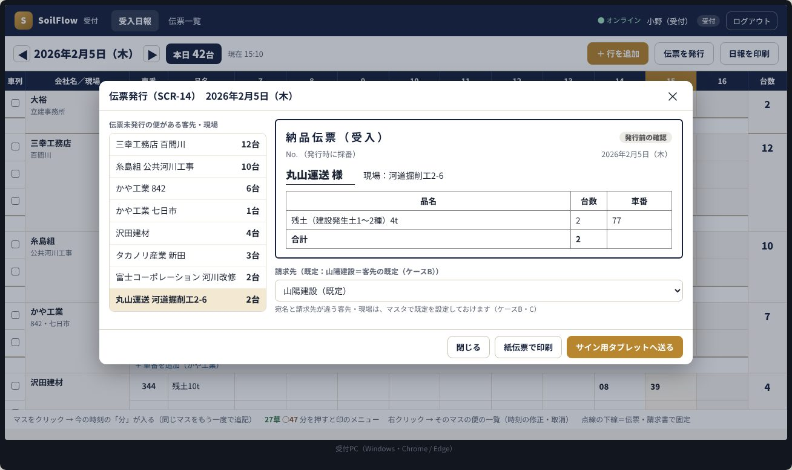

**表示・入力の項目**

| 項目 | 種類 | 内容・決まり |
|---|---|---|
| 伝票未発行の便がある客先・現場 | 一覧 | 台数つき |
| 伝票の見本 | 表示 | 宛名・現場・日付・品名（日報表記（価格表品目）車格）・台数・車番・合計 |
| 請求先 | 選択 | 初期値：現場の既定→客先の既定→客先自身。どれで決まったかを表示 |
| 変更の理由 | 入力（任意） | 請求先を既定から変えたとき |

**操作**

| 操作 | 動き |
|---|---|
| サイン用タブレットへ送る | POST /slips → POST /slips/{id}/send-to-terminal。受付PCは日報に戻る |
| 紙伝票で印刷 | POST /slips → POST /slips/{id}/print-paper（RPT-04） |
| 閉じる | 何もしない |

**入力の確認・制限**

- 対になるサイン端末に別のサイン待ちがあるときは送れない（「送信を取りやめるか、サインを待ってください」）

### SCR-15 当日の伝票一覧・控えの印刷

| 項目 | 内容 |
|---|---|
| 目的 | その日の伝票の状態を見る。サインが確定したら控えを印刷する |
| 利用者・端末 | 受付・本社／受付PC |
| 要件 | FR-SLP-06・09・10・12 |
| 主な API | /slips |

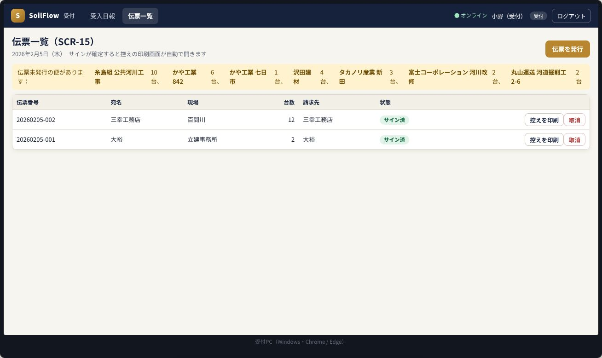

**表示・入力の項目**

| 項目 | 種類 | 内容・決まり |
|---|---|---|
| 伝票未発行の便 | 警告 | 客先・現場と台数 |
| 伝票 | 一覧 | 番号・宛名・現場・台数・請求先（変更の印）・状態 |
| 控えの印刷 | ダイアログ | サイン入りのお客さま控え（RPT-02）。サイン確定時に自動で開く |

**操作**

| 操作 | 動き |
|---|---|
| 送信を取りやめ | POST /slips/{id}/withdraw |
| 紙に切替 | POST /slips/{id}/print-paper |
| タブレットへ送る（作成の伝票） | POST /slips/{id}/send-to-terminal |
| 控えを印刷 | GET /slips/{id}/pdf |
| 取消 | 理由を入れて POST /slips/{id}/cancel |

**入力の確認・制限**

- 送信済の請求書に含まれる便がある伝票は取り消せない

### SCR-20 サイン待機

| 項目 | 内容 |
|---|---|
| 目的 | 伝票が送られてくるまで待つ |
| 利用者・端末 | サイン端末／タブレット |
| 要件 | FR-SGN-01・06 |
| 主な API | /terminal/current-slip |

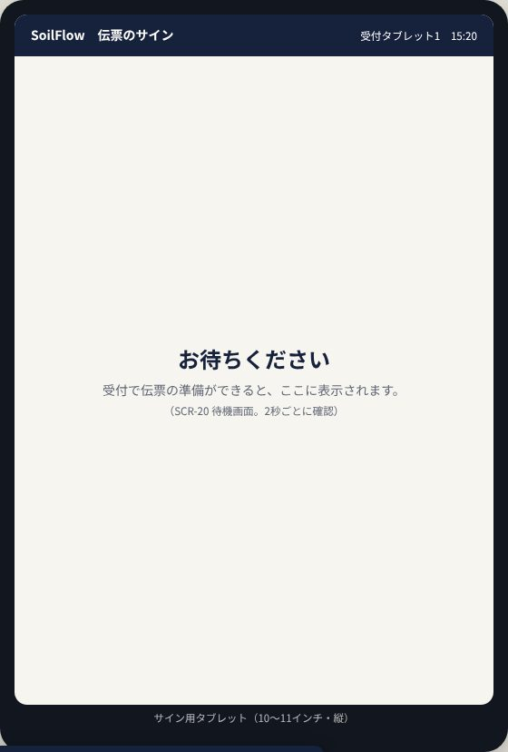

**表示・入力の項目**

| 項目 | 種類 | 内容・決まり |
|---|---|---|
| お待ちください | 表示 | 端末名と時刻 |

**操作**

| 操作 | 動き |
|---|---|
| （自動） | 2秒ごとに GET /terminal/current-slip。伝票があれば SCR-21 |

### SCR-21 伝票の表示・サイン

| 項目 | 内容 |
|---|---|
| 目的 | お客さまに伝票を確認してもらい、サインをもらう |
| 利用者・端末 | サイン端末／タブレット |
| 要件 | FR-SGN-02〜05 |
| 主な API | /terminal/slips/{id}/sign |

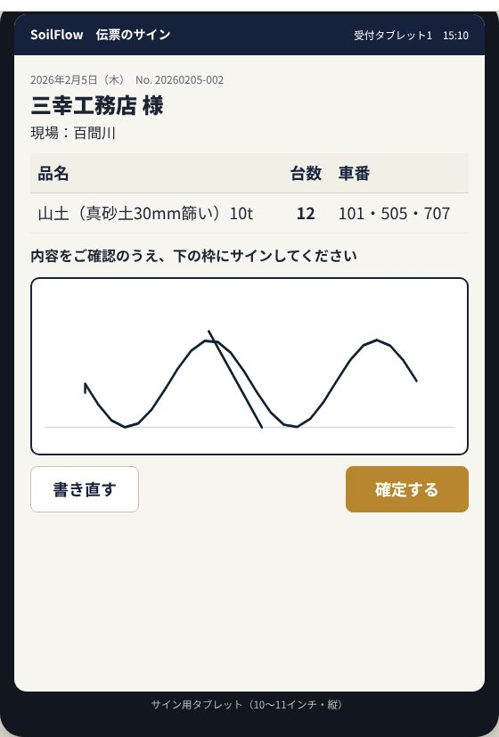

**表示・入力の項目**

| 項目 | 種類 | 内容・決まり |
|---|---|---|
| 日付・伝票番号 | 表示 |  |
| 宛名・現場 | 表示（大きな文字） |  |
| 品名・台数・車番 | 表示（大きな文字） | 金額は出さない |
| サインの枠 | 手書き | 指またはペン |

**操作**

| 操作 | 動き |
|---|---|
| 書き直す | 枠を消す |
| 確定する | POST /terminal/slips/{id}/sign（PNG と線の数）→ SCR-22 |

**入力の確認・制限**

- 何も書いていないと「確定する」を押せない
- 送信が取りやめられたら SCR-20 に戻る

### SCR-22 サイン完了

| 項目 | 内容 |
|---|---|
| 目的 | お礼を出して待機に戻る |
| 利用者・端末 | サイン端末／タブレット |
| 要件 | FR-SGN-04 |
| 主な API | ― |

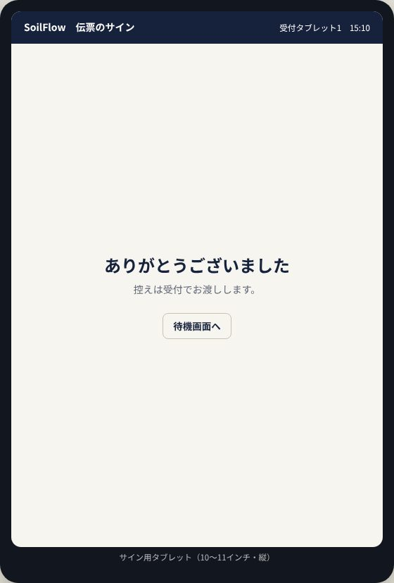

**表示・入力の項目**

| 項目 | 種類 | 内容・決まり |
|---|---|---|
| ありがとうございました | 表示 | 控えは受付で渡す旨 |

**操作**

| 操作 | 動き |
|---|---|
| 待機画面へ | SCR-20（次の伝票が来たら自動で SCR-21） |

### SCR-30 状況

| 項目 | 内容 |
|---|---|
| 目的 | 今日の受入、請求書、freee の状態と、対応が必要なことを一覧する |
| 利用者・端末 | 本社・管理者／本社PC |
| 要件 | FR-AGG-01 |
| 主な API | /dashboard |

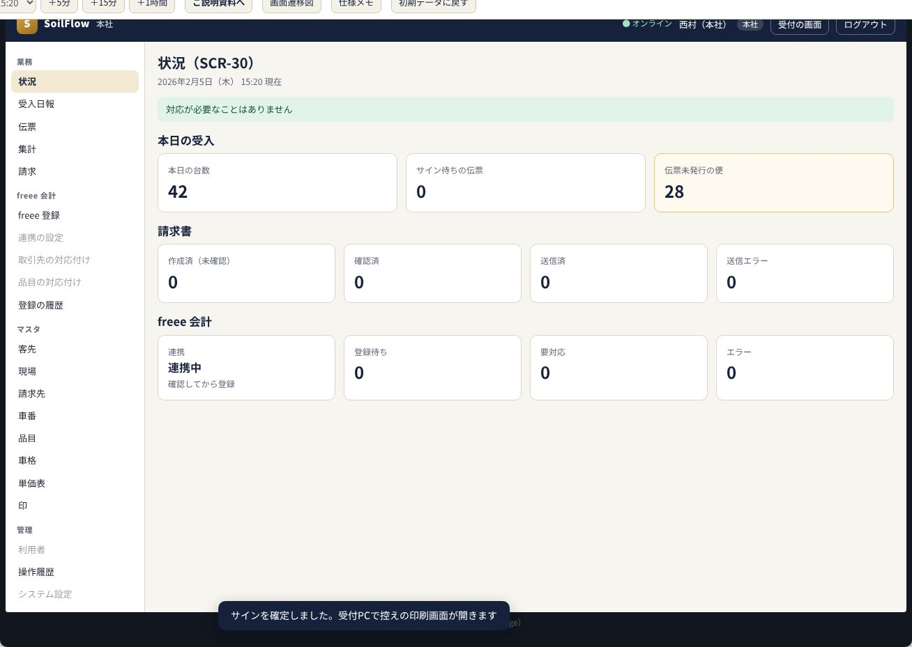

**表示・入力の項目**

| 項目 | 種類 | 内容・決まり |
|---|---|---|
| 対応が必要なこと | 警告の一覧 | freee の再連携、送信エラー、freee の要対応・エラー、要再確認、紙伝票のスキャン未登録 |
| 本日の受入 | 数値 | 台数・サイン待ち・伝票未発行の便 |
| 請求書 | 数値 | 状態ごとの件数 |
| freee | 数値 | 連携状態・登録のしかた・登録待ち・要対応・エラー |

**操作**

| 操作 | 動き |
|---|---|
| 開く | その画面へ |

### SCR-31 受入日報（本社）

| 項目 | 内容 |
|---|---|
| 目的 | 受付と同じ日報を参照・修正する |
| 利用者・端末 | 本社・管理者／本社PC |
| 要件 | FR-AGG-02、FR-RCV-17 |
| 主な API | SCR-10 と同じ |

**表示・入力の項目**

| 項目 | 種類 | 内容・決まり |
|---|---|---|
| SCR-10 と同じ |  |  |
| 日計の金額 | 表示 | 税抜・参考（本社だけ） |

**操作**

| 操作 | 動き |
|---|---|
| SCR-10 と同じ |  |

### SCR-32 伝票（本社）

| 項目 | 内容 |
|---|---|
| 目的 | 伝票（フジモト様控え）を見る。紙伝票のスキャンを登録する |
| 利用者・端末 | 本社・管理者／本社PC |
| 要件 | FR-SLP-07・11 |
| 主な API | /slips、/slips/{id}/paper-scan |

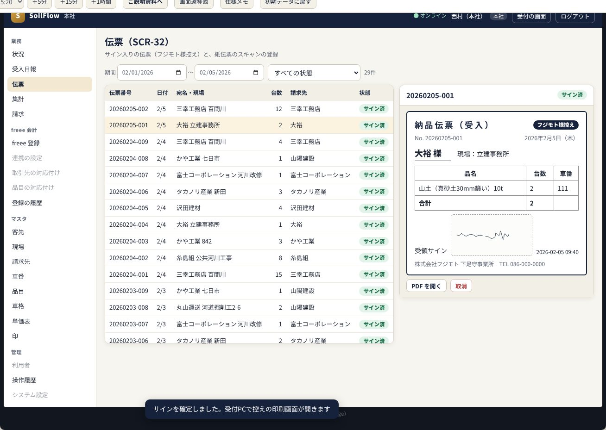

**表示・入力の項目**

| 項目 | 種類 | 内容・決まり |
|---|---|---|
| 期間・状態 | 条件 |  |
| 伝票 | 一覧 |  |
| 伝票の詳細 | 表示 | サイン入りの伝票、請求先の変更と理由 |

**操作**

| 操作 | 動き |
|---|---|
| スキャンを登録 | PDF を選んで POST /slips/{id}/paper-scan |
| PDF を開く | GET /slips/{id}/pdf |
| 取消 | SCR-15 と同じ |

**入力の確認・制限**

- PDF のみ、20MB まで

### SCR-33 集計

| 項目 | 内容 |
|---|---|
| 目的 | 期間を選んで、客先・現場・請求先・品目・車格・日付の別に台数と金額を集計する |
| 利用者・端末 | 本社・管理者／本社PC |
| 要件 | FR-AGG-03〜05 |
| 主な API | /aggregates、/aggregates/export |

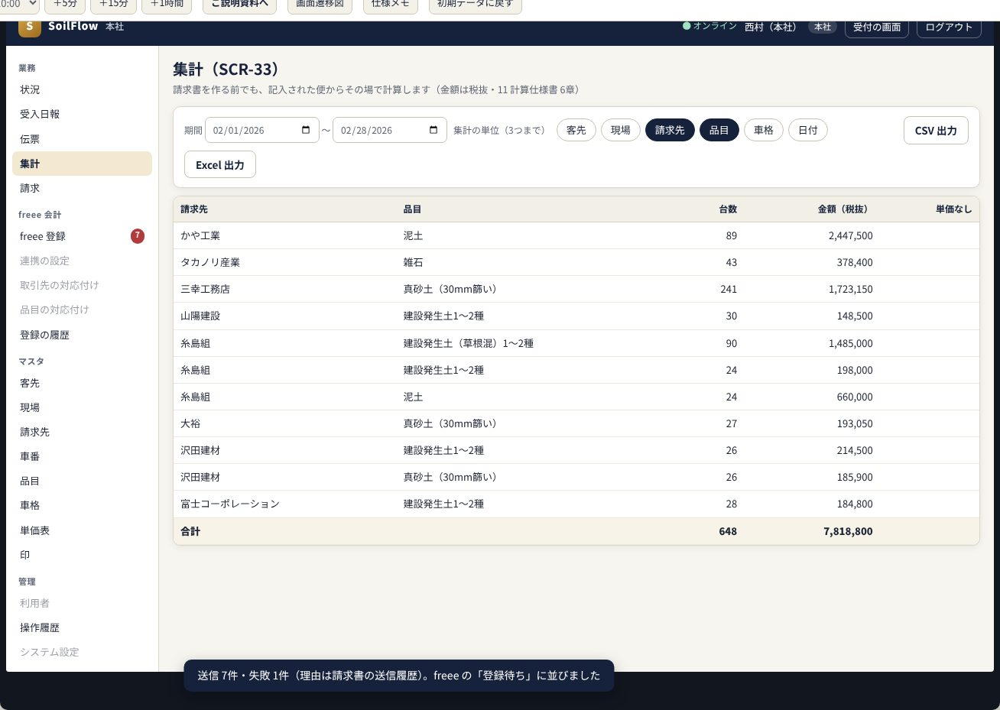

**表示・入力の項目**

| 項目 | 種類 | 内容・決まり |
|---|---|---|
| 期間 | 日付 |  |
| 集計の単位 | 選択（3つまで） |  |
| 集計表 | 一覧 | 台数・金額（税抜）・単価なしの台数・合計 |

**操作**

| 操作 | 動き |
|---|---|
| CSV 出力 | GET /aggregates/export?format=csv（UTF-8 BOM 付き） |
| Excel 出力 | format=xlsx（集計・明細の2シート） |

### SCR-34 請求

| 項目 | 内容 |
|---|---|
| 目的 | 締めで請求書を作り、一覧から確認・送信する |
| 利用者・端末 | 本社・管理者／本社PC |
| 要件 | FR-BIL-03・04・09、02 6.3 |
| 主な API | /billing/precheck、/billing/runs、/invoices |

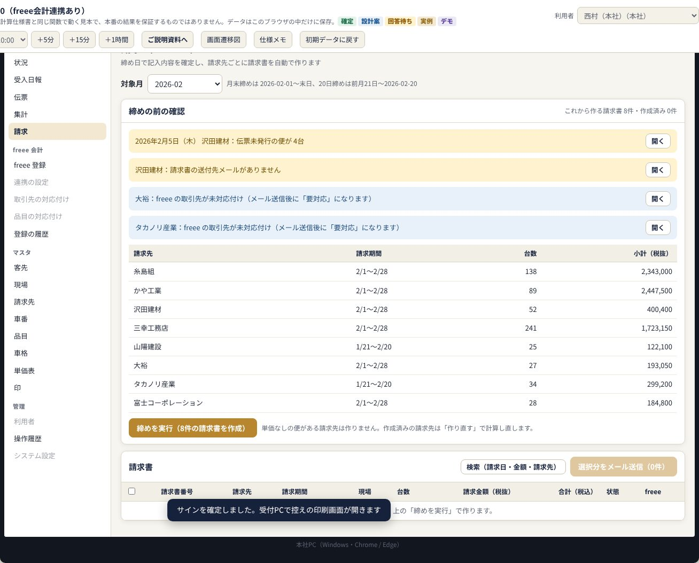

**表示・入力の項目**

| 項目 | 種類 | 内容・決まり |
|---|---|---|
| 対象月 | 選択 |  |
| 締めの前の確認 | 警告の一覧 | 伝票未発行・サイン待ち・紙伝票未登録・単価なし・送付先なし・freee 未対応付け |
| これから作る請求書 | 一覧 | 請求先・請求期間・台数・小計 |
| 請求書 | 一覧 | 番号・請求先・期間・現場数・台数・請求金額（税抜）・合計・状態・freee |
| 検索 | 条件 | 請求日の範囲・金額の範囲・請求先・取消を含む（電子帳簿保存法） |

**操作**

| 操作 | 動き |
|---|---|
| 締めを実行 | POST /billing/runs |
| 請求書番号 | SCR-35 |
| 選択分をメール送信 | SCR-36（確認済・送信エラーだけ選べる） |

**入力の確認・制限**

- 単価なしの便がある請求先は作らない
- 作成済みの請求先は対象外（作り直しは SCR-35）

### SCR-35 請求書の詳細

| 項目 | 内容 |
|---|---|
| 目的 | 請求書の内容を確かめ、確認・作り直し・送信・取消・再発行をする |
| 利用者・端末 | 本社・管理者／本社PC |
| 要件 | FR-BIL-05〜14 |
| 主な API | /invoices/{id} |

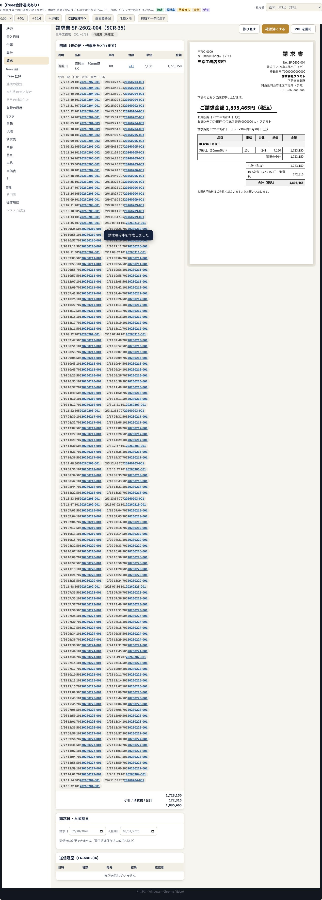

**表示・入力の項目**

| 項目 | 種類 | 内容・決まり |
|---|---|---|
| 明細 | 一覧 | 現場・品目・車格・台数（押すと元の便と伝票）・単価・金額、小計・消費税・合計 |
| 請求日・入金期日 | 日付 | 送信前だけ変更できる |
| 送信履歴 | 一覧 | 日時・種類・宛先・結果・送信者 |
| 請求書の見本 | 表示 | RPT-05 |

**操作**

| 操作 | 動き |
|---|---|
| 作り直す | POST /invoices/{id}/rebuild |
| 確認済にする／確認を取り消す | POST /confirm、/unconfirm |
| メール送信・再送 | SCR-36、POST /invoices/{id}/resend |
| 取消 | 理由を入れて POST /invoices/{id}/void |
| 取消して再発行 | 理由を入れて POST /invoices/{id}/reissue |

**入力の確認・制限**

- 送信後は請求日・金額を変えられない
- 取消・再発行は理由が必須

### SCR-36 メール送信の確認

| 項目 | 内容 |
|---|---|
| 目的 | 送る前に宛先・件名・本文・添付を確かめて送信する |
| 利用者・端末 | 本社・管理者／本社PC（ダイアログ） |
| 要件 | FR-MAL-01〜07、FR-FRE-22 |
| 主な API | /invoices/mail-preview、/invoices/send |

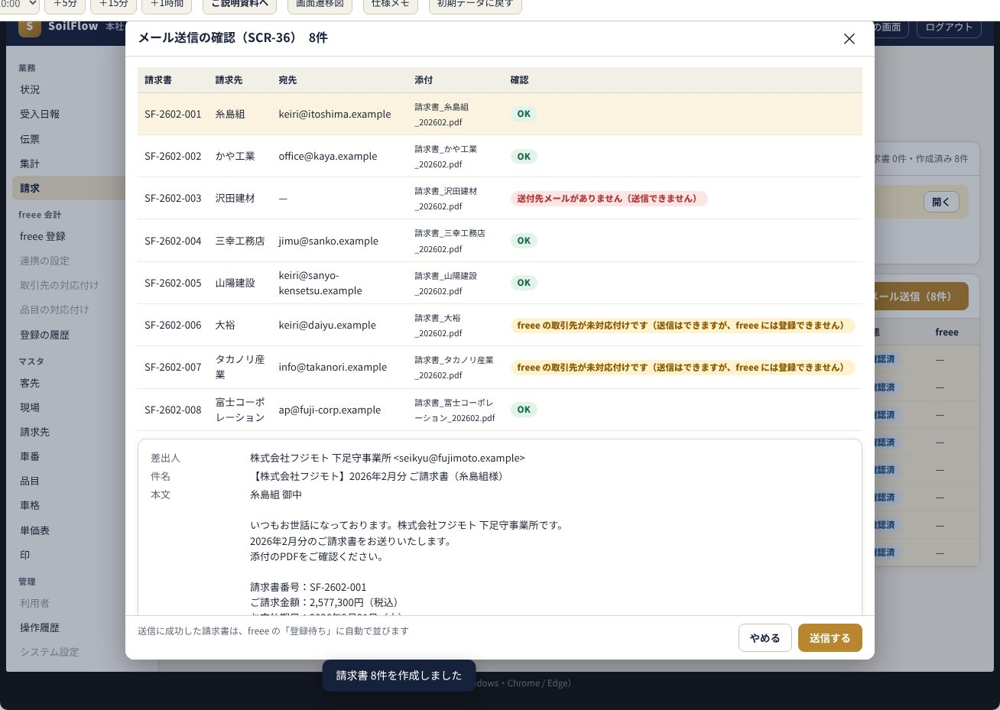

**表示・入力の項目**

| 項目 | 種類 | 内容・決まり |
|---|---|---|
| 送る請求書 | 一覧 | 番号・請求先・宛先（CC）・添付・確認（警告） |
| メールの見本 | 表示 | 差出人・件名・本文・添付 |

**操作**

| 操作 | 動き |
|---|---|
| 送信する | POST /invoices/send。成功した請求書は freee の登録待ちへ |

**入力の確認・制限**

- 送付先がない請求書は送信できない（警告）
- freee の取引先が未対応付け・品目の勘定科目が未設定なら警告（送信はできる）

### SCR-40 freee 登録

| 項目 | 内容 |
|---|---|
| 目的 | freee に送る内容を確かめて、請求書 PDF と売上を登録する |
| 利用者・端末 | 管理者（本社は参照）／本社PC |
| 要件 | FR-FRE-10〜21 |
| 主な API | /freee/registrations |

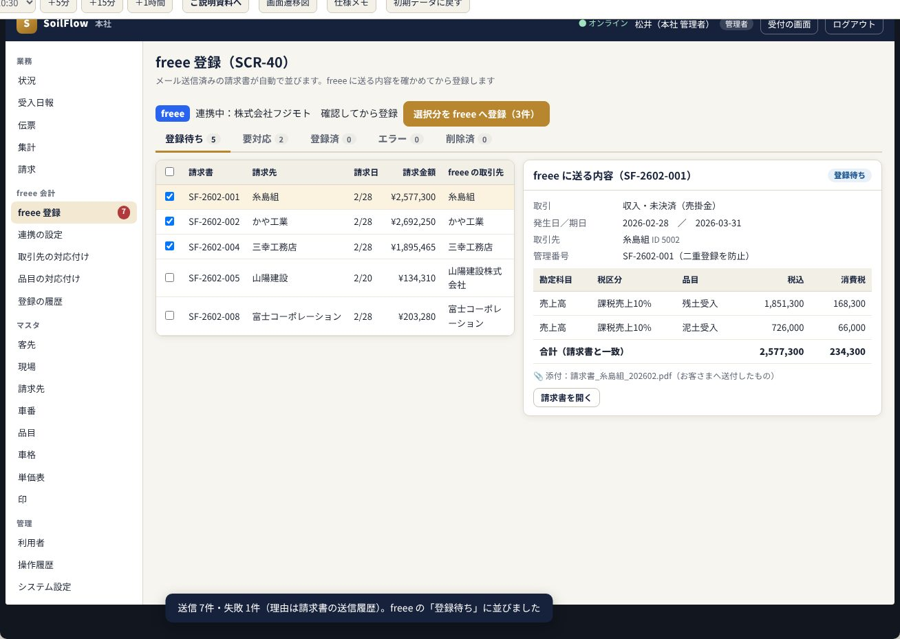

**表示・入力の項目**

| 項目 | 種類 | 内容・決まり |
|---|---|---|
| 連携状態・登録のしかた | 表示 |  |
| 状態のタブ | 登録待ち・要対応・登録済・エラー・削除済 | 件数つき |
| 一覧 | 表 | 請求書・請求先・請求日・請求金額・freee の取引先・状態 |
| freee に送る内容 | 表示 | 取引（収入・未決済）・発生日・期日・取引先・管理番号、明細（勘定科目・税区分・品目・税込・消費税、合計＝請求書）、添付 |
| 理由 | 警告 | 要対応・エラーの理由と直す画面へのボタン |

**操作**

| 操作 | 動き |
|---|---|
| 選択分を freee へ登録 | POST /freee/registrations/register（管理者だけ） |
| 再登録 | POST /freee/registrations/{id}/retry |
| freee で開く | freee の取引の画面 |

**入力の確認・制限**

- 要対応の行は選べない
- 未連携・再連携が必要なときは登録できない

### SCR-41 freee 連携の設定

| 項目 | 内容 |
|---|---|
| 目的 | freee との連携を許可・解除し、登録のしかたを決める |
| 利用者・端末 | 管理者／本社PC |
| 要件 | FR-FRE-01〜05・09 |
| 主な API | /freee/connection |

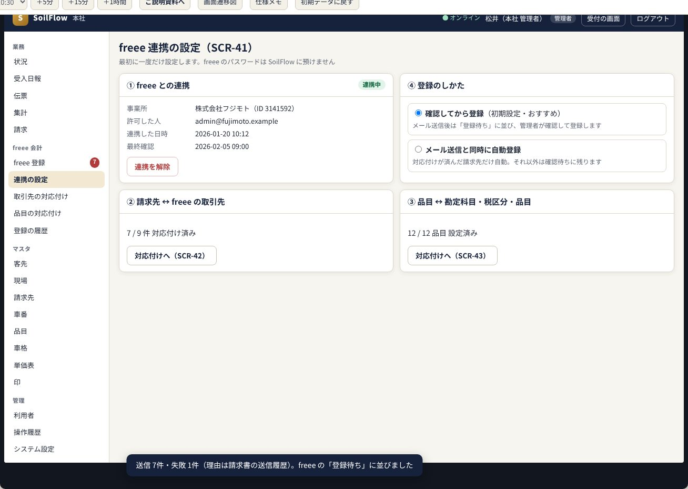

**表示・入力の項目**

| 項目 | 種類 | 内容・決まり |
|---|---|---|
| 連携状態 | 表示 | 連携中・未連携・再連携が必要。事業所・許可した人・連携した日時・最終確認 |
| 登録のしかた | 選択 | 確認してから登録（初期）／メール送信と同時に自動登録 |
| 対応付けの進み具合 | 表示 | 請求先・品目 |

**操作**

| 操作 | 動き |
|---|---|
| freee と連携する | POST /freee/connection/authorize → freee の許可画面 → 戻る |
| 連携を解除 | DELETE /freee/connection |
| 登録のしかたを変える | PATCH /freee/connection |

### SCR-42 取引先の対応付け

| 項目 | 内容 |
|---|---|
| 目的 | SoilFlow の請求先と freee の取引先を結び付ける |
| 利用者・端末 | 管理者／本社PC |
| 要件 | FR-FRE-06・07 |
| 主な API | /freee/partner-mappings |

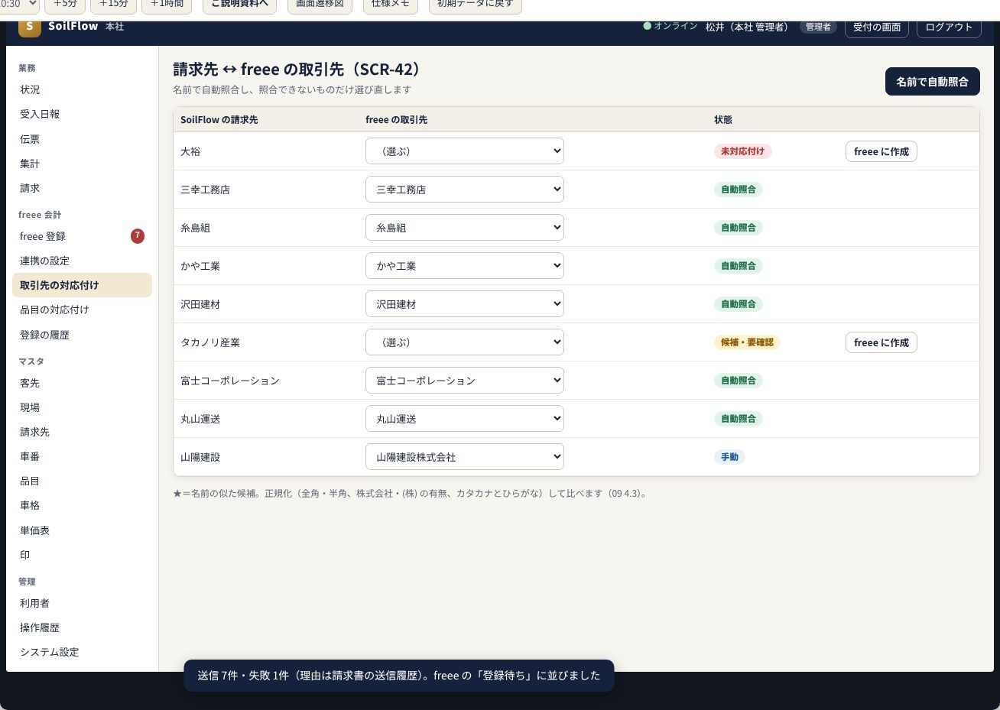

**表示・入力の項目**

| 項目 | 種類 | 内容・決まり |
|---|---|---|
| 請求先 | 表示 |  |
| freee の取引先 | 選択 | ★＝名前の似た候補 |
| 状態 | 表示 | 自動照合・候補・要確認・手動・freee に作成・未対応付け |

**操作**

| 操作 | 動き |
|---|---|
| 名前で自動照合 | POST /freee/partner-mappings/auto-match |
| 取引先を選ぶ | PUT /billing-parties/{id}/freee-partner |
| freee に作成 | POST /freee/partners |

### SCR-43 品目の対応付け

| 項目 | 内容 |
|---|---|
| 目的 | 品目ごとに freee の勘定科目・税区分・品目を決める |
| 利用者・端末 | 管理者／本社PC |
| 要件 | FR-FRE-08 |
| 主な API | /items/{id}/freee-mapping |

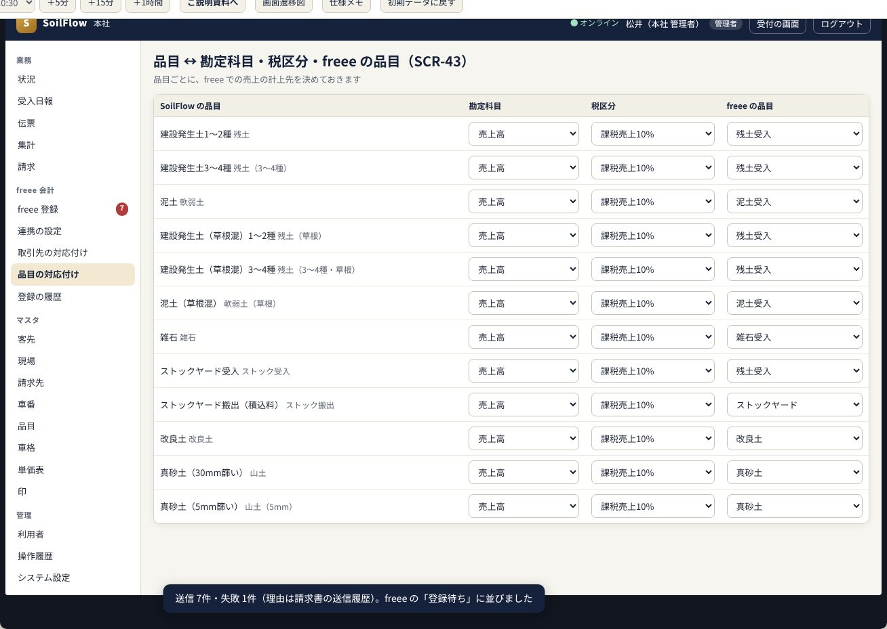

**表示・入力の項目**

| 項目 | 種類 | 内容・決まり |
|---|---|---|
| 品目 | 表示 |  |
| 勘定科目・税区分・freee の品目 | 選択 |  |

**操作**

| 操作 | 動き |
|---|---|
| 選ぶ | PUT /items/{id}/freee-mapping |

### SCR-44 freee 登録の履歴

| 項目 | 内容 |
|---|---|
| 目的 | freee への登録・更新・削除の記録を見る |
| 利用者・端末 | 本社・管理者／本社PC |
| 要件 | FR-FRE-20 |
| 主な API | /freee/api-logs |

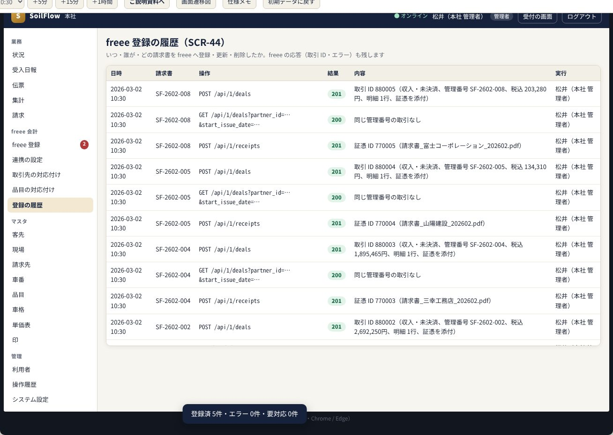

**表示・入力の項目**

| 項目 | 種類 | 内容・決まり |
|---|---|---|
| 履歴 | 一覧 | 日時・請求書・操作（メソッド・パス）・結果・内容・実行者 |

### SCR-50 客先マスタ

| 項目 | 内容 |
|---|---|
| 目的 | 客先を登録・変更・無効化する |
| 利用者・端末 | 本社・管理者／本社PC |
| 要件 | FR-MST-01 |
| 主な API | /masters/{kind} |

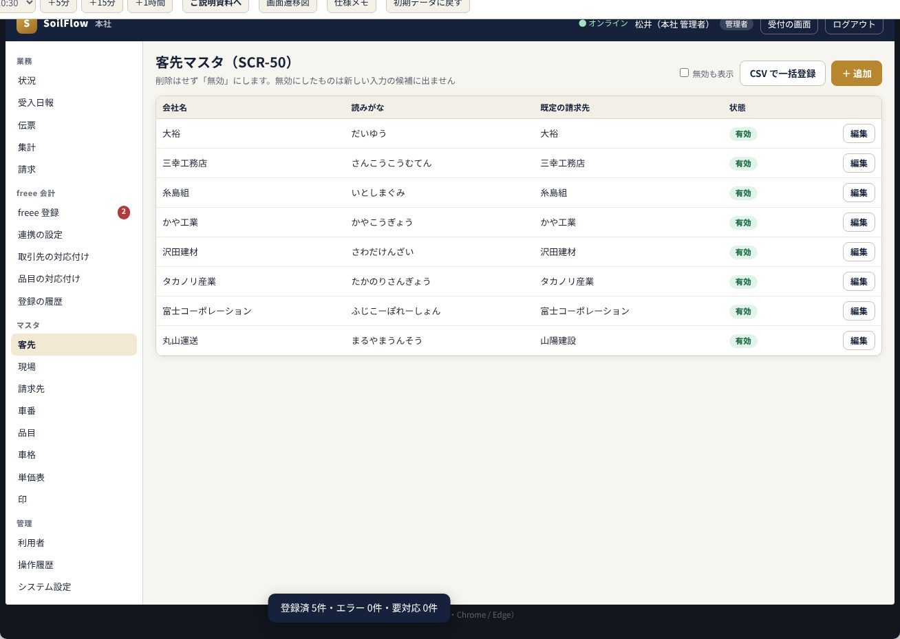

**表示・入力の項目**

| 項目 | 種類 | 内容・決まり |
|---|---|---|
| 一覧 | 表 | 会社名・読みがな・既定の請求先 |
| 無効も表示 | チェック |  |

**操作**

| 操作 | 動き |
|---|---|
| ＋追加・編集 | ダイアログで入力して保存（POST/PATCH /masters/{kind}） |
| CSV で一括登録 | 客先・現場・請求先・車番（POST /masters/import、dryRun で確認してから） |

**入力の確認・制限**

- 必須項目が空なら保存できない
- 削除はせず無効にする
- 客先を追加すると同じ名前の請求先を作る（ケースA）。既定の請求先を元請にする（ケースB）

### SCR-51 現場マスタ

| 項目 | 内容 |
|---|---|
| 目的 | 現場を登録・変更・無効化する |
| 利用者・端末 | 本社・管理者／本社PC |
| 要件 | FR-MST-02 |
| 主な API | /masters/{kind} |

**表示・入力の項目**

| 項目 | 種類 | 内容・決まり |
|---|---|---|
| 一覧 | 表 | 客先・現場名・読みがな・既定の請求先 |
| 無効も表示 | チェック |  |

**操作**

| 操作 | 動き |
|---|---|
| ＋追加・編集 | ダイアログで入力して保存（POST/PATCH /masters/{kind}） |
| CSV で一括登録 | 客先・現場・請求先・車番（POST /masters/import、dryRun で確認してから） |

**入力の確認・制限**

- 必須項目が空なら保存できない
- 削除はせず無効にする
- 現場の既定は客先の既定より優先（ケースC）

### SCR-52 請求先マスタ

| 項目 | 内容 |
|---|---|
| 目的 | 請求先を登録・変更・無効化する |
| 利用者・端末 | 本社・管理者／本社PC |
| 要件 | FR-MST-03 |
| 主な API | /masters/{kind} |

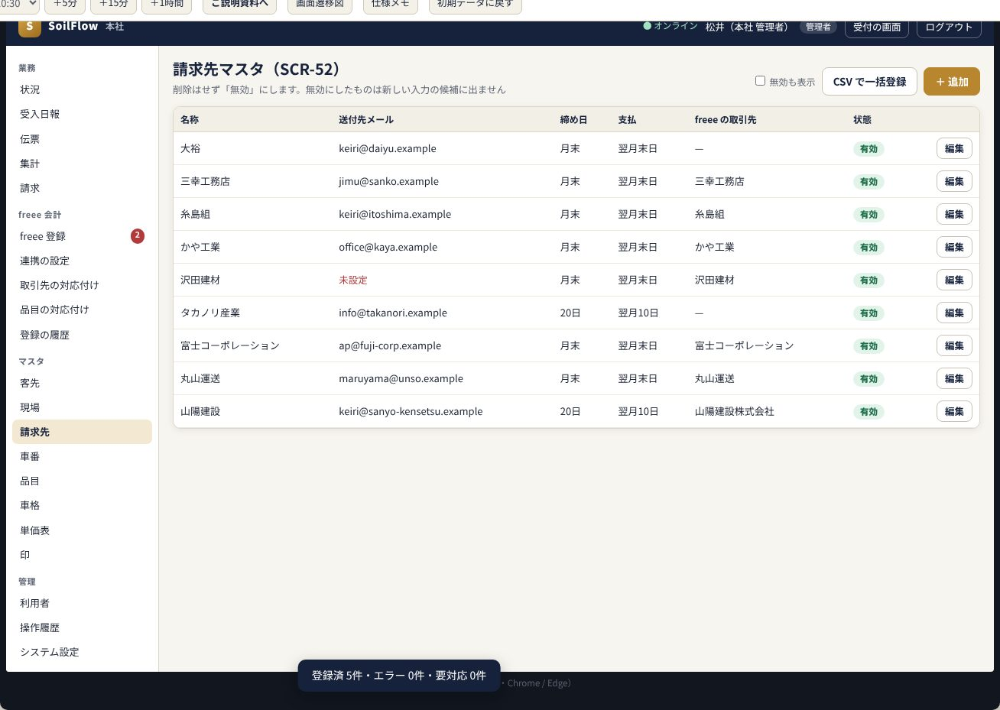

**表示・入力の項目**

| 項目 | 種類 | 内容・決まり |
|---|---|---|
| 一覧 | 表 | 名称・読みがな・敬称・郵便番号・住所・送付先メール（宛先・CC）・締め日・支払月・支払日・freee の取引先（表示） |
| 無効も表示 | チェック |  |

**操作**

| 操作 | 動き |
|---|---|
| ＋追加・編集 | ダイアログで入力して保存（POST/PATCH /masters/{kind}） |
| CSV で一括登録 | 客先・現場・請求先・車番（POST /masters/import、dryRun で確認してから） |

**入力の確認・制限**

- 必須項目が空なら保存できない
- 削除はせず無効にする
- 締め日は月末または1〜28日

### SCR-53 車番マスタ

| 項目 | 内容 |
|---|---|
| 目的 | 車番を登録・変更・無効化する |
| 利用者・端末 | 本社・管理者／本社PC |
| 要件 | FR-MST-04 |
| 主な API | /masters/{kind} |

**表示・入力の項目**

| 項目 | 種類 | 内容・決まり |
|---|---|---|
| 一覧 | 表 | 客先・車番・よく使う車格 |
| 無効も表示 | チェック |  |

**操作**

| 操作 | 動き |
|---|---|
| ＋追加・編集 | ダイアログで入力して保存（POST/PATCH /masters/{kind}） |
| CSV で一括登録 | 客先・現場・請求先・車番（POST /masters/import、dryRun で確認してから） |

**入力の確認・制限**

- 必須項目が空なら保存できない
- 削除はせず無効にする
- 日報で新しい車番を入力すると自動で登録

### SCR-54 品目マスタ

| 項目 | 内容 |
|---|---|
| 目的 | 品目を登録・変更・無効化する |
| 利用者・端末 | 本社・管理者／本社PC |
| 要件 | FR-MST-05 |
| 主な API | /masters/{kind} |

**表示・入力の項目**

| 項目 | 種類 | 内容・決まり |
|---|---|---|
| 一覧 | 表 | 日報表記・価格表品目・区分（受入／納品）・表示順 |
| 無効も表示 | チェック |  |

**操作**

| 操作 | 動き |
|---|---|
| ＋追加・編集 | ダイアログで入力して保存（POST/PATCH /masters/{kind}） |
| CSV で一括登録 | 客先・現場・請求先・車番（POST /masters/import、dryRun で確認してから） |

**入力の確認・制限**

- 必須項目が空なら保存できない
- 削除はせず無効にする

### SCR-55 車格マスタ

| 項目 | 内容 |
|---|---|
| 目的 | 車格を登録・変更・無効化する |
| 利用者・端末 | 本社・管理者／本社PC |
| 要件 | FR-MST-06 |
| 主な API | /masters/{kind} |

**表示・入力の項目**

| 項目 | 種類 | 内容・決まり |
|---|---|---|
| 一覧 | 表 | 車格・容量（㎥）・4t車以下 |
| 無効も表示 | チェック |  |

**操作**

| 操作 | 動き |
|---|---|
| ＋追加・編集 | ダイアログで入力して保存（POST/PATCH /masters/{kind}） |
| CSV で一括登録 | 客先・現場・請求先・車番（POST /masters/import、dryRun で確認してから） |

**入力の確認・制限**

- 必須項目が空なら保存できない
- 削除はせず無効にする

### SCR-56 単価表

| 項目 | 内容 |
|---|---|
| 目的 | 品目×車格の1台の単価を、適用開始日ごとに管理する |
| 利用者・端末 | 本社・管理者／本社PC |
| 要件 | FR-MST-07 |
| 主な API | /price-tables |

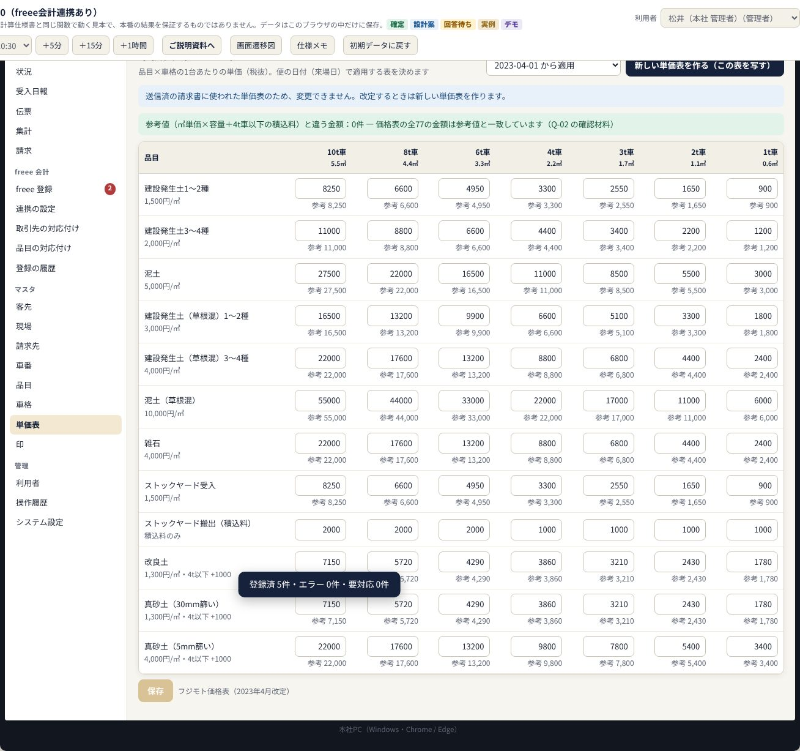

**表示・入力の項目**

| 項目 | 種類 | 内容・決まり |
|---|---|---|
| 適用開始日 | 選択 |  |
| 単価 | 入力（品目×車格） | 下に参考値（㎥単価×容量＋4t車以下の積込料）。違えば色を付ける |
| 参考値との違い | 警告 | 件数 |

**操作**

| 操作 | 動き |
|---|---|
| 新しい単価表を作る | この表を写して作る（POST /price-tables） |
| 保存 | PUT /price-tables/{id}/entries |

**入力の確認・制限**

- 送信済の請求書に使われた表は変更できない
- 同じ適用開始日の表は作れない

### SCR-57 印マスタ

| 項目 | 内容 |
|---|---|
| 目的 | 印の表示名と、印で切り替える品目を決める |
| 利用者・端末 | 本社・管理者／本社PC |
| 要件 | FR-MST-08 |
| 主な API | /masters/marks |

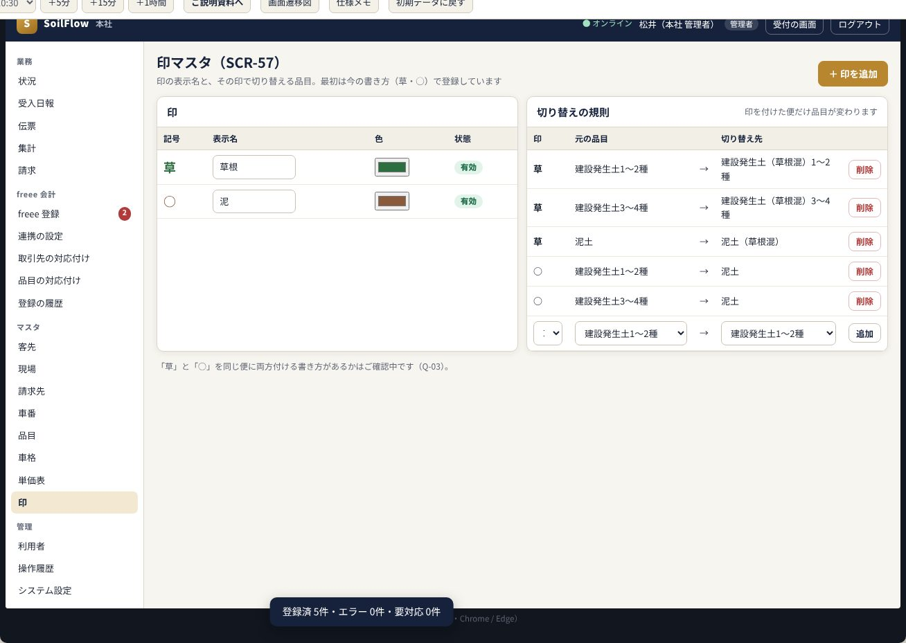

**表示・入力の項目**

| 項目 | 種類 | 内容・決まり |
|---|---|---|
| 印 | 一覧 | 記号・表示名・色 |
| 切り替えの規則 | 一覧 | 印・元の品目→切り替え先 |

**操作**

| 操作 | 動き |
|---|---|
| ＋印を追加 | 新しい印 |
| 規則の追加・削除 |  |

**入力の確認・制限**

- 同じ印・元の品目の規則は1つ
- 元と切り替え先が同じ規則は作れない

### SCR-60 利用者管理

| 項目 | 内容 |
|---|---|
| 目的 | 利用者の追加・区分の変更・無効化・パスワードの初期化 |
| 利用者・端末 | 管理者／本社PC |
| 要件 | FR-CMN-03 |
| 主な API | /users |

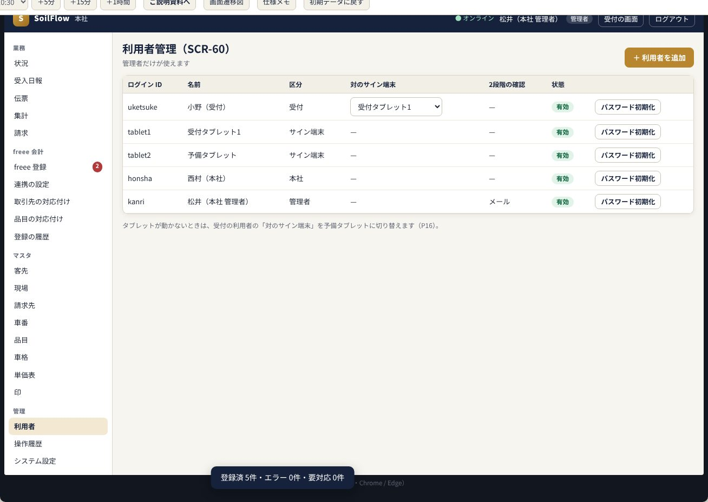

**表示・入力の項目**

| 項目 | 種類 | 内容・決まり |
|---|---|---|
| 利用者 | 一覧 | ログインID・名前・区分・対のサイン端末・2段階の確認・状態 |

**操作**

| 操作 | 動き |
|---|---|
| ＋利用者を追加 | POST /users（仮のパスワードを表示） |
| 対のサイン端末を変える | PATCH /users/{id}（予備タブレットへの切り替え） |
| パスワード初期化 | POST /users/{id}/reset-password |

### SCR-61 操作履歴

| 項目 | 内容 |
|---|---|
| 目的 | いつ・誰が・何をしたかを見る |
| 利用者・端末 | 本社・管理者／本社PC |
| 要件 | FR-CMN-04 |
| 主な API | /audit-logs |

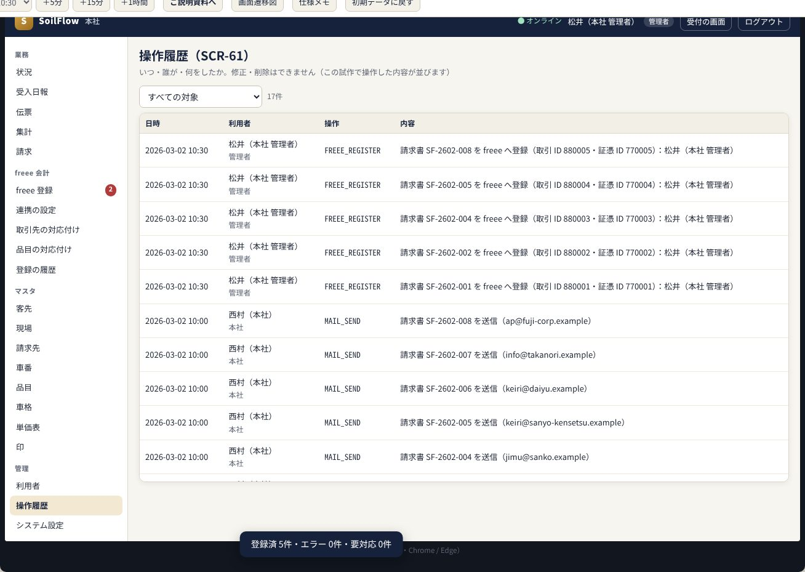

**表示・入力の項目**

| 項目 | 種類 | 内容・決まり |
|---|---|---|
| 対象・期間 | 条件 |  |
| 履歴 | 一覧 | 日時・利用者・操作・内容 |

**入力の確認・制限**

- 変更・削除はできない

### SCR-62 システム設定

| 項目 | 内容 |
|---|---|
| 目的 | 会社情報・請求書・メール・日報・消費税の設定 |
| 利用者・端末 | 管理者／本社PC |
| 要件 | FR-CMN-05 |
| 主な API | /settings |

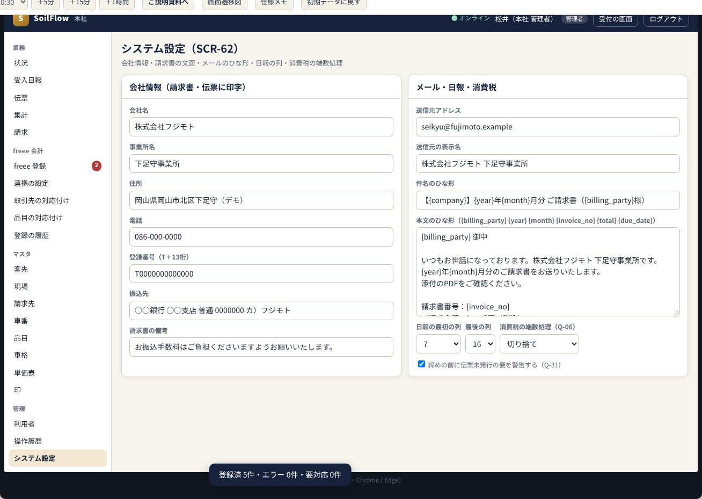

**表示・入力の項目**

| 項目 | 種類 | 内容・決まり |
|---|---|---|
| 会社情報 | 入力 | 会社名・事業所名・住所・電話・登録番号・振込先・請求書の備考 |
| メール | 入力 | 送信元アドレス・表示名・件名と本文のひな形 |
| 日報 | 選択 | 最初と最後の時間帯の列 |
| 消費税 | 選択 | 端数処理（切り捨て・四捨五入・切り上げ） |
| 伝票未発行の警告 | チェック |  |

**操作**

| 操作 | 動き |
|---|---|
| 保存 | PATCH /settings |

**入力の確認・制限**

- 登録番号は T＋13桁
