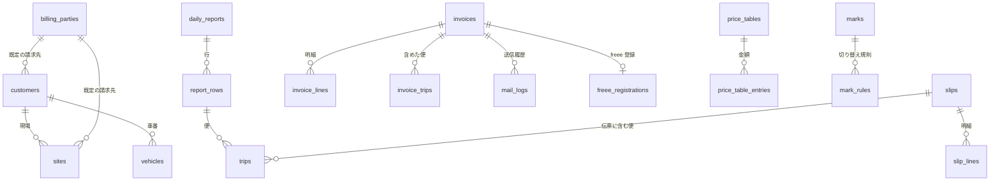

# 07 DB設計書

| 項目 | 内容 |
|---|---|
| 文書番号 | SF-DOC-07 |
| 版 | 1.0（2026-11-18） |
| 正本 | `spec/schema.sql`（DDL）、`spec/seed.sql`（初期データ）、`spec/er.md`（ER図） |
| データベース | PostgreSQL 16（Cloud SQL for PostgreSQL） |
| 関連 | 02 要件定義書 6章、04 基本設計書、11 計算仕様書 |

## 1. 設計の方針

| No | 方針 | 理由 |
|---|---|---|
| 1 | 主キーは UUID（`gen_random_uuid()`） | 画面で先に ID を作れる（オフライン時の再送でも重複しない）、件数を推測されない |
| 2 | 状態の値は `text` ＋ CHECK 制約 | 状態を足すときの変更が簡単（ENUM 型は避ける） |
| 3 | マスタは削除せず `active=false` で無効にする | 過去の日報・請求書から参照し続けるため（FR-MST-09） |
| 4 | 請求書・伝票・明細には、作成時の名称・単価を書き残す | 後でマスタを変えても、送った請求書の内容は変わらない（11 1章 5） |
| 5 | 日時は `timestamptz`、日付は `date`、時刻は `time(0)` | 表示は日本時間（NFR-20） |
| 6 | 更新するテーブルには `version` を持たせ、更新のたびに1増やす | 同時に直したときの検出（FR-RCV-18、楽観ロック） |
| 7 | 守るべき決まりはデータベースの制約・トリガーでも守る | アプリの不具合や手作業の SQL でも壊れないようにする（5章） |
| 8 | 鍵（トークン）は暗号化した値だけを持つ | NFR-14。暗号化と復号は Cloud KMS で行う |
| 9 | 金額は `integer`（単価）・`bigint`（合計） | 円の整数。小数を持たない |

## 2. テーブルの一覧

| 区分 | テーブル | 和名 | 1年の件数の目安 |
|---|---|---|---|
| 設定・利用者 | settings | 設定 | 1 |
| | users | 利用者 | 10 |
| | sessions | ログイン中の利用者 | 数千 |
| | mfa_codes | 2段階の確認コード | 数百 |
| マスタ | billing_parties | 請求先 | 数百 |
| | customers | 客先 | 数百 |
| | sites | 現場 | 数百〜千 |
| | vehicles | 車番 | 千 |
| | vehicle_classes | 車格 | 7 |
| | items | 品目 | 12 |
| | price_tables | 単価表 | 改定のたびに1 |
| | price_table_entries | 単価表の金額 | 84 × 改定数 |
| | marks | 印 | 2〜 |
| | mark_rules | 印の切り替え規則 | 5〜 |
| 受入日報・伝票 | daily_reports | 日報 | 300 |
| | report_rows | 日報の行 | 2万 |
| | trips | 便 | 7.5万 |
| | slips | 伝票 | 1万 |
| | slip_lines | 伝票の明細 | 1.5万 |
| | slip_counters | 伝票番号の採番 | 300 |
| 請求・メール | billing_runs | 締めの実行 | 24 |
| | invoices | 請求書 | 600 |
| | invoice_lines | 請求書の明細 | 3,000 |
| | invoice_trips | 請求書に含めた便 | 7.5万 |
| | invoice_counters | 請求書番号の採番 | 12 |
| | mail_logs | 送信履歴 | 700 |
| freee 会計連携 | freee_connection | freee の連携 | 1 |
| | freee_oauth_states | 連携許可の途中の値 | 数件 |
| | freee_registrations | freee 登録 | 600 |
| | freee_api_logs | freee API の記録 | 3,000 |
| ジョブ・履歴 | jobs | ジョブ | 3,000（完了分は90日で削除） |
| | audit_logs | 操作履歴 | 数十万 |

10年分でも最大のテーブル（trips・invoice_trips・audit_logs）は数百万件で、Cloud SQL の最小構成で NFR-10 を満たします。

## 3. ER図

`spec/er.md` に、マスタ・受入日報と伝票・請求と freee の3つに分けた図と全体の図があります。主な関係は次のとおりです。

## 4. 状態の値

### 4.1 便（trips.status）

| 値 | 意味 |
|---|---|
| ACTIVE | 有効。台数・請求に数える |
| CANCELLED | 取消。記録は残るが数えない（FR-RCV-13） |

### 4.2 伝票（slips.status）

| 値 | 意味 | 次の状態 |
|---|---|---|
| DRAFT | 作成（タブレットへ送る前） | AWAITING_SIGNATURE、PAPER_PRINTED、CANCELLED |
| AWAITING_SIGNATURE | サイン待ち（タブレットに表示中） | SIGNED、DRAFT（送信の取りやめ）、CANCELLED |
| SIGNED | サイン済（確定） | CANCELLED |
| PAPER_PRINTED | 紙伝票を印刷した | PAPER_SIGNED、CANCELLED |
| PAPER_SIGNED | 紙のサインを登録済 | CANCELLED |
| CANCELLED | 取消 | ― |

1台のサイン端末に「サイン待ち」の伝票は1件だけです（`ux_slips_one_awaiting_per_terminal`）。

### 4.3 請求書（invoices.status）

| 値 | 意味 | 次の状態 |
|---|---|---|
| DRAFT | 作成済（未確認） | CONFIRMED、NEEDS_RECHECK |
| NEEDS_RECHECK | 要再確認（確認後に便が変わった） | CONFIRMED |
| CONFIRMED | 確認済 | SENDING、NEEDS_RECHECK、DRAFT（確認の取消） |
| SENDING | 送信中 | SENT、SEND_ERROR |
| SENT | 送信済 | VOIDED |
| SEND_ERROR | 送信エラー | SENDING（再送）、VOIDED |
| VOIDED | 取消 | ― |

### 4.4 freee 登録（freee_registrations.status）

| 値 | 意味 |
|---|---|
| PENDING | 登録待ち（確認してから登録のとき） |
| NEEDS_ACTION | 要対応（対応付けがない、決済済みの取引を変えられない など。reasons に理由） |
| QUEUED | 登録の処理待ち |
| PROCESSING | 処理中 |
| REGISTERED | 登録済（証憑 ID・取引 ID あり） |
| ERROR | エラー（再試行しても失敗） |
| DELETED | 取消により freee の取引を削除済み |

状態の移り変わりの図は「04 基本設計書」5章にあります。

## 5. データベースで守る決まり

| 決まり | 実装 | 要件 |
|---|---|---|
| 送信済の請求書の内容（番号・請求先・期間・日付・金額・PDF）は変えられない。取消した請求書は戻せない | トリガー `sf_invoices_freeze` | 02 6.3、FR-BIL-12 |
| 送信済の請求書は削除できない | トリガー `sf_invoices_no_delete` | 02 6.3 |
| 合計＝小計＋消費税 | CHECK | 11 4.5 |
| 明細の金額＝単価×台数 | CHECK | 11 4.4 |
| 同じ請求先・同じ請求期間の有効な請求書は1件 | 部分一意索引 `ux_invoices_active_period` | 11 4.2 |
| 送信済の請求書に含まれる便、伝票（取消以外）に含まれる便は、時刻・印・取消・行・品目を変えられない | トリガー `sf_trips_lock` | FR-RCV-14 |
| 行の現場・車番は、その行の客先のもの | 複合外部キー（`sites(id, customer_id)`、`vehicles(id, customer_id)`） | FR-RCV-04 |
| 同じクリックを二重に保存しない | `trips.client_op_id` の一意制約 | NFR-01 |
| 便の日付＝日報の日付 | 複合外部キー（`daily_reports(id, report_date)`） | 11 2章 |
| 操作履歴は追記のみ | トリガー `sf_audit_append_only`、アプリのユーザーから UPDATE・DELETE の権限を外す | FR-CMN-04 |
| サイン済の伝票にはサイン画像と日時がある | CHECK | FR-SGN-04 |
| 登録済の freee 登録には証憑 ID と取引 ID がある | CHECK | FR-FRE-13 |
| freee が連携中なら事業所と鍵がある | CHECK | FR-FRE-01 |

これらは実際の PostgreSQL 16 で、禁止される操作がすべてエラーになり、許される操作（請求書の取消、取消後の便の修正）が通ることを確かめました（12章）。

## 6. 主な索引

| 索引 | 用途 |
|---|---|
| `ix_trips_report_updated (daily_report_id, updated_at)` | 日報の変更分の取得（本社・タブレットへの反映。FR-RCV-17） |
| `ix_trips_date (trip_date) WHERE status='ACTIVE'` | 締め・集計 |
| `ix_invoices_search (issue_date, total, billing_party_id)` | 電子帳簿保存法の検索（請求日・金額・請求先） |
| `ux_report_rows_key` | 同じ日に同じ行（客先・現場・車番・品目・車格）を二重に作らない |
| `ix_slips_terminal`、`ux_slips_one_awaiting_per_terminal` | タブレットに表示する伝票の取得 |
| `ix_jobs_pick (run_after) WHERE status='QUEUED'` | ジョブの取り出し（`FOR UPDATE SKIP LOCKED`） |
| `ux_jobs_dedupe (dedupe_key)` | 同じ請求書の freee 登録を二重に予約しない |

## 7. 採番

| 番号 | 方法 |
|---|---|
| 伝票番号 | `slip_counters` をその日の行で `INSERT … ON CONFLICT DO UPDATE SET last_no = last_no + 1 RETURNING last_no` し、`YYYYMMDD-NNN` を作る（同時に発行しても重複しない） |
| 請求書番号 | `invoice_counters` を年月（YYMM）で同じ方法で採番し、`SF-YYMM-NNN`（11 4.7）。締めでは請求先の読みがな順に1つの処理の中で採番する |

番号は取消しても再利用しません（欠番になります）。

## 8. 同時に更新したとき

- 更新の API は、画面が持っている `version` を一緒に送ります。`UPDATE … WHERE id = $1 AND version = $2` が0件なら「他の人が先に変更しました」（HTTP 409）を返し、画面は読み直します。
- 便の追加は1件ずつ別の行になるため、同じマスに同時に記入しても両方残ります（FR-RCV-18）。
- 締め・請求書の作り直しは、対象の請求先の行を `SELECT … FOR UPDATE` でロックしてから行います。

## 9. 保存期間と削除

| データ | 保存 | 削除 |
|---|---|---|
| 日報・便・伝票・請求書・送信履歴・freee 登録・操作履歴 | 7年以上（Q-24） | 削除しない。7年を過ぎた分の扱いは保守で相談 |
| sessions・mfa_codes・freee_oauth_states | 期限切れ後 | 毎日のジョブ（CLEANUP）で削除 |
| jobs | 完了・失敗から90日 | 毎日のジョブで削除 |
| freee_api_logs | 2年 | 毎日のジョブで削除 |

バックアップは「12 環境・インフラ・ネットワーク設計書」で定めます（毎日の自動バックアップ＋7日間の任意時点への復元）。

## 10. 初期データ

`spec/seed.sql` は、価格表（2023年4月改定）の転記から作った初期データです。何度流しても同じ結果になるように、ID は名前から決まる UUID（v5）にし、`ON CONFLICT DO NOTHING` にしています。

| 内容 | 件数 |
|---|---|
| 設定（会社名・事業所名・メール本文のひな形） | 1 |
| 車格（10t・8t・6t・4t・3t・2t・1t） | 7 |
| 品目（価格表の12品目。日報表記は 02 要件定義書 5.8 の初期値） | 12 |
| 単価表（2023-04-01）と金額 | 1・84 |
| 印（草・○）と切り替え規則 | 2・5 |
| freee の連携（未連携） | 1 |

客先・現場・請求先・車番は、要件定義工程でいただく資料（Q-23）から「16 移行・導入計画書」の手順で登録します。

## 11. テーブル定義

列の一覧は `schema.sql` を実際のデータベースに流した結果から作っています。「必須」は NOT NULL、「キー」の FK は参照先のテーブルです。

### 1. 設定・利用者

#### settings（設定（1行だけ））

会社情報・請求書の文面・メールのひな形・日報の列・税の設定（FR-CMN-05）

| 列 | 型 | 必須 | 既定値 | キー | 説明 |
|---|---|---|---|---|---|
| id | smallint | ○ | 1 | PK | 識別子 |
| company_name | text | ○ |  |  | 会社名・事業所名 |
| office_name | text | ○ |  |  | 事業所名 |
| postal_code | text |  |  |  | 郵便番号 |
| address | text |  |  |  | 住所 |
| tel | text |  |  |  | 電話番号 |
| fax | text |  |  |  | FAX |
| invoice_registration_no | text |  |  |  | 登録番号（インボイス） |
| bank_account_text | text |  |  |  | 振込先（請求書に印字） |
| invoice_note | text |  |  |  | 請求書の備考 |
| mail_from_address | text |  |  |  | 送信元アドレス |
| mail_from_name | text |  |  |  | 送信元の表示名 |
| mail_reply_to | text |  |  |  | 返信先アドレス |
| mail_subject_template | text | ○ | '【{company}】{year}年{month}月分 ご請求書（{billing_party}様）' |  | メール件名のひな形 |
| mail_body_template | text | ○ |  |  | メール本文のひな形 |
| report_first_hour | smallint | ○ | 7 |  | 日報の最初の時間帯の列 |
| report_last_hour | smallint | ○ | 16 |  | 日報の最後の時間帯の列 |
| tax_rate | smallint | ○ | 10 |  | 税率（%） |
| tax_rounding | text | ○ | 'floor' |  | 消費税の端数処理 |
| slip_warning_enabled | boolean | ○ | true |  | 締めの前に伝票未発行を警告する |
| updated_at | timestamptz | ○ | now() |  | 更新日時 |
| updated_by | uuid |  |  |  | 更新した利用者 |
| version | integer | ○ | 1 |  | 版（同時更新の検出用） |

#### users（利用者）

受付・本社・管理者・サイン端末（FR-CMN-03）

| 列 | 型 | 必須 | 既定値 | キー | 説明 |
|---|---|---|---|---|---|
| id | uuid | ○ | gen_random_uuid() | PK | 識別子 |
| login_id | text | ○ |  |  | ログイン ID |
| name | text | ○ |  |  | 名称 |
| role | text | ○ |  |  | 利用者区分 |
| email | text |  |  |  | メールアドレス |
| password_hash | text | ○ |  |  | パスワードのハッシュ値（argon2id） |
| mfa_enabled | boolean | ○ | false |  | 2段階の確認を使う |
| paired_terminal_id | uuid |  |  | FK→users | 対になるサイン端末 |
| failed_login_count | smallint | ○ | 0 |  | 続けて失敗したログインの回数 |
| locked_until | timestamptz |  |  |  | ロックの解除日時 |
| password_changed_at | timestamptz | ○ | now() |  | パスワード変更日時 |
| must_change_password | boolean | ○ | true |  | 次回ログイン時にパスワードの変更が必要 |
| active | boolean | ○ | true |  | 有効（false＝無効化。削除はしない） |
| created_at | timestamptz | ○ | now() |  | 作成日時 |
| updated_at | timestamptz | ○ | now() |  | 更新日時 |
| version | integer | ○ | 1 |  | 版（同時更新の検出用） |

#### sessions（ログイン中の利用者）

Cookie のセッション（NFR-13）

| 列 | 型 | 必須 | 既定値 | キー | 説明 |
|---|---|---|---|---|---|
| id | text | ○ |  | PK | 識別子 |
| user_id | uuid | ○ |  | FK→users | 利用者 |
| created_at | timestamptz | ○ | now() |  | 作成日時 |
| last_seen_at | timestamptz | ○ | now() |  | 最後の操作日時 |
| expires_at | timestamptz | ○ |  |  | 有効期限 |
| idle_timeout | interval | ○ |  |  | 無操作でログアウトするまでの時間 |
| mfa_passed | boolean | ○ | false |  | 2段階の確認を通過済み |
| ip | inet |  |  |  | IP アドレス |
| user_agent | text |  |  |  | ブラウザの情報 |
| revoked_at | timestamptz |  |  |  | 無効にした日時 |

#### mfa_codes（2段階の確認コード）

管理者のメールによる確認（NFR-12）

| 列 | 型 | 必須 | 既定値 | キー | 説明 |
|---|---|---|---|---|---|
| id | uuid | ○ | gen_random_uuid() | PK | 識別子 |
| user_id | uuid | ○ |  | FK→users | 利用者 |
| code_hash | text | ○ |  |  | 確認コードのハッシュ値 |
| expires_at | timestamptz | ○ |  |  | 有効期限 |
| used_at | timestamptz |  |  |  | 使用日時 |
| attempts | smallint | ○ | 0 |  | 試行回数 |

### 2. マスタ

#### billing_parties（請求先）

締め日・支払条件・送付先・freee の取引先（FR-MST-03）

| 列 | 型 | 必須 | 既定値 | キー | 説明 |
|---|---|---|---|---|---|
| id | uuid | ○ | gen_random_uuid() | PK | 識別子 |
| name | text | ○ |  |  | 名称 |
| kana | text | ○ |  |  | 読みがな |
| honorific | text | ○ | '御中' |  | 敬称 |
| postal_code | text |  |  |  | 郵便番号 |
| address | text |  |  |  | 住所 |
| mail_to | text[] | ○ | '{}'[] |  | 送付先メール（宛先） |
| mail_cc | text[] | ○ | '{}'[] |  | 送付先メール（CC） |
| closing_day | smallint | ○ | 0 |  | 締め日（0＝月末、1〜28） |
| payment_month_offset | smallint | ○ | 1 |  | 支払月（締めの月から何か月後か） |
| payment_day | smallint | ○ | 0 |  | 支払日（0＝末日） |
| freee_partner_id | bigint |  |  |  | freee の取引先 ID |
| freee_partner_name | text |  |  |  | freee の取引先名 |
| freee_partner_code | text |  |  |  | freee の取引先コード |
| freee_mapping_status | text | ○ | 'UNMAPPED' |  | 取引先の対応付けの状態 |
| note | text |  |  |  | 備考 |
| active | boolean | ○ | true |  | 有効（false＝無効化。削除はしない） |
| created_at | timestamptz | ○ | now() |  | 作成日時 |
| updated_at | timestamptz | ○ | now() |  | 更新日時 |
| version | integer | ○ | 1 |  | 版（同時更新の検出用） |

#### customers（客先）

既定の請求先は必須（FR-MST-01）

| 列 | 型 | 必須 | 既定値 | キー | 説明 |
|---|---|---|---|---|---|
| id | uuid | ○ | gen_random_uuid() | PK | 識別子 |
| name | text | ○ |  |  | 名称 |
| kana | text | ○ |  |  | 読みがな |
| default_billing_party_id | uuid | ○ |  | FK→billing_parties | 既定の請求先 |
| sort_order | integer | ○ | 0 |  | 表示順 |
| note | text |  |  |  | 備考 |
| active | boolean | ○ | true |  | 有効（false＝無効化。削除はしない） |
| created_at | timestamptz | ○ | now() |  | 作成日時 |
| updated_at | timestamptz | ○ | now() |  | 更新日時 |
| version | integer | ○ | 1 |  | 版（同時更新の検出用） |

#### sites（現場）

客先ごと。既定の請求先は客先より優先（FR-MST-02）

| 列 | 型 | 必須 | 既定値 | キー | 説明 |
|---|---|---|---|---|---|
| id | uuid | ○ | gen_random_uuid() | PK | 識別子 |
| customer_id | uuid | ○ |  | FK→customers | 客先 |
| name | text | ○ |  |  | 名称 |
| kana | text | ○ |  |  | 読みがな |
| default_billing_party_id | uuid |  |  | FK→billing_parties | 既定の請求先 |
| active | boolean | ○ | true |  | 有効（false＝無効化。削除はしない） |
| created_at | timestamptz | ○ | now() |  | 作成日時 |
| updated_at | timestamptz | ○ | now() |  | 更新日時 |
| version | integer | ○ | 1 |  | 版（同時更新の検出用） |

#### vehicles（車番）

客先ごと（FR-MST-04）

| 列 | 型 | 必須 | 既定値 | キー | 説明 |
|---|---|---|---|---|---|
| id | uuid | ○ | gen_random_uuid() | PK | 識別子 |
| customer_id | uuid | ○ |  | FK→customers | 客先 |
| vehicle_no | text | ○ |  |  | 車番 |
| default_vehicle_class_id | uuid |  |  | FK→vehicle_classes | よく使う車格 |
| active | boolean | ○ | true |  | 有効（false＝無効化。削除はしない） |
| created_at | timestamptz | ○ | now() |  | 作成日時 |
| updated_at | timestamptz | ○ | now() |  | 更新日時 |
| version | integer | ○ | 1 |  | 版（同時更新の検出用） |

#### vehicle_classes（車格）

10t〜1t（FR-MST-06）

| 列 | 型 | 必須 | 既定値 | キー | 説明 |
|---|---|---|---|---|---|
| id | uuid | ○ | gen_random_uuid() | PK | 識別子 |
| name | text | ○ |  |  | 名称 |
| capacity_m3 | numeric(4,2) | ○ |  |  | 容量（㎥） |
| small_vehicle | boolean | ○ | false |  | 4t車以下 |
| sort_order | integer | ○ |  |  | 表示順 |
| active | boolean | ○ | true |  | 有効（false＝無効化。削除はしない） |
| created_at | timestamptz | ○ | now() |  | 作成日時 |
| updated_at | timestamptz | ○ | now() |  | 更新日時 |
| version | integer | ○ | 1 |  | 版（同時更新の検出用） |

#### items（品目）

日報表記・価格表品目・freee の対応付け（FR-MST-05）

| 列 | 型 | 必須 | 既定値 | キー | 説明 |
|---|---|---|---|---|---|
| id | uuid | ○ | gen_random_uuid() | PK | 識別子 |
| report_label | text | ○ |  |  | 日報表記 |
| price_item_name | text | ○ |  |  | 価格表品目名 |
| direction | text | ○ |  |  | 区分（RECEIVE＝受入、DELIVER＝納品） |
| price_per_m3_ref | integer |  |  |  | ㎥単価（参考値の計算用） |
| small_vehicle_fee_ref | integer | ○ | 0 |  | 4t車以下の積込料加算（参考値の計算用） |
| sort_order | integer | ○ |  |  | 表示順 |
| freee_account_item_id | bigint |  |  |  | freee の勘定科目 ID |
| freee_account_item_name | text |  |  |  | freee の勘定科目名 |
| freee_tax_code | integer |  |  |  | freee の税区分コード |
| freee_tax_name | text |  |  |  | freee の税区分名 |
| freee_item_id | bigint |  |  |  | freee の品目 ID |
| freee_item_name | text |  |  |  | freee の品目名 |
| active | boolean | ○ | true |  | 有効（false＝無効化。削除はしない） |
| created_at | timestamptz | ○ | now() |  | 作成日時 |
| updated_at | timestamptz | ○ | now() |  | 更新日時 |
| version | integer | ○ | 1 |  | 版（同時更新の検出用） |

#### price_tables（単価表）

適用開始日ごと（FR-MST-07）

| 列 | 型 | 必須 | 既定値 | キー | 説明 |
|---|---|---|---|---|---|
| id | uuid | ○ | gen_random_uuid() | PK | 識別子 |
| effective_from | date | ○ |  |  | 適用開始日 |
| note | text |  |  |  | 備考 |
| created_by | uuid |  |  | FK→users | 作成した利用者 |
| created_at | timestamptz | ○ | now() |  | 作成日時 |

#### price_table_entries（単価表の金額）

品目×車格の1台の単価

| 列 | 型 | 必須 | 既定値 | キー | 説明 |
|---|---|---|---|---|---|
| price_table_id | uuid | ○ |  | PK FK→price_tables | 単価表 |
| item_id | uuid | ○ |  | PK FK→items | 品目 |
| vehicle_class_id | uuid | ○ |  | PK FK→vehicle_classes | 車格 |
| unit_price | integer | ○ |  |  | 単価（1台・税抜） |

#### marks（印）

草・○（FR-MST-08）

| 列 | 型 | 必須 | 既定値 | キー | 説明 |
|---|---|---|---|---|---|
| id | uuid | ○ | gen_random_uuid() | PK | 識別子 |
| symbol | text | ○ |  |  | 記号 |
| display_name | text | ○ |  |  | 表示名 |
| color | text | ○ |  |  | 表示色 |
| sort_order | integer | ○ |  |  | 表示順 |
| active | boolean | ○ | true |  | 有効（false＝無効化。削除はしない） |
| created_at | timestamptz | ○ | now() |  | 作成日時 |
| updated_at | timestamptz | ○ | now() |  | 更新日時 |
| version | integer | ○ | 1 |  | 版（同時更新の検出用） |

#### mark_rules（印の切り替え規則）

印×元の品目→切り替え先

| 列 | 型 | 必須 | 既定値 | キー | 説明 |
|---|---|---|---|---|---|
| mark_id | uuid | ○ |  | PK FK→marks | 印 |
| from_item_id | uuid | ○ |  | PK FK→items | 元の品目 |
| to_item_id | uuid | ○ |  | FK→items | 切り替え先の品目 |

### 3. 受入日報・伝票

#### daily_reports（日報）

1日1件（FR-RCV-01）

| 列 | 型 | 必須 | 既定値 | キー | 説明 |
|---|---|---|---|---|---|
| id | uuid | ○ | gen_random_uuid() | PK | 識別子 |
| report_date | date | ○ |  |  | 日報の日付 |
| created_at | timestamptz | ○ | now() |  | 作成日時 |

#### report_rows（日報の行）

客先×現場×車番×品目×車格（FR-RCV-04）

| 列 | 型 | 必須 | 既定値 | キー | 説明 |
|---|---|---|---|---|---|
| id | uuid | ○ | gen_random_uuid() | PK | 識別子 |
| daily_report_id | uuid | ○ |  | FK→daily_reports | 日報 |
| customer_id | uuid | ○ |  | FK→customers・sites・vehicles | 客先 |
| site_id | uuid |  |  | FK→sites | 現場 |
| vehicle_id | uuid | ○ |  | FK→vehicles | 車番 |
| item_id | uuid | ○ |  | FK→items | 品目 |
| vehicle_class_id | uuid | ○ |  | FK→vehicle_classes | 車格 |
| sort_order | integer | ○ |  |  | 表示順 |
| carried_from_row_id | uuid |  |  | FK→report_rows | 引継ぎ元の行（前日） |
| created_by | uuid | ○ |  | FK→users | 作成した利用者 |
| created_at | timestamptz | ○ | now() |  | 作成日時 |
| updated_at | timestamptz | ○ | now() |  | 更新日時 |
| deleted_at | timestamptz |  |  |  | 削除日時（論理削除） |
| version | integer | ○ | 1 |  | 版（同時更新の検出用） |

#### trips（便）

1台の来場。時刻・印・車列・伝票・請求書（FR-RCV-07〜14）

| 列 | 型 | 必須 | 既定値 | キー | 説明 |
|---|---|---|---|---|---|
| id | uuid | ○ | gen_random_uuid() | PK | 識別子 |
| daily_report_id | uuid | ○ |  | FK→daily_reports | 日報 |
| trip_date | date | ○ |  | FK→daily_reports | 便の日付 |
| report_row_id | uuid | ○ |  | FK→report_rows | 日報の行 |
| trip_time | time(0) | ○ |  |  | 来場時刻（時:分） |
| mark_id | uuid |  |  | FK→marks | 印 |
| effective_item_id | uuid | ○ |  | FK→items | 便の品目（印で切り替えた後） |
| convoy_id | uuid |  |  |  | 車列（同時に記入した便のまとまり） |
| slip_id | uuid |  |  | FK→slips | 伝票 |
| invoice_id | uuid |  |  | FK→invoices | 請求書 |
| status | text | ○ | 'ACTIVE' |  | 状態 |
| cancel_reason | text |  |  |  | 取消の理由 |
| cancelled_at | timestamptz |  |  |  | 取消日時 |
| cancelled_by | uuid |  |  | FK→users | 取消した利用者 |
| client_op_id | uuid | ○ |  |  | 画面の操作 ID（二重保存の防止） |
| created_by | uuid | ○ |  | FK→users | 作成した利用者 |
| created_at | timestamptz | ○ | now() |  | 作成日時 |
| updated_at | timestamptz | ○ | now() |  | 更新日時 |
| version | integer | ○ | 1 |  | 版（同時更新の検出用） |

#### slips（伝票）

宛名・請求先・サイン・PDF（FR-SLP）

| 列 | 型 | 必須 | 既定値 | キー | 説明 |
|---|---|---|---|---|---|
| id | uuid | ○ | gen_random_uuid() | PK | 識別子 |
| slip_no | text | ○ |  |  | 伝票番号 |
| slip_date | date | ○ |  |  | 伝票の日付 |
| customer_id | uuid | ○ |  | FK→customers・sites | 客先 |
| site_id | uuid |  |  | FK→sites | 現場 |
| addressee_name | text | ○ |  |  | 宛名（発行時の客先名） |
| site_name | text |  |  |  | 現場名（作成時） |
| billing_party_id | uuid | ○ |  | FK→billing_parties | 請求先 |
| default_billing_party_id | uuid | ○ |  | FK→billing_parties | 既定の請求先 |
| billing_change_reason | text |  |  |  | 請求先を変えた理由（任意） |
| status | text | ○ | 'DRAFT' |  | 状態 |
| terminal_user_id | uuid |  |  | FK→users | 表示先のサイン端末 |
| sent_to_terminal_at | timestamptz |  |  |  | タブレットへ送った日時 |
| signature_object_key | text |  |  |  | サイン画像の保存先 |
| signer_name | text |  |  |  | サインした人の名前（任意） |
| signed_at | timestamptz |  |  |  | サインの確定日時 |
| pdf_object_key | text |  |  |  | PDF の保存先（Cloud Storage） |
| pdf_sha256 | text |  |  |  | PDF のハッシュ値（改ざんの確認用） |
| paper_scan_object_key | text |  |  |  | 紙伝票のスキャン PDF（保存先） |
| paper_registered_at | timestamptz |  |  |  | 紙伝票の登録日時 |
| paper_registered_by | uuid |  |  | FK→users | 紙伝票を登録した利用者 |
| cancel_reason | text |  |  |  | 取消の理由 |
| cancelled_at | timestamptz |  |  |  | 取消日時 |
| cancelled_by | uuid |  |  | FK→users | 取消した利用者 |
| created_by | uuid | ○ |  | FK→users | 作成した利用者 |
| created_at | timestamptz | ○ | now() |  | 作成日時 |
| updated_at | timestamptz | ○ | now() |  | 更新日時 |
| version | integer | ○ | 1 |  | 版（同時更新の検出用） |

#### slip_lines（伝票の明細）

品名・台数・車番

| 列 | 型 | 必須 | 既定値 | キー | 説明 |
|---|---|---|---|---|---|
| slip_id | uuid | ○ |  | PK FK→slips | 伝票 |
| line_no | smallint | ○ |  | PK | 行番号 |
| item_id | uuid | ○ |  | FK→items | 品目 |
| vehicle_class_id | uuid | ○ |  | FK→vehicle_classes | 車格 |
| item_label | text | ○ |  |  | 品名の表示（例：山土（真砂土30mm）10t） |
| trip_count | integer | ○ |  |  | 台数 |
| vehicle_nos | text | ○ |  |  | 車番の一覧 |

#### slip_counters（伝票番号の採番）

日付ごとの連番

| 列 | 型 | 必須 | 既定値 | キー | 説明 |
|---|---|---|---|---|---|
| slip_date | date | ○ |  | PK | 伝票の日付 |
| last_no | integer | ○ |  |  | 最後に使った番号 |

### 4. 請求・メール

#### billing_runs（締めの実行）

いつ・誰が・何件作ったか

| 列 | 型 | 必須 | 既定値 | キー | 説明 |
|---|---|---|---|---|---|
| id | uuid | ○ | gen_random_uuid() | PK | 識別子 |
| target_month | char(7) | ○ |  |  | 対象月（YYYY-MM） |
| executed_by | uuid | ○ |  | FK→users | 実行した利用者 |
| executed_at | timestamptz | ○ | now() |  | 実行日時 |
| result | jsonb | ○ |  |  | 結果（JSON） |

#### invoices（請求書）

送信後は内容を変更できない（02 6.3）

| 列 | 型 | 必須 | 既定値 | キー | 説明 |
|---|---|---|---|---|---|
| id | uuid | ○ | gen_random_uuid() | PK | 識別子 |
| invoice_no | text | ○ |  |  | 請求書番号 |
| billing_party_id | uuid | ○ |  | FK→billing_parties | 請求先 |
| billing_run_id | uuid |  |  | FK→billing_runs | 締めの実行 |
| period_from | date | ○ |  |  | 請求期間の始まり |
| period_to | date | ○ |  |  | 請求期間の終わり |
| issue_date | date | ○ |  |  | 請求日 |
| due_date | date | ○ |  |  | 入金期日 |
| billing_party_name | text | ○ |  |  | 請求先名（作成時） |
| billing_party_honorific | text | ○ |  |  | 請求先の敬称（作成時） |
| billing_party_postal | text |  |  |  | 請求先の郵便番号（作成時） |
| billing_party_address | text |  |  |  | 請求先の住所（作成時） |
| subtotal | bigint | ○ |  |  | 小計（税抜） |
| tax_rate | smallint | ○ |  |  | 税率（%） |
| tax_rounding | text | ○ |  |  | 消費税の端数処理 |
| tax_amount | bigint | ○ |  |  | 消費税額 |
| total | bigint | ○ |  |  | 合計（税込） |
| status | text | ○ | 'DRAFT' |  | 状態 |
| pdf_object_key | text |  |  |  | PDF の保存先（Cloud Storage） |
| pdf_sha256 | text |  |  |  | PDF のハッシュ値（改ざんの確認用） |
| replaces_invoice_id | uuid |  |  | FK→invoices | 取消して再発行した元の請求書 |
| confirmed_at | timestamptz |  |  |  | 確認日時 |
| confirmed_by | uuid |  |  | FK→users | 確認した利用者 |
| sent_at | timestamptz |  |  |  | 送信日時 |
| void_reason | text |  |  |  | 取消の理由 |
| voided_at | timestamptz |  |  |  | 取消日時 |
| voided_by | uuid |  |  | FK→users | 取り消した利用者 |
| created_by | uuid | ○ |  | FK→users | 作成した利用者 |
| created_at | timestamptz | ○ | now() |  | 作成日時 |
| updated_at | timestamptz | ○ | now() |  | 更新日時 |
| version | integer | ○ | 1 |  | 版（同時更新の検出用） |

#### invoice_lines（請求書の明細）

現場×品目×車格×単価

| 列 | 型 | 必須 | 既定値 | キー | 説明 |
|---|---|---|---|---|---|
| invoice_id | uuid | ○ |  | PK FK→invoices | 請求書 |
| line_no | smallint | ○ |  | PK | 行番号 |
| site_id | uuid |  |  | FK→sites | 現場 |
| site_name | text |  |  |  | 現場名（作成時） |
| item_id | uuid | ○ |  | FK→items | 品目 |
| item_name | text | ○ |  |  | 品目名（作成時） |
| vehicle_class_id | uuid | ○ |  | FK→vehicle_classes | 車格 |
| vehicle_class_name | text | ○ |  |  | 車格名（作成時） |
| unit_price | integer | ○ |  |  | 単価（1台・税抜） |
| trip_count | integer | ○ |  |  | 台数 |
| amount | bigint | ○ |  |  | 金額（円・税抜） |

#### invoice_trips（請求書に含めた便）

取消後も残る記録

| 列 | 型 | 必須 | 既定値 | キー | 説明 |
|---|---|---|---|---|---|
| invoice_id | uuid | ○ |  | PK FK→invoices | 請求書 |
| trip_id | uuid | ○ |  | PK FK→trips | 便 |
| line_no | smallint | ○ |  |  | 行番号 |
| effective_item_id | uuid | ○ |  | FK→items | 便の品目（印で切り替えた後） |
| unit_price | integer | ○ |  |  | 単価（1台・税抜） |

#### invoice_counters（請求書番号の採番）

年月ごとの連番

| 列 | 型 | 必須 | 既定値 | キー | 説明 |
|---|---|---|---|---|---|
| ym | char(4) | ○ |  | PK | 年月（YYMM） |
| last_no | integer | ○ |  |  | 最後に使った番号 |

#### mail_logs（送信履歴）

送信・再送（FR-MAL-04）

| 列 | 型 | 必須 | 既定値 | キー | 説明 |
|---|---|---|---|---|---|
| id | uuid | ○ | gen_random_uuid() | PK | 識別子 |
| invoice_id | uuid | ○ |  | FK→invoices | 請求書 |
| kind | text | ○ |  |  | 種類 |
| to_addresses | text[] | ○ |  |  | 宛先 |
| cc_addresses | text[] | ○ | '{}'[] |  | CC |
| subject | text | ○ |  |  | 件名 |
| body | text | ○ |  |  | 本文 |
| attachment_name | text | ○ |  |  | 添付ファイル名 |
| attachment_sha256 | text | ○ |  |  | 添付ファイルのハッシュ値（改ざんの確認用） |
| provider_message_id | text |  |  |  | メールサービスのメッセージ ID |
| status | text | ○ | 'QUEUED' |  | 状態 |
| error_message | text |  |  |  | エラー内容 |
| requested_by | uuid | ○ |  | FK→users | 依頼した利用者 |
| requested_at | timestamptz | ○ | now() |  | 依頼日時 |
| completed_at | timestamptz |  |  |  | 完了日時 |

### 5. freee 会計連携

#### freee_connection（freee の連携（1行だけ））

状態・事業所・暗号化した鍵・登録のしかた

| 列 | 型 | 必須 | 既定値 | キー | 説明 |
|---|---|---|---|---|---|
| id | smallint | ○ | 1 | PK | 識別子 |
| status | text | ○ | 'DISCONNECTED' |  | 状態 |
| company_id | bigint |  |  |  | freee の事業所 ID |
| company_name | text |  |  |  | 会社名・事業所名 |
| authorized_freee_user | text |  |  |  | 連携を許可した freee の利用者 |
| access_token_enc | bytea |  |  |  | アクセストークン（暗号化済み） |
| refresh_token_enc | bytea |  |  |  | リフレッシュトークン（暗号化済み） |
| kms_key_version | text |  |  |  | 暗号化に使った鍵の版 |
| access_token_expires_at | timestamptz |  |  |  | アクセストークンの有効期限 |
| last_checked_at | timestamptz |  |  |  | 最終確認日時 |
| last_error | text |  |  |  | 最後のエラー |
| registration_mode | text | ○ | 'REVIEW' |  | 登録のしかた（REVIEW＝確認してから、AUTO＝自動） |
| connected_at | timestamptz |  |  |  | 連携した日時 |
| connected_by | uuid |  |  | FK→users | 連携した利用者 |
| updated_at | timestamptz | ○ | now() |  | 更新日時 |
| version | integer | ○ | 1 |  | 版（同時更新の検出用） |

#### freee_oauth_states（連携許可の途中の値）

10分で失効

| 列 | 型 | 必須 | 既定値 | キー | 説明 |
|---|---|---|---|---|---|
| state | text | ○ |  | PK | 使い捨ての値（CSRF 対策） |
| code_verifier | text | ○ |  |  | PKCE の検証用の値 |
| user_id | uuid | ○ |  | FK→users | 利用者 |
| created_at | timestamptz | ○ | now() |  | 作成日時 |
| expires_at | timestamptz | ○ |  |  | 有効期限 |
| used_at | timestamptz |  |  |  | 使用日時 |

#### freee_registrations（freee 登録）

請求書ごとの状態・証憑 ID・取引 ID（FR-FRE-10〜19）

| 列 | 型 | 必須 | 既定値 | キー | 説明 |
|---|---|---|---|---|---|
| id | uuid | ○ | gen_random_uuid() | PK | 識別子 |
| invoice_id | uuid | ○ |  | FK→invoices | 請求書 |
| action | text | ○ | 'CREATE' |  | 操作・処理の種類 |
| status | text | ○ |  |  | 状態 |
| reasons | jsonb | ○ | '[]'::jsonb |  | 要対応・エラーの理由の一覧 |
| receipt_id | bigint |  |  |  | freee の証憑 ID |
| deal_id | bigint |  |  |  | freee の取引 ID |
| update_target_deal_id | bigint |  |  |  | 更新する元の freee の取引 ID |
| payload | jsonb |  |  |  | 処理の内容（JSON） |
| attempts | smallint | ○ | 0 |  | 試行回数 |
| next_attempt_at | timestamptz |  |  |  | 次の再試行日時 |
| last_error_code | text |  |  |  | 最後のエラーコード |
| last_error_message | text |  |  |  | 最後のエラー内容 |
| requested_by | uuid |  |  | FK→users | 依頼した利用者 |
| requested_at | timestamptz |  |  |  | 依頼日時 |
| registered_at | timestamptz |  |  |  | 登録日時 |
| created_at | timestamptz | ○ | now() |  | 作成日時 |
| updated_at | timestamptz | ○ | now() |  | 更新日時 |
| version | integer | ○ | 1 |  | 版（同時更新の検出用） |

#### freee_api_logs（freee API の記録）

呼び出しごとの要求と応答の要約（FR-FRE-20）

| 列 | 型 | 必須 | 既定値 | キー | 説明 |
|---|---|---|---|---|---|
| id | bigint | ○ | 連番 | PK | 識別子 |
| registration_id | uuid |  |  | FK→freee_registrations | freee 登録 |
| method | text | ○ |  |  | HTTP メソッド |
| path | text | ○ |  |  | API のパス |
| status_code | smallint |  |  |  | HTTP ステータス |
| duration_ms | integer |  |  |  | 処理時間（ミリ秒） |
| request_summary | jsonb |  |  |  | 送った内容の要約（鍵は含めない） |
| response_summary | jsonb |  |  |  | 応答の要約 |
| error | text |  |  |  | エラー内容 |
| requested_by | uuid |  |  | FK→users | 依頼した利用者 |
| created_at | timestamptz | ○ | now() |  | 作成日時 |

### 6. ジョブ・操作履歴

#### jobs（ジョブ）

PDF 作成・メール送信・freee 登録・鍵の更新

| 列 | 型 | 必須 | 既定値 | キー | 説明 |
|---|---|---|---|---|---|
| id | bigint | ○ | 連番 | PK | 識別子 |
| kind | text | ○ |  |  | 種類 |
| payload | jsonb | ○ |  |  | 処理の内容（JSON） |
| dedupe_key | text |  |  |  | 重複実行の防止キー |
| status | text | ○ | 'QUEUED' |  | 状態 |
| run_after | timestamptz | ○ | now() |  | 実行してよい日時 |
| attempts | smallint | ○ | 0 |  | 試行回数 |
| max_attempts | smallint | ○ | 5 |  | 最大試行回数 |
| locked_at | timestamptz |  |  |  | 処理を始めた日時 |
| locked_by | text |  |  |  | 処理しているプロセス |
| last_error | text |  |  |  | 最後のエラー |
| created_at | timestamptz | ○ | now() |  | 作成日時 |
| finished_at | timestamptz |  |  |  | 終了日時 |

#### audit_logs（操作履歴）

追記のみ（FR-CMN-04）

| 列 | 型 | 必須 | 既定値 | キー | 説明 |
|---|---|---|---|---|---|
| id | bigint | ○ | 連番 | PK | 識別子 |
| occurred_at | timestamptz | ○ | now() |  | 発生日時 |
| user_id | uuid |  |  | FK→users | 利用者 |
| user_name | text |  |  |  | 利用者名（記録時） |
| role | text |  |  |  | 利用者区分 |
| action | text | ○ |  |  | 操作・処理の種類 |
| target_type | text | ○ |  |  | 対象の種類 |
| target_id | text |  |  |  | 対象の ID |
| summary | text | ○ |  |  | 内容（画面表示用の一文） |
| before_data | jsonb |  |  |  | 変更前の値 |
| after_data | jsonb |  |  |  | 変更後の値 |
| reason | text |  |  |  | 理由 |
| ip | inet |  |  |  | IP アドレス |
| request_id | text |  |  |  | リクエスト ID |

## 12. 検証の結果（2026-11-18）

PostgreSQL 16.x で次を確かめました。

| No | 確認 | 結果 |
|---|---|---|
| 1 | `schema.sql` と `seed.sql` がエラーなく流れる | 32テーブル、単価表の金額84件、品目12件 |
| 2 | 正解データ G-01 をテーブルに入れ、ビュー `v_trip_price`（便の請求先・単価）で請求先ごとの小計を出す | 糸島組 68,750・かや工業 12,650・三幸工務店 52,800・山陽建設 61,600、新規建設は単価なし。`packages/billing` の計算と一致 |
| 3 | 送信済の請求書の金額を変える | エラー（SF_INVOICE_FROZEN） |
| 4 | 送信済の請求書に含まれる便の印を変える | エラー（SF_TRIP_LOCKED_BY_INVOICE） |
| 5 | 送信済の請求書を取り消す | 通る |
| 6 | 取消した請求書を送信済に戻す | エラー（SF_INVOICE_FROZEN） |
| 7 | 送信済の請求書を削除する | エラー（SF_INVOICE_FROZEN） |
| 8 | 合計が小計＋税と合わない請求書を作る | エラー（CHECK） |
| 9 | サイン済の伝票に含まれる便の時刻を変える | エラー（SF_TRIP_LOCKED_BY_SLIP） |
| 10 | 操作履歴を書き換える | エラー（SF_AUDIT_APPEND_ONLY） |
| 11 | 別の客先の現場を行に付ける | エラー（外部キー） |
| 12 | 同じクリックの ID で便を2回保存する | エラー（一意制約） |
| 13 | 請求書の取消後に便の印を直す | 通る |
