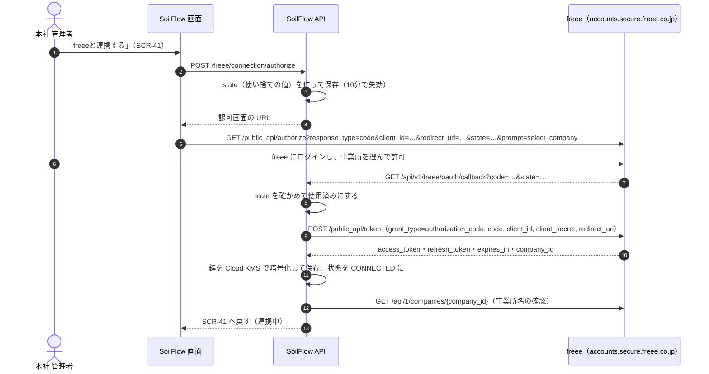
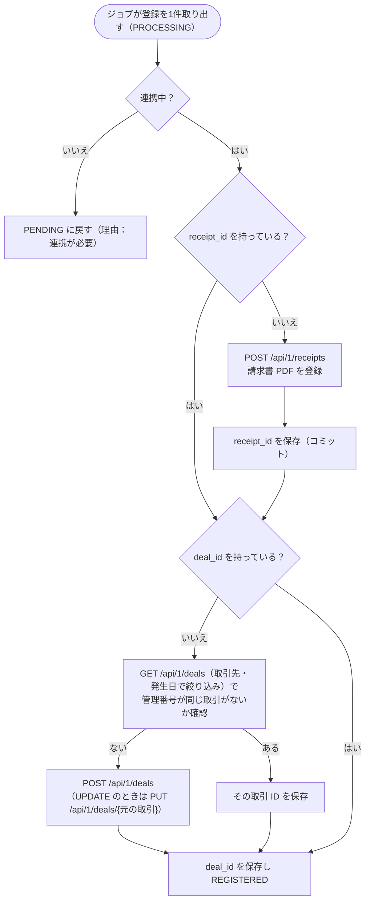

# 09 外部インターフェイス設計書

| 項目 | 内容 |
|---|---|
| 文書番号 | SF-DOC-09 |
| 版 | 1.0（2026-11-18） |
| 関連 | 02 要件定義書 7章（IF-01〜05）、FR-FRE、FR-MAL／freee会計連携 調査報告書 第2版 5章／11 計算仕様書 5章 |
| 注意 | freee の API の仕様は、freee が公開している API スキーマ（GitHub: freee/freee-api-schema、2026-11-16 更新分）と調査報告書によります。実装の前に、最新の公式リファレンスで項目名・必須・上限を確かめます（Q-38） |

## 1. つなぎ口の一覧

| ID | 相手 | 方式 | 方向 | 頻度 |
|---|---|---|---|---|
| IF-01 | freee会計 API | HTTPS（REST・JSON・multipart）、OAuth2.0 | SoilFlow → freee | 請求書1件につき2〜3回。月数十件 |
| IF-02 | メール送信サービス（SendGrid を想定。Q-25） | HTTPS（REST）、webhook | SoilFlow ⇔ メールサービス | 月数十通 |
| IF-03 | 複合機（印刷） | ブラウザの印刷機能 | 受付PC・本社PC → 複合機 | 1日数十枚 |
| IF-04 | 複合機（スキャン） | 複合機の PDF をファイルで本社PCへ、ブラウザから登録 | 複合機 → SoilFlow | 紙伝票のときだけ |
| IF-05 | サイン用タブレット | ブラウザ（画面の一つ） | ⇔ | 伝票ごと |

## 2. freee 側の準備（16 移行・導入計画書と同じ）

| No | 作業 | 担当 |
|---|---|---|
| 1 | freee のアプリ管理画面で「SoilFlow」アプリを作る（会社アプリ。リダイレクト URI：`https://<SoilFlow のドメイン>/api/v1/freee/oauth/callback`） | 当方（フジモト様の freee のアカウントで、または当方の開発者アカウントで作り、フジモト様の事業所で許可） |
| 2 | アプリの権限（スコープ）を最小にする：取引の参照・更新、ファイルボックスの参照・更新、取引先の参照・更新、勘定科目・税区分・品目・事業所の参照 | 当方 |
| 3 | クライアント ID・シークレットを Secret Manager に入れる | 当方 |
| 4 | 試験用の事業所（Q-37）で結合試験 | 当方 |
| 5 | フジモト様の管理者が本番の事業所で連携を許可（1月中、P18） | フジモト様 |

## 3. 連携の許可（OAuth2.0 の認可コードフロー）



| 項目 | 内容 |
|---|---|
| 認可画面 | `https://accounts.secure.freee.co.jp/public_api/authorize` |
| 鍵の発行・更新 | `https://accounts.secure.freee.co.jp/public_api/token` |
| 事業所の決め方 | `prompt=select_company` を付けると、許可した事業所1つだけを使える鍵が発行され、応答に `company_id` が入る。入っていなければ COMPANY_REQUIRED にして `GET /api/1/companies` から選ぶ（FR-FRE-02） |
| PKCE | freee の対応を公式に確認できたら `code_challenge`（S256）を付ける（Q-38）。それまではクライアントシークレットと state で守る |
| 失効の目安 | アクセストークン 6時間、リフレッシュトークン 90日・1回限り（第三者の解説による。Q-38）。応答の `expires_in` に従う |
| 鍵の更新 | 期限の5分前に更新する。90日の失効を防ぐため、使っていなくても毎日1回更新する。更新の応答の新しいリフレッシュトークンで必ず置き換える（古いものは使えなくなる） |
| 同時更新の防止 | 鍵の更新は `freee_connection` の行を `FOR UPDATE` でロックしてから行う（2つの処理が同じリフレッシュトークンを使うと、片方が失敗して再連携が必要になるため） |
| 更新に失敗 | 400・401 なら REAUTH_REQUIRED にして本社に知らせる（FR-FRE-05）。通信エラーなら次の分に再試行 |
| 解除 | 鍵を消して DISCONNECTED に。freee 側の連携の解除は freee の画面で行うよう案内する |

## 4. freee への登録

### 4.1 使う API

ベース URL は `https://api.freee.co.jp`。すべて `Authorization: Bearer <アクセストークン>` を付け、`company_id` を渡します。

| 用途 | メソッド・パス | 呼ぶとき |
|---|---|---|
| 事業所 | GET /api/1/companies、GET /api/1/companies/{id} | 連携許可のとき |
| 取引先 | GET /api/1/partners（keyword・offset・limit） | 対応付け（SCR-42） |
| 取引先の作成 | POST /api/1/partners | FR-FRE-07 |
| 勘定科目 | GET /api/1/account_items | 品目の対応付け（SCR-43） |
| 税区分 | GET /api/1/taxes/companies/{company_id}（旧 /api/1/taxes/codes は廃止予定のため使わない） | 品目の対応付け |
| 品目 | GET /api/1/items | 品目の対応付け |
| 証憑の登録 | POST /api/1/receipts（multipart/form-data） | 登録の手順1 |
| 取引の作成 | POST /api/1/deals | 登録の手順2 |
| 取引の参照 | GET /api/1/deals/{id}、GET /api/1/deals（partner_id・start_issue_date・end_issue_date） | 決済済みかの確認、二重登録の確認（4.4） |
| 取引の更新 | PUT /api/1/deals/{id} | 再発行（FR-FRE-19） |
| 取引の削除 | DELETE /api/1/deals/{id} | 取消（FR-FRE-18） |

### 4.2 登録待ちへの入れ方

メール送信に成功した請求書ごとに `freee_registrations` を作ります（CREATE、再発行なら UPDATE）。

```
freee と連携していない／再連携が必要        → PENDING（理由：連携が必要。連携後に自動で判定し直す）
請求先に freee の取引先が対応付いていない    → NEEDS_ACTION（理由：取引先が未対応付け）
明細の品目に勘定科目・税区分がない           → NEEDS_ACTION（理由：品目「…」の勘定科目が未設定）
明細が100行を超える                          → NEEDS_ACTION（理由：明細が多すぎる）
上のどれでもない かつ 登録のしかた＝AUTO      → QUEUED（すぐ登録の処理へ）
上のどれでもない かつ 登録のしかた＝REVIEW    → PENDING（本社の確認を待つ）
```

対応付けを直したら、NEEDS_ACTION の登録を自動で判定し直します。

### 4.3 取引先の自動照合（FR-FRE-06）

1. freee の取引先を全部取得する（100件ずつ）。
2. 名前を正規化する：前後の空白・全角空白を除き、全角英数を半角に、「株式会社」「(株)」「㈱」「有限会社」「(有)」「㈲」「合同会社」を取り除き、カタカナ・ひらがなを同一視する。
3. 正規化した名前が1件だけ一致 → AUTO（自動照合）。
4. 一致しないが、片方が他方を含む、または読みの違いが2文字以内 → CANDIDATE（候補・要確認）。候補を最大5件出す。
5. それ以外 → UNMAPPED（未対応付け）。
6. 取引先コードを使っている事業所（Q-16）は、コードの一致を名前より優先する。

### 4.4 登録の手順（冪等）



- 手順ごとに、freee が返した ID をすぐに保存してコミットします。途中で止まっても、やり直しでは保存済みの手順を飛ばします（PDF を二重に登録しない。FR-FRE-15）。
- 取引の作成の前に、取引の一覧を取引先と発生日で絞り込んで取得し、管理番号（請求書番号）が同じ取引がないか SoilFlow 側で確かめます（応答を受け取る前に通信が切れた場合でも、二重に作らない）。一覧の絞り込み条件は実装の前に公式リファレンスで確かめます（Q-38）。
- 1件ずつ処理し、1件ごとに `freee_api_logs` に記録します。

### 4.5 送る内容

**証憑の登録（POST /api/1/receipts）**

| freee の項目 | 値 |
|---|---|
| company_id | 事業所 ID |
| receipt | 請求書 PDF（お客さまに送ったもの。SHA-256 が `invoices.pdf_sha256` と一致することを確かめてから送る） |
| document_type | invoice |
| receipt_metadatum_partner_name | 請求先名 |
| receipt_metadatum_issue_date | 請求日 |
| receipt_metadatum_amount | 合計（税込） |
| description | `SoilFlow 請求書 SF-2602-001`（255文字以内） |

**取引の作成（POST /api/1/deals）**

| freee の項目 | 値 |
|---|---|
| company_id | 事業所 ID |
| type | income（収入） |
| issue_date | 請求日 |
| due_date | 入金期日 |
| partner_id | 対応付けた取引先 ID（取引先コードを使う設定なら partner_code） |
| ref_number | 請求書番号 |
| details[] | 11 計算仕様書 5章のまとめ方：account_item_id・tax_code・item_id（任意）・amount（税込）・vat（消費税額）・description（「2026年2月分 受入・納品（SoilFlow）」） |
| receipt_ids | [手順1の証憑 ID] |
| payments | 送らない（未決済＝売掛金） |

`amount` は税込、`vat` は11章のとおり配った税額です。freee の事業所が税抜経理か税込経理か（Q-18）で表示は変わりますが、取引の合計（税込）と消費税額は請求書と一致させます（AC-08）。

### 4.6 取消・再発行のとき

| 場合 | 処理 |
|---|---|
| 登録済の請求書を取消 | GET /api/1/deals/{id} で決済の状況を見る。未決済なら DELETE し、DELETED。決済済み（payments がある）なら変えずに NEEDS_ACTION（理由：freee で決済済み）。証憑は削除しない |
| 再発行した請求書の登録 | 元の請求書が登録済なら `update_target_deal_id` に元の取引を入れ、新しい PDF の証憑を登録してから PUT /api/1/deals/{元の取引}（明細・金額・管理番号・証憑を差し替え）。決済済みなら NEEDS_ACTION |
| 未登録の請求書を取消 | freee には何もしない。登録待ちから外す |

### 4.7 エラーと再試行

| freee の応答 | 扱い |
|---|---|
| 2xx | 成功 |
| 400（入力の誤り） | 再試行しない。ERROR にし、freee のエラーメッセージを理由に出す（例：取引先が見つからない、税区分が使えない） |
| 401 | 鍵を一度更新して1回だけやり直す。だめなら REAUTH_REQUIRED |
| 403（権限不足） | 再試行しない。ERROR（理由：freee のアプリの権限・プランを確認） |
| 403（呼び出しすぎ）・429 | 10分以上あけて再試行（freee は約10分で制限を解く） |
| 404（更新・削除の対象がない） | 削除なら成功とみなす。更新なら ERROR |
| 5xx・通信エラー・30秒の時間切れ | 1・5・15・60・180分後に再試行（最大5回）。それでもだめなら ERROR |

| freee の利用の上限（調査報告書 5.7） | SoilFlow の使い方 |
|---|---|
| 1日のAPI呼び出し 3,000回〜（プランにより 5,000・10,000回） | 1日最大で数百回（毎日の鍵の更新・対応付けの取得・月末の登録）。十分な余裕 |
| ファイルボックス 1ファイル 64MB、月 10GB、1分300ファイル | 請求書 PDF は1件 200KB 程度、月数十件 |
| ファイルボックスの月間アップロード数（プランごと） | Q-14 で確認 |

### 4.8 記録

`freee_api_logs` に、メソッド・パス・ステータス・処理時間・要求と応答の要約を残します。鍵・PDF の中身は残しません。要約は、取引 ID・証憑 ID・金額・エラーメッセージまでです。

## 5. メール送信（IF-02）

| 項目 | 内容 |
|---|---|
| サービス | SendGrid（Twilio）の Web API v3 を想定【設計案、Q-25】。フジモト様のドメインから送る場合は、送信ドメイン認証（SPF・DKIM・DMARC）の DNS 設定をフジモト様のドメインの管理者にお願いする |
| 送信 | `POST https://api.sendgrid.com/v3/mail/send`。添付は請求書 PDF（Base64）。`custom_args` に `mail_log_id` を入れる |
| 応答 | 202 なら受け付けられた（SENT）。4xx は送信エラー（SEND_ERROR、理由を表示）。5xx・通信エラーは 1・5・15・60分後に再試行 |
| 結果の受け取り | Event Webhook（`/api/v1/webhooks/mail-events`、署名を検証）。bounce・dropped を受け取ったら `mail_logs` を FAILED、請求書を SEND_ERROR にして本社の状況画面に出す |
| 件名・本文 | 設定のひな形に差し込む（`{company}` `{billing_party}` `{year}` `{month}` `{invoice_no}` `{total}` `{due_date}`）。初期値は `seed.sql` |
| 差出人 | 設定の送信元アドレス・表示名・返信先 |
| 添付ファイル名 | `請求書_<請求先名>_<年月>.pdf`（ファイル名に使えない文字は全角に置き換え） |
| 大きさ | 1通 1MB 以下（請求書 PDF は 200KB 程度） |
| 試験 | 開発・検証の環境では、宛先を試験用のアドレスに置き換えて送る（本物のお客さまに送らない） |

フジモト様の Google Workspace・Microsoft 365 から送る方式を望まれる場合は、Gmail API・Microsoft Graph に差し替えます（アダプタを替えるだけで、ほかは変わりません）。

## 6. 印刷（IF-03）

| 帳票 | 開き方 | 用紙・向き | 備考 |
|---|---|---|---|
| お客さま控え（RPT-02） | サインの確定後、受付PCで PDF を新しいタブで開き、印刷のダイアログを自動で出す | Q-10 で決める（設計案 A5 横） | 複合機を既定のプリンターにしておく |
| 受入日報（RPT-01） | SCR-13 の「印刷」 | A3 横（設計案） | |
| 紙伝票（RPT-04） | SCR-14 の「紙伝票で印刷」 | RPT-02 と同じ | |

- ブラウザの印刷の設定で「余白なし」「ヘッダーとフッターを付けない」「実際のサイズ」にします（16 移行・導入計画書のチェック表）。
- 複合機のドライバーは Windows 標準のものを使います。専用ソフトは入れません。

## 7. スキャン（IF-04）

| 項目 | 内容 |
|---|---|
| 複合機の設定 | PDF・300dpi・白黒（またはグレー）で、本社PCの共有フォルダ（またはメール）に送る |
| 登録 | 本社が SCR-32 で伝票を選び、PDF を選んで登録する（20MB まで） |
| 確認 | 登録した PDF を画面で表示し、伝票の内容と合っているかを本社が確かめる |

## 8. サイン用タブレット（IF-05）

| 項目 | 内容 |
|---|---|
| 画面 | SCR-20〜22（ブラウザ。ホーム画面に追加し、全画面で使う） |
| ログイン | 「サイン端末」の利用者でログインしたままにする（12時間で自動ログアウト、毎朝ログイン） |
| 伝票の受け取り | 2秒ごとに `GET /terminal/current-slip` |
| サイン | Canvas に指・ペンで書く。線の数と PNG（1200×400 まで）を送る |
| 誤操作の防止 | 戻る・再読み込みでサインが消えないよう、確定前の線は端末の中に一時的に持つ。ほかの画面へは移れない |
