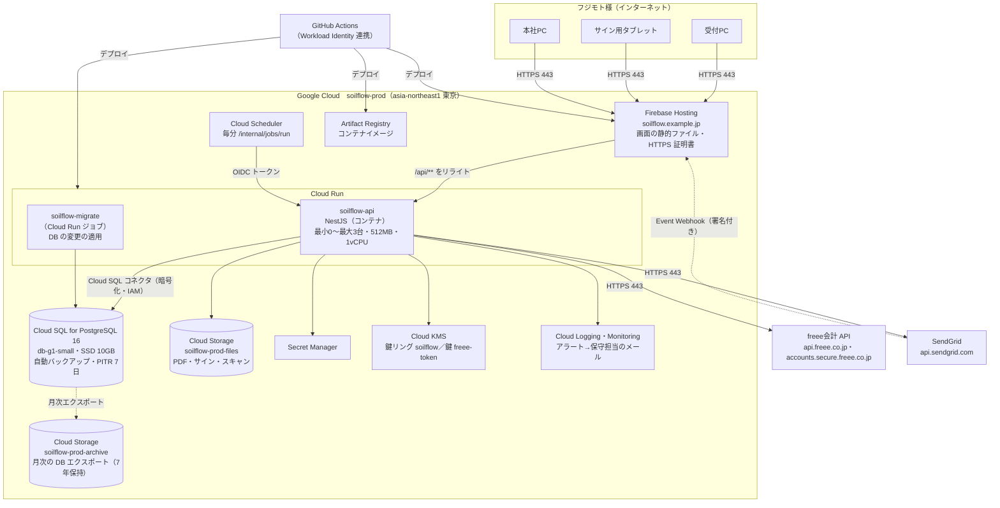
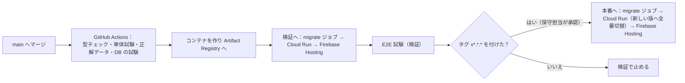

# 12 環境・インフラ・ネットワーク設計書

| 項目 | 内容 |
|---|---|
| 文書番号 | SF-DOC-12 |
| 版 | 1.0（2026-11-18） |
| 関連 | 04 基本設計書 1章、13 セキュリティ設計書、17 運用・保守手順書、NFR-05〜08・23 |
| 注意 | 料金は 2026年時点の公開価格をもとにした目安（1ドル＝150円）です。構築の前に Google Cloud の料金計算ツールで確かめます |

## 1. 環境

| 環境 | 用途 | GCP プロジェクト | データ | 利用者 |
|---|---|---|---|---|
| ローカル | 開発者の PC での開発・単体試験 | ― | Docker の PostgreSQL 16、試験データ | 開発者 |
| 検証（stg） | 結合試験・freee の試験用事業所との試験・お客さまの受入試験・並行稼働の前の確認 | `soilflow-stg` | 試験データ、移行リハーサルのデータ | 開発者・お客さま |
| 本番（prod） | 本稼働 | `soilflow-prod` | 本番データ | お客さま |

- 検証と本番は GCP のプロジェクトを分け、権限・データ・鍵が混ざらないようにします。
- 検証のメール送信は、宛先を試験用のアドレスに置き換えます（09 5章）。検証の freee は試験用の事業所にだけ連携します（Q-37）。
- GCP の契約者（請求先）は【回答待ち Q-33】です。

## 2. 構成

### 2.1 構成図

### 2.2 サービスごとの設定

| サービス | 設定 | 理由 |
|---|---|---|
| Firebase Hosting | 独自ドメイン（例：`soilflow.<フジモト様のドメイン>`、Q-33）。`/api/**` を Cloud Run `soilflow-api` へリライト。それ以外は静的ファイル（Next.js の静的出力） | 04 1.2。HTTPS 証明書は自動で更新 |
| Cloud Run `soilflow-api` | リージョン asia-northeast1、最小インスタンス 0（営業時間 7:00〜18:00 は 1）、最大 3、CPU 1、メモリ 512MB、同時リクエスト 40、タイムアウト 60秒、実行のサービスアカウント `sa-api` | 営業時間の最初のクリックで起動待ちを出さない（NFR-01）。夜間は0台で費用を抑える |
| Cloud Run ジョブ `soilflow-migrate` | デプロイの前に DB の変更（マイグレーション）を適用 | 07 DB設計書 |
| Cloud SQL | PostgreSQL 16、db-g1-small（共有コア 1.7GB）、SSD 10GB（自動拡張）、ゾーン1つ、自動バックアップ（毎日 3:00、7世代）、ポイントインタイムリカバリ（7日）、メンテナンスの時間 日曜 4:00、パブリック IP なし＋Cloud SQL コネクタ、`cloudsql.iam_authentication` 有効 | NFR-08。小規模（同時10人、便 年7.5万件）に十分 |
| Cloud Storage `soilflow-prod-files` | 標準クラス、東京、バージョニング有効、`slips/`・`invoices/` に保持ポリシー 7年（ロックは本稼働後に確定）、1年後に Nearline へ移す | 02 6.2・6.3（消せない・書き換えられない） |
| Cloud Storage `soilflow-prod-archive` | Archive クラス、保持ポリシー 7年 | DB の月次エクスポートの長期保管 |
| Secret Manager | `freee-client-id`、`freee-client-secret`、`sendgrid-api-key`、`sendgrid-webhook-public-key`、`session-secret`、`db-password`（IAM 認証にできない場合） | 13 セキュリティ設計書 |
| Cloud KMS | 鍵リング `soilflow`、鍵 `freee-token`（対称、90日ごとに自動で新しい版） | NFR-14 |
| Cloud Scheduler | `jobs-every-minute`（* * * * *、POST /api/v1/internal/jobs/run、OIDC：`sa-scheduler`）、`token-refresh-daily`（0 2 * * *）、`cleanup-daily`（30 2 * * *）、`db-export-monthly`（0 3 1 * *） | 04 3.4 |
| Artifact Registry | `asia-northeast1-docker.pkg.dev/soilflow-prod/soilflow` | |
| Cloud Logging | 保存 30日（既定）。操作履歴は DB に7年 | |
| Cloud Monitoring | 稼働確認（`/api/v1/healthz` を5分ごと、東京・大阪から）、5xx・応答時間・ジョブの失敗・Cloud SQL の使用率のアラート | 04 7章 |

### 2.3 サービスアカウント（最小の権限）

| サービスアカウント | 使うもの | 主な権限 |
|---|---|---|
| `sa-api` | Cloud Run `soilflow-api` | Cloud SQL クライアント、Cloud SQL インスタンスユーザー、ストレージ オブジェクト作成者・閲覧者（files バケットだけ）、Secret Manager のシークレットアクセサー（必要なシークレットだけ）、KMS 暗号鍵の暗号化・復号（`freee-token` だけ）、署名付き URL のための サービスアカウント トークン作成者（自分自身） |
| `sa-migrate` | Cloud Run ジョブ | Cloud SQL クライアント・インスタンスユーザー（DB の所有者ロール） |
| `sa-scheduler` | Cloud Scheduler | Cloud Run 起動元（`soilflow-api` だけ） |
| `sa-deploy` | GitHub Actions（Workload Identity 連携、`main` ブランチとタグだけ） | Cloud Run 管理者、Artifact Registry 書き込み、Firebase Hosting 管理者、サービスアカウント ユーザー |
| `sa-export` | DB の月次エクスポート | Cloud SQL 閲覧者（エクスポート）、archive バケットへの書き込み |

鍵ファイル（JSON キー）は作りません。開発者の個人アカウントには本番の閲覧だけを付け、変更は GitHub Actions を通します。

## 3. ネットワーク

| 通信 | 経路 | プロトコル | 守り |
|---|---|---|---|
| 端末 → 画面・API | インターネット → Firebase Hosting（Google のエッジ） → Cloud Run | HTTPS（TLS 1.2 以上）、HSTS | Cookie（HttpOnly・Secure・SameSite=Lax）、CSRF トークン |
| Cloud Run → Cloud SQL | Google 内部（Cloud SQL コネクタ） | TLS、IAM 認証 | DB のパブリック IP なし |
| Cloud Run → Cloud Storage・Secret Manager・KMS | Google 内部 | HTTPS | IAM |
| Cloud Run → freee・SendGrid | インターネット（Cloud Run の外向き通信） | HTTPS | API の鍵は Secret Manager・KMS |
| SendGrid → Webhook | インターネット → Firebase Hosting → Cloud Run | HTTPS | 署名の検証（ECDSA） |
| Cloud Scheduler → Cloud Run | Google 内部 | HTTPS | OIDC トークン（`sa-scheduler`）の検証 |

- 受付・本社のネットワークに特別な設定（固定 IP・VPN）は要りません。一般的なインターネット回線で使えます。
- 受付の回線が切れたときの業務継続は 02 BR-13（紙に戻す）です。モバイル回線（スマートフォンのテザリング）を予備にすることを推奨します。
- 外向きの通信の固定 IP は不要です（freee・SendGrid は送信元 IP を制限しない）。

## 4. 端末の要件

| 端末 | 要件 |
|---|---|
| 受付PC・本社PC | Windows 10/11、Chrome または Edge の最新版、画面 1920×1080 推奨、既定のプリンター＝複合機（09 6章） |
| サイン用タブレット | 10〜11インチ、ペンまたは指で書ける、Chrome（Android）または Safari（iPad）の最新版、Wi-Fi（Q-11） |
| 複合機 | Windows から印刷できること（A3・A4・A5）、PDF でスキャンして本社PCへ渡せること |
| 回線 | 下り 10Mbps 以上（PDF の表示に必要。日報の記入だけなら 1Mbps で足りる） |

## 5. バックアップと復旧

| 対象 | 方法 | 保持 | 復旧 |
|---|---|---|---|
| データベース | Cloud SQL の自動バックアップ（毎日） | 7世代 | 新しいインスタンスへ復元 |
| データベース | ポイントインタイムリカバリ（トランザクションログ） | 7日 | 指定した時刻の状態へ復元（RPO 5分） |
| データベース | 月次のエクスポート（SQL ダンプ）を archive バケットへ | 7年 | 新しいインスタンスに取り込む |
| ファイル（PDF・サイン・スキャン） | Cloud Storage のバージョニング＋保持ポリシー | 7年 | 前の版を戻す |
| 設定（インフラ） | Terraform のコード（Git） | ― | `terraform apply` で作り直す |
| アプリ | コンテナイメージ（Artifact Registry）とタグ | 直近10版 | 前の版のイメージで Cloud Run を戻す |

復旧の手順は「17 運用・保守手順書」4章です。復旧の目標は RTO 4時間・RPO 5分（NFR-08）。年1回、検証の環境で復元の練習をします。

## 6. 費用の目安（本番・月額）

| サービス | 目安 | 備考 |
|---|---|---|
| Cloud SQL（db-g1-small・SSD 10GB・バックアップ） | 約 4,000円 | 最も大きい費用。小さくする場合は db-f1-micro（約 1,500円。SLA なし） |
| Cloud Run（営業時間 1台＋夜間 0台） | 約 1,000〜2,000円 | 最小インスタンスを0にすると数百円 |
| Firebase Hosting・Cloud Storage・KMS・Secret Manager・Scheduler・Logging | 約 200〜500円 | ほとんどが無料枠 |
| SendGrid | 0円 | 無料プラン（1日100通）で足りる見込み。不足なら有料プラン |
| 合計 | 約 5,000〜7,000円 | 提案書 P20「月数千円程度」の範囲。検証の環境は使うときだけ立ち上げて月 1,000円程度 |

費用をさらに抑える場合は、Cloud SQL を db-f1-micro にし、Cloud Run の最小インスタンスを0にすると、本番で月 2,500〜3,500円程度です（起動に数秒かかる場合があり、SLA はありません）。どちらにするかは【回答待ち Q-33】でお客さまと決めます。

## 7. インフラのコード化

- GCP の設定は `infra/`（Terraform）に書きます。環境ごとの値は `infra/envs/stg.tfvars`・`prod.tfvars`。
- Terraform の状態ファイルは各プロジェクトの Cloud Storage（`soilflow-<env>-tfstate`、バージョニング有効）に置きます。
- 手作業で設定を変えたときは、必ず Terraform に反映します（ずれを月1回 `terraform plan` で確認）。

## 8. デプロイ

- 本番へのデプロイは営業時間外（18時以降・休日）に行います（NFR-05）。
- DB の変更は「前の版のアプリでも動く」形で先に入れます（列の追加は先、削除は後の版で）。
- 問題があれば、Cloud Run を前の版に戻します（数十秒）。DB の変更を戻す必要がある場合は 17 4章。
