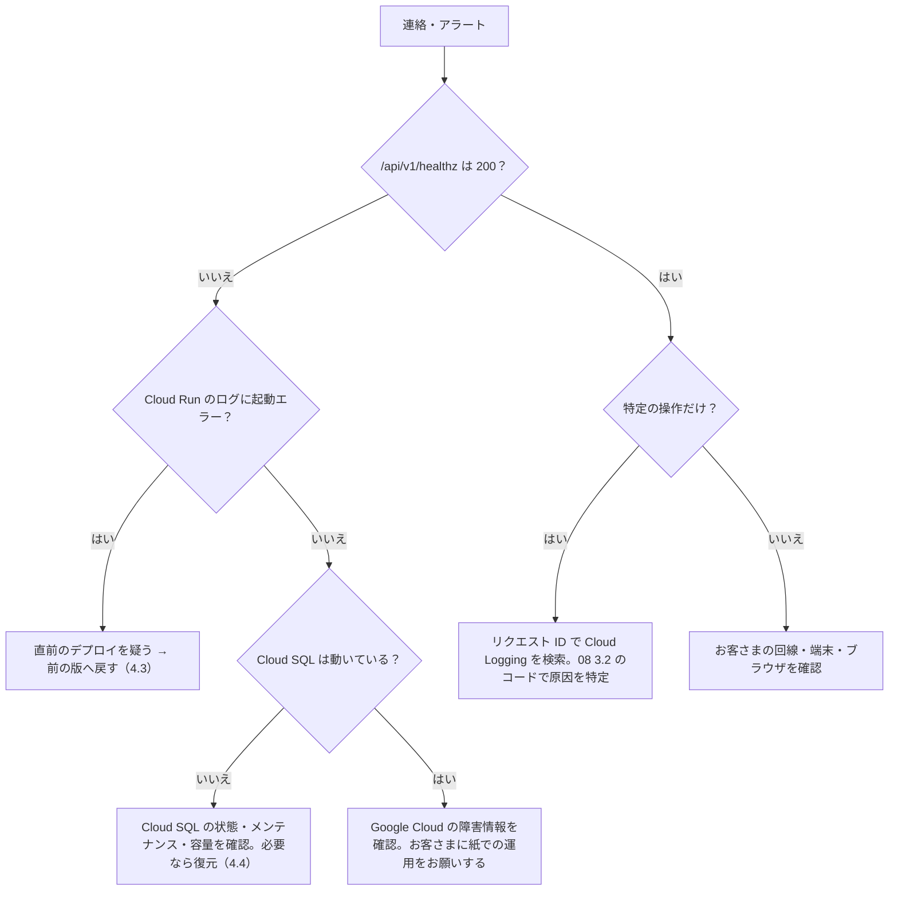

# 17 運用・保守手順書

| 項目 | 内容 |
|---|---|
| 文書番号 | SF-DOC-17 |
| 版 | 1.0（2026-11-18。本稼働の前に 1.1 で手順を実機に合わせる） |
| 関連 | 提案書 P20（瑕疵保証・保守）、12 環境・インフラ・ネットワーク設計書、13 セキュリティ設計書、16 移行・導入計画書 |

## 1. 保守の範囲（提案書 P20）

| 期間 | 内容 | 費用 |
|---|---|---|
| 瑕疵保証 | 本稼働開始日から3か月。合意した仕様と違う動作など、設計・開発に原因がある再現できる不具合の調査と修正 | 無償 |
| 保守 | 保証の終了の翌日から33か月。操作の問い合わせ、障害の受付・一次の切り分け、復旧の方法の案内、既存の機能の軽微な設定変更・修正、freee 連携のエラー対応・再連携の支援 | 月額 5,000円（Q-28） |
| 対象外（別途見積り） | 機能の追加・仕様の変更、帳票の大幅な変更、大量のデータの修正、利用者の誤操作・端末の故障、クラウド・freee などの外部サービスの障害、OS・ブラウザ・freee API などの大幅な仕様変更に伴う改修 | ― |

### 1.1 受付と対応の目安【設計案】

| 項目 | 目安 |
|---|---|
| 受付の方法 | メール（保守担当のアドレス）、急ぎは電話 |
| 受付の時間 | 平日 9:00〜17:00 |
| 最初の回答 | 受付から翌営業日まで。業務が止まる障害は当日中に連絡 |
| 業務が止まる障害の目安 | 4時間以内の復旧を目指す（NFR-08）。その間は紙に戻して業務を続けていただく |

## 2. ふだんの運用

### 2.1 毎日

| 時刻 | 誰が | 作業 |
|---|---|---|
| 朝 | 受付 | 受付PC・タブレットで SoilFlow にログイン（タブレットはサイン端末）。必要なら「前日の行を引き継ぐ」 |
| 日中 | 受付 | 日報の記入、伝票の発行とサイン |
| 夕方 | 受付 | 伝票一覧で伝票未発行の便がないかを確かめる。必要なら日報を印刷 |
| 夕方 | 本社 | 状況画面で、サイン待ち・紙伝票の未登録・送信エラー・freee の要対応を確かめる。紙伝票があればスキャンを登録 |
| 自動 | SoilFlow | 毎分のジョブ（PDF・メール・freee の再試行）、2時に freee の鍵の更新、2時半に掃除 |

### 2.2 月末・月初（締め）

| 手順 | 画面 | 内容 |
|---|---|---|
| 1 | SCR-34 | 対象月を選び、締めの前の確認の警告を見る。伝票未発行・サイン待ち・単価なし・送付先なしを片付ける |
| 2 | SCR-34 | 「締めを実行」。20日締めの請求先は20日を過ぎてから |
| 3 | SCR-35 | 請求書ごとに明細を確かめる（台数を押すと元の便と伝票）。直したら「作り直す」。よければ「確認済にする」 |
| 4 | SCR-34・36 | 確認済を選んで「選択分をメール送信」。宛先・添付を確かめて送信 |
| 5 | SCR-34 | 送信エラーがあれば、請求先のメールアドレスを直して再送 |
| 6 | SCR-40 | 管理者が「登録待ち」を選び、送る内容を確かめて「freee へ登録」。要対応は理由のボタンから直す |
| 7 | freee | 入金は従来どおり「自動で経理」で消込 |

### 2.3 価格の改定

1. SCR-56 で「新しい単価表を作る」（今の表を写す）。適用開始日を改定の日にする。
2. 改定する金額を直して保存する（参考値との違いが色で出る）。
3. 適用開始日の前日までに本社で確かめる。開始日以降の便から新しい単価になる。
4. 送信済の請求書に使われた単価表は直せない（間違えたら新しい表を作る）。

### 2.4 利用者・端末

| 場面 | 作業 |
|---|---|
| 人が増えた・辞めた | 管理者が SCR-60 で追加・無効化 |
| パスワードを忘れた・ロックされた | 管理者がパスワードを初期化して仮のパスワードを手渡す |
| タブレットが壊れた | 予備タブレットに切り替え（受付の利用者の「対のサイン端末」を予備に）。予備もなければ紙伝票 |
| タブレットをなくした | 管理者がそのサイン端末の利用者を無効にする |

## 3. 困ったとき（業務側）

| 事象 | 業務での対応 | 復旧後 |
|---|---|---|
| インターネットがつながらない（受付） | 紙の日報・紙伝票に戻す。テザリングを試す | 受付が紙の内容を画面に入力（過去の時間帯のマスに分を指定）。紙伝票は本社でスキャンを登録 |
| SoilFlow が開かない・エラーが続く | 同上。保守担当に連絡（画面の写真、時刻、操作） | 同上 |
| タブレットが動かない | 予備タブレット → 紙伝票 | 紙伝票のスキャンを登録 |
| 請求書の送信エラー | 理由（宛先不明など）を見て、請求先のメールを直して再送 | ― |
| freee の「再連携が必要」 | freee の管理者が SCR-41 で再び許可 | 登録待ちをまとめて登録 |
| freee の要対応（決済済み） | 請求書を取り消したが freee で消込済み → freee 側で取引を直す（経理の方） | ― |
| 送った請求書に誤り | 取消して再発行（SCR-35）。freee 登録済なら元の取引が更新される | 新しい請求書を送る |

## 4. 困ったとき（保守担当）

### 4.1 障害の切り分け

### 4.2 ジョブの失敗

| ジョブ | 確認 | 対応 |
|---|---|---|
| MAIL_SEND | 請求書の送信履歴のエラー | 宛先の誤りならお客さまに連絡。SendGrid の障害なら回復後に再送 |
| FREEE_REGISTER・DELETE | SCR-40 のエラーの理由、SCR-44 の記録 | 400 系：内容（取引先・税区分）を直して再登録。5xx：freee の障害情報を確認し再登録 |
| FREEE_TOKEN_REFRESH | freee_connection.status | REAUTH_REQUIRED ならお客さまに再連携を依頼 |
| PDF_* | jobs.last_error | フォント・データの不正を確認して再実行 |

### 4.3 前の版に戻す

1. Cloud Run の「リビジョン」で直前の正常な版にトラフィックを100%戻す（`gcloud run services update-traffic soilflow-api --to-revisions=<版>=100`）。
2. 画面（Firebase Hosting）も前のリリースに戻す（`firebase hosting:rollback` または管理画面）。
3. DB の変更を含むリリースの場合、DB の変更は「前の版のアプリでも動く」形で入れてあるため、戻さない（12 8章）。どうしても戻す場合は 4.4。

### 4.4 データの復元

| 場面 | 手順 |
|---|---|
| 誤った操作でデータを壊した（数時間以内） | 1. 新しいインスタンスに、壊れる前の時刻へポイントインタイムリカバリ（`gcloud sql instances clone soilflow-prod soilflow-restore --point-in-time=…`）。2. 必要な行だけを比べて戻す（本番の DB を丸ごと置き換えない）。3. 操作履歴に記録 |
| DB が使えない | 1. 最新のバックアップから新しいインスタンスへ復元。2. Cloud Run の接続先を切り替え。3. バックアップ以降の記録は、お客さまの紙の記録から入力し直す |
| ファイルを消した・上書きした | Cloud Storage の前の版を戻す（保持ポリシーで消えていない） |

### 4.5 本番の DB に直接つなぐとき

緊急時だけ、保守担当がお客さまの了承を得て行います。

1. 作業の目的と SQL を事前に書き、お客さまに連絡。
2. 一時的に権限を付け（IAM の条件付きで2時間）、Cloud SQL Studio から接続。
3. 更新は1つのトランザクションで行い、件数を確かめてからコミット。
4. 実施内容を `audit_logs` に保守担当の名前で記録し、権限を外す。

## 5. セキュリティの事故

13 セキュリティ設計書 10章の最初の対応のあと、次を行います。

1. 影響の範囲（期間・データ・利用者）を操作履歴とログで調べる。
2. お客さまに報告し、対応を相談する（個人情報が関わる場合は法令に従って報告・通知）。
3. 原因を直し、再発の防止を台帳（CHG）に記録する。

## 6. 定期の作業

| 頻度 | 作業 |
|---|---|
| 毎週 | 依存ライブラリの脆弱性の確認（Dependabot・pnpm audit） |
| 毎月 | 費用の確認、`terraform plan` で設定のずれ、DB の容量・遅いクエリ、freee の開発者向けのお知らせ（API の変更）の確認 |
| 3か月ごと | 利用者の棚卸し（辞めた人の無効化）をお客さまに依頼 |
| 毎年 | 復元の練習（検証の環境）、セッションの署名鍵の更新、Node.js・PostgreSQL のサポート期限の確認 |
| 随時 | freee API の仕様変更への追随（軽微なものは保守内。大幅なものは別途見積り） |
