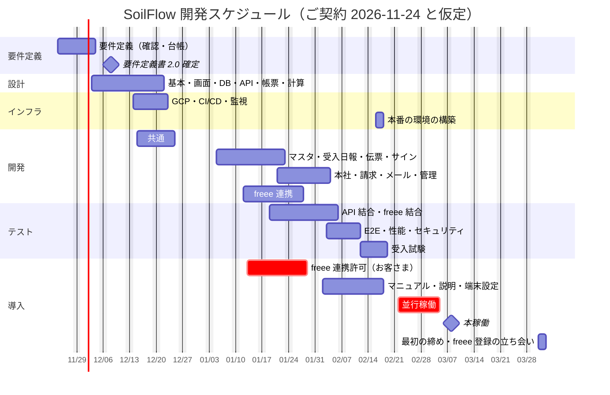

# 18 WBS・開発スケジュール

| 項目 | 内容 |
|---|---|
| 文書番号 | SF-DOC-18 |
| 版 | 1.0（2026-11-18。ご契約日が決まったら日付を確定） |
| 関連 | 提案書 P18（スケジュール）・P19（見積）、15 テスト計画書、16 移行・導入計画書 |
| 前提 | ご契約・着手を 2026年11月24日と仮定。2月中に完成、3月上旬に本稼働（D-16）。年末年始（12/29〜1/3）は作業しない |

## 1. 工数（提案書 P19 と同じ）

| 工程 | 本体 | freee 連携 | 合計 |
|---|---|---|---|
| 要件定義 | 6人日 | 1人日 | 7人日 |
| 基本・UI・データ設計 | 14人日 | 2人日 | 16人日 |
| システム開発 | 54人日 | 10人日 | 64人日 |
| クラウドインフラ環境構築 | 6人日 | ― | 6人日 |
| 単体・結合テスト | 10人日 | 3人日 | 13人日 |
| 導入・操作マニュアル作成・並行稼働支援 | 4人日 | 1人日 | 5人日 |
| プロジェクト管理・調整 | 7人日 | 1人日 | 8人日 |
| 合計 | 101人日 | 18人日 | 119人日（約6.0人月） |

### 1.1 体制【設計案】

| 役割 | 担当 | 主な作業 |
|---|---|---|
| プロジェクト管理・要件定義・設計・freee 連携 | 有馬 | 1・2・4.9〜4.12・7 |
| 開発・テスト | 開発担当（1名） | 3・4.1〜4.8・5 |
| お客さまの窓口 | フジモト様（受付・本社・freee の管理者）、NINE様 | 資料の提供・確認・受入試験 |

119人日を約3か月半（営業日 約70日）で行うため、2名で並行して進めます。

## 2. WBS

| ID | 作業 | 工数 | 期間 | 成果物 | 関係する資料 |
|---|---|---|---|---|---|
| **1** | **要件定義** | **7** | 11/24〜12/8 | | |
| 1.1 | キックオフ、資料の受け取り（日報・伝票・請求書の見本、マスタ） | 1 | 11/24〜11/26 | 議事録 | Q-07・Q-10・Q-23 |
| 1.2 | 受付の方への確認（日報の書き方・印・伝票の単位）、試作画面での確認 | 2 | 11/26〜12/2 | 台帳の回答 | Q-01〜Q-05・Q-10〜Q-13・Q-26・Q-30・Q-31 |
| 1.3 | 請求・締め・税・現金のお客さまの確認 | 1 | 11/30〜12/3 | 台帳の回答 | Q-06〜Q-09・Q-29・Q-35・Q-36 |
| 1.4 | freee 側の設定の確認（freee 連携） | 1 | 12/1〜12/4 | 台帳の回答 | Q-14〜Q-21・Q-37 |
| 1.5 | 要件定義書 2.0 の確定・ご承認 | 2 | 12/3〜12/8 | 02 要件定義書 2.0 | 02 |
| **2** | **基本・UI・データ設計** | **16** | 12/3〜12/22 | | |
| 2.1 | 基本設計（回答の反映） | 3 | 12/3〜12/9 | 04 1.1 | 04 |
| 2.2 | 画面設計・試作画面の修正とご確認 | 4 | 12/7〜12/16 | 05・06 1.1 | 05・06 |
| 2.3 | DB 設計 | 2 | 12/9〜12/11 | 07・schema.sql 1.1 | 07 |
| 2.4 | API・外部インターフェイス設計（うち freee 2） | 3 | 12/10〜12/15 | 08・09・openapi.yaml 1.1 | 08・09 |
| 2.5 | 帳票・計算の設計、正解データに実際の請求書を追加 | 3 | 12/14〜12/18 | 10・11・billing-golden.json 1.1 | 10・11 |
| 2.6 | 設計のレビュー | 1 | 12/21〜12/22 | レビュー記録 | |
| **3** | **クラウドインフラ環境構築** | **6** | 12/14〜12/23、2/16〜2/18 | | |
| 3.1 | GCP プロジェクト（検証・本番）、Terraform | 2 | 12/14〜12/16 | infra/ | 12 |
| 3.2 | CI/CD（GitHub Actions・Workload Identity） | 1.5 | 12/16〜12/18 | .github/workflows | 12 8章 |
| 3.3 | 監視・アラート・バックアップ・月次エクスポート | 1 | 12/21〜12/22 | | 12 2.2・5章 |
| 3.4 | ドメイン・HTTPS・メールの送信ドメインの DNS | 0.5 | 12/23 | | Q-25・Q-33 |
| 3.5 | 本番の環境の構築と確認 | 1 | 2/16〜2/18 | | 16 7章 |
| **4** | **システム開発** | **64** | 12/15〜2/6 | | |
| 4.1 | 共通（認証・2段階の確認・権限・CSRF・操作履歴・ジョブ・PDF の土台・エラーの変換） | 8 | 12/15〜12/25 | | 04・13 |
| 4.2 | マスタ（客先〜印、CSV 一括登録、単価表と参考値） | 7 | 1/5〜1/13 | SCR-50〜57 | FR-MST |
| 4.3 | 受入日報（日報・行・便・車列・印・引継ぎ・変更分の取得・印刷） | 12 | 1/5〜1/20 | SCR-10〜13 | FR-RCV |
| 4.4 | 伝票・電子サイン（発行・タブレット・控え・紙伝票・取消） | 8 | 1/14〜1/23 | SCR-14・15・20〜22 | FR-SLP・FR-SGN |
| 4.5 | 本社（状況・日報・伝票・スキャン登録・集計・CSV/Excel） | 5 | 1/21〜1/27 | SCR-30〜33 | FR-AGG |
| 4.6 | 請求（締めの前の確認・締め・作り直し・確認・取消・再発行・請求書 PDF・検索） | 8 | 1/22〜2/2 | SCR-34・35 | FR-BIL |
| 4.7 | メール送信（確認・送信・再送・不達の Webhook） | 3 | 1/28〜2/2 | SCR-36 | FR-MAL |
| 4.8 | 利用者管理・操作履歴・設定 | 3 | 2/2〜2/4 | SCR-60〜62 | FR-CMN |
| 4.9 | freee：連携許可・鍵の暗号化と更新・解除 | 2.5 | 1/12〜1/15 | SCR-41 | FR-FRE-01〜05 |
| 4.10 | freee：取引先・品目の対応付け、自動照合、取引先の作成 | 2 | 1/15〜1/19 | SCR-42・43 | FR-FRE-06〜08 |
| 4.11 | freee：登録待ち・プレビュー・登録の処理（冪等・再試行）・自動登録 | 3.5 | 1/19〜1/23 | SCR-40 | FR-FRE-09〜17 |
| 4.12 | freee：取消・再発行・決済済みの判定・履歴 | 2 | 1/26〜1/28 | SCR-44 | FR-FRE-18〜21 |
| **5** | **単体・結合テスト**（単体試験は 4 の中で行う） | **13** | 1/19〜2/19 | | |
| 5.1 | API 結合試験（権限の全組合せを含む） | 3 | 1/19〜2/5 | 試験の記録 | 15 2.3 |
| 5.2 | freee 結合試験（試験用事業所） | 3 | 1/26〜2/6 | 試験の記録・freee の画面の写し | 15 2.4 |
| 5.3 | E2E 試験 | 2.5 | 2/3〜2/9 | | 15 2.5 |
| 5.4 | 性能試験（10年分の試験データ） | 1.5 | 2/6〜2/10 | | 15 2.6 |
| 5.5 | セキュリティ試験 | 1.5 | 2/9〜2/12 | | 15 2.7 |
| 5.6 | 受入試験の支援 | 1.5 | 2/12〜2/19 | 受入試験の記録 | 15 3章 |
| **6** | **導入・操作マニュアル作成・並行稼働支援** | **5** | 1/6〜3/5 | | |
| 6.1 | マスタの初期登録（検証・本番） | 1 | 1/6〜1/9、2/18 | | 16 2・3章 |
| 6.2 | 操作マニュアル（受付編・本社編・管理者編） | 1.5 | 2/2〜2/10 | 操作マニュアル | 16 6章 |
| 6.3 | 操作の説明、端末・複合機の設定 | 0.5 | 2/16〜2/18 | | 16 4・6章 |
| 6.4 | 並行稼働の支援・本稼働の判断 | 1 | 2/22〜3/5 | 照合の記録 | 15 4章 |
| 6.5 | freee の初期の対応付けの支援（freee 連携） | 1 | 2/16〜2/19 | | 16 5章 |
| **7** | **プロジェクト管理・調整** | **8** | 11/24〜3/12 | 週次の報告・台帳 | 19 |
| | **合計** | **119** | | | |

## 3. スケジュール

## 4. 節目

| 節目 | 日付（予定） | 判断する人 | 条件 |
|---|---|---|---|
| 要件定義の完了 | 12/8 | フジモト様・NINE様 | 要件定義書 2.0 のご承認。高の未決事項が解決 |
| 設計の完了 | 12/22 | 当方 | 設計のレビューの指摘が解決、試作画面 1.1 のご確認 |
| 開発の完了 | 2/6 | 当方 | 全画面が動く、単体・結合試験の終わりの条件 |
| 受入試験の完了 | 2/19 | フジモト様 | AC-01〜16 |
| 本稼働の判断 | 3/5 | フジモト様・当方 | 並行稼働の判断の条件（15 4章） |
| 本稼働 | 3/8（月） | ― | 紙の日報をやめる |
| 瑕疵保証の終わり | 6/7 | ― | 本稼働から3か月（P20） |

## 5. お客さまにお願いすること（期限）

| 項目 | 期限 | 台帳 |
|---|---|---|
| 日報・伝票・請求書の見本、価格の使い方の回答 | 12/2 | Q-01〜Q-10 |
| 現金のお客さまの有無、締め日・支払条件 | 12/3 | Q-08・Q-29 |
| freee の契約プラン・管理者・勘定科目・税区分など | 12/4 | Q-14〜Q-21 |
| マスタの資料（客先・現場・請求先・車番・メール） | 12/18 | Q-22・Q-23 |
| freee の試験用事業所の可否 | 12/18 | Q-37 |
| 本番の freee の連携許可 | 1月中 | P18 |
| サイン用タブレット（本体・予備）の購入 | 2/12 | Q-11・Q-32 |
| 受入試験の実施 | 2/12〜2/19 | 15 3章 |
| 並行稼働（紙と画面の二重記録） | 2/22〜3/5 | 15 4章 |

期限に間に合わない場合は、影響（後ろの作業の遅れ）を当方からお知らせし、台帳に記録します。

## 6. リスク

| リスク | 影響 | 対策 |
|---|---|---|
| 要件定義の回答（特に Q-01・Q-02・Q-10）が遅れる | 設計・開発の手戻り | 試作画面で早く確認していただく。回答待ちの間は設計案で進め、差分を CHG で管理 |
| freee の連携許可・試験用事業所の準備が遅れる | freee 結合試験が遅れる | 1月中を期限としてお願い。遅れたら freee の結合試験を本稼働後に回し、最初の締めは「確認してから登録」で慎重に |
| 受付の方の慣れ | 並行稼働の延長 | 受入試験で実際に記入していただく。並行稼働を最大2週間 |
| 端末・回線の準備の遅れ | 並行稼働の開始の遅れ | タブレットの購入を2月中旬までに。回線の予備（テザリング） |
| 119人日を2名で約3.5か月 | 遅れ | 週次で進み具合を確認。遅れはプロジェクト管理で早めにお知らせ |
