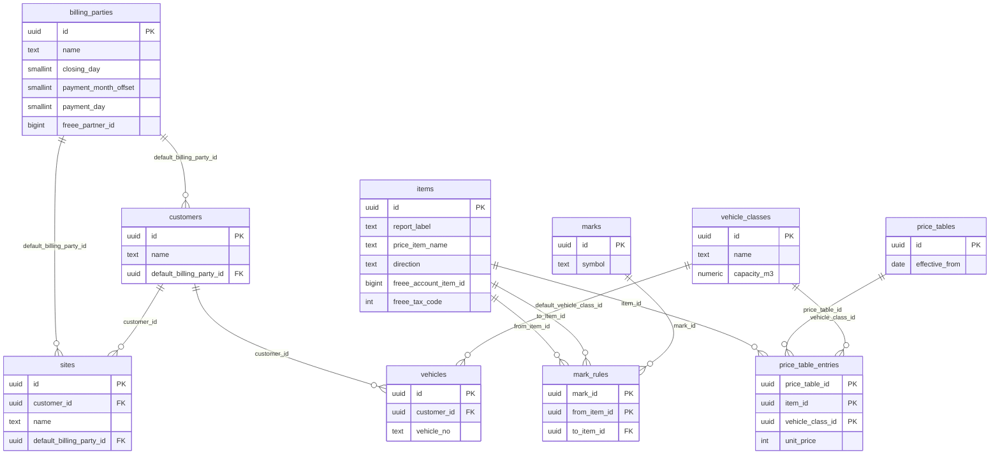
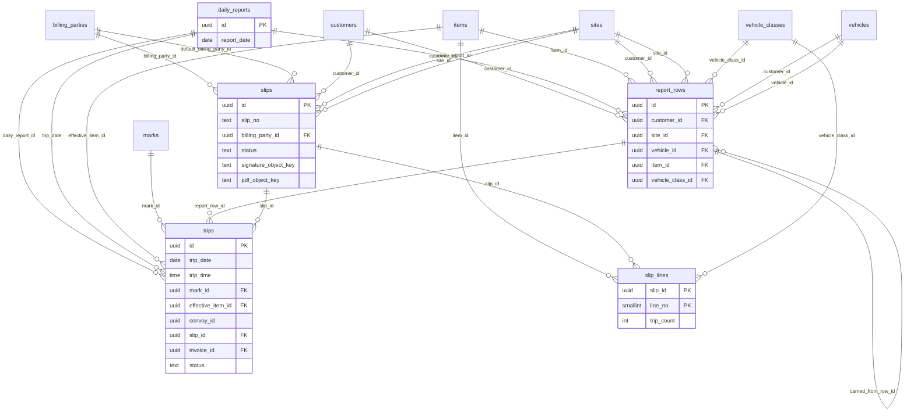
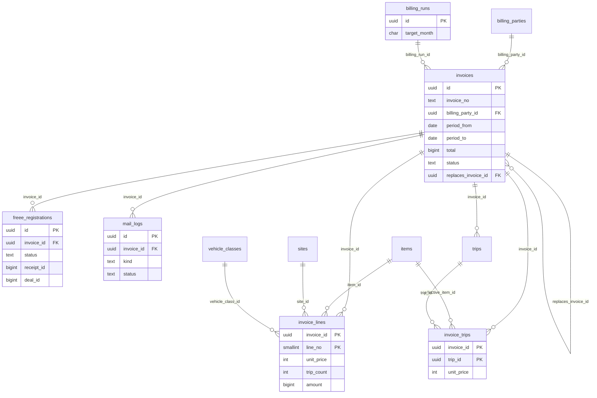
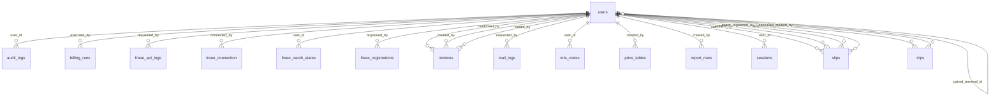
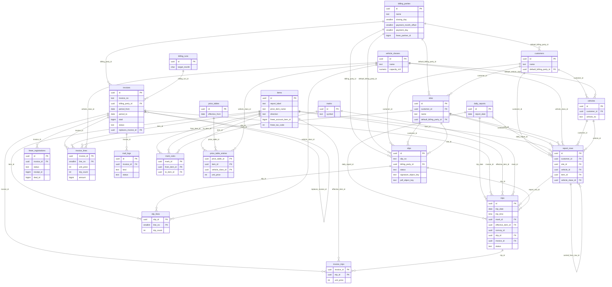

# ER図

| 項目 | 内容 |
|---|---|
| 文書番号 | SF-DOC-07B |
| 版 | 1.0（2026-11-18） |
| 正本 | `spec/schema.sql`（この図は schema.sql を実際の PostgreSQL 16 に流した結果のテーブル・外部キーから作成） |

記号：`||--o{` は「1対0以上」です。線の名前は、多い側のテーブルの外部キーの列名です。

## 1. マスタ

## 2. 受入日報・伝票

## 3. 請求・メール・freee

## 4. 利用者への参照（作成者・確認者など）

## 5. 全体（参考）

